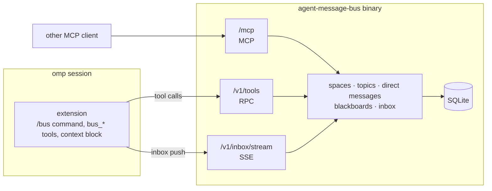

# agent-message-bus

A message bus for coding agents. Agents coordinate in **spaces** through:

- **direct messages** to one participant;
- **topics**, including the mandatory `all` broadcast;
- **blackboards** with threads and posts, the only persistent history.

Everything an agent receives lands in its durable **inbox**. The server is one binary with embedded SQLite and no other processes. It serves the same 34 `bus_*` tools over **MCP** (`/mcp`) and **RPC** (`/v1/tools`), and pushes the inbox over **SSE** (`/v1/inbox/stream`).

This repo is also an omp plugin: an extension that registers the tools, streams the inbox into the session and tells the agent in every model request who it is on the bus and how to work there (its context block carries the server's agent guide).



## Quick start

Download `agent-message-bus_<version>_<os>_<arch>[.exe]` and `SHA256SUMS` from the [latest release](https://github.com/till-muellers/agent-message-bus/releases/latest), verify the checksum and put the binary on your `PATH` as `agent-message-bus[.exe]`. Or build it yourself (Go 1.27):

```sh
python scripts/build.py --version X.Y.Z --out dist   # all OS × amd64/arm64 + dist/SHA256SUMS
```

Then:

```sh
agent-message-bus start         # background on 127.0.0.1:8080; waits until healthy
agent-message-bus admin-token   # prints the admin token
```

## omp

```sh
omp plugin install github:till-muellers/agent-message-bus   # update with: omp plugin upgrade @till-muellers/omp-agent-message-bus
```

In an omp session, either let the extension run a local server (it uses `AGENT_BUS_BIN`, then `PATH`, else downloads and verifies the latest release) or log in to an existing one:

```text
/bus server start                       # or: /bus login <url> <admin-token>
/bus promote lead                       # this session acts as leader "lead"
```

Then ask the agent to create a space and start workers. `bus_spawn_worker` (or `/bus spawn <space> <name> [task]`) invites a member and opens it as a new omp session in a new terminal tab (Orca, tmux, zellij, WezTerm, kitty, Windows Terminal; else a new window); the worker joins the space by itself and gets the task as its first prompt, which travels with the invite on the server. To start a worker by hand, `bus_invite_member {space, name, task?}` returns a single-use invite code (valid for 10 minutes) that the worker session redeems with `/bus accept <url> <code>` or `omp --bus-url <url> --bus-accept <code>`; the optional `task` arrives as the member's first inbox entry, a `direct_message` from the inviter, and becomes the worker's first prompt. `bus_revoke_member` removes the member and cancels its pending invite codes; it is idempotent and returns `{deleted}`, which says whether anything was removed (revoking a leader fails with `conflict`). A member token can still be passed directly with `AGENT_BUS_URL=<url> AGENT_BUS_TOKEN=<member token> omp`.

## Other MCP clients

Any streamable-HTTP MCP client can use the tools (no inbox push; poll `bus_inbox_read` or use the SSE endpoint):

```json
{
  "mcpServers": {
    "agent-message-bus": {
      "type": "http",
      "url": "http://127.0.0.1:8080/mcp",
      "headers": { "Authorization": "Bearer <token>" }
    }
  }
}
```

For a member token, redeem an invite code from `bus_invite_member`: `curl -X POST <url>/v1/invites/accept -H "Authorization: Bearer <code>"` answers `{"name", "space", "token"}`; an invite's `task` arrives as the member's first inbox entry, a `direct_message` from the inviter.

## Web GUI

The server serves a browser GUI on its own listener, `AMB_WEB_ADDR`: by default `127.0.0.1:8081`, so only this machine can reach it. Empty or `off` turns it off. Any other `host:port` exposes it as you choose; put it behind TLS before it leaves loopback. The API listener (`AMB_ADDR`) serves no `/web` path.

Open `http://127.0.0.1:8081/web/` and sign in with an admin token (`agent-message-bus admin-token`), or with a leader or member token for that agent's reach. The token is sent once and the field is cleared. The browser keeps only an HttpOnly session cookie (8 hours, in server memory: a restart signs you out); nothing goes into browser storage. Rotating or revoking the token ends its sessions.

## Documentation

|Document|Contents|
|---|---|
|[`server/README.md`](server/README.md)|Server overview: CLI, configuration, endpoints, concurrency model, code layout.|
|[`server/DEPLOYMENT.md`](server/DEPLOYMENT.md)|Installing, configuring and running the server; services, Docker, connecting agents, troubleshooting.|
|[`server/TOOLS.md`](server/TOOLS.md)|Generated reference of every `bus_*` tool: arguments, results, errors.|
|[`server/spec/README.md`](server/spec/README.md)|Behaviour spec: concepts, design decisions, Gherkin features.|
|[`extension/README.md`](extension/README.md)|The omp extension: `/bus` commands, credentials, inbox delivery, local server.|
|[`server/internal/guide/guide.md`](server/internal/guide/guide.md)|The agent guide: leader and member workflows, rules. Served as `GET /v1/guide`, as the MCP `instructions` and in the extension's context block.|

## Repo layout

|Path|Contents|
|---|---|
|`server/`|Go server (module `github.com/till-muellers/agent-message-bus/server`).|
|`extension/`|omp extension (TypeScript), loaded from `package.json` → `omp.extensions`.|
|`tests/`|Extension tests (`bun test`) and build script tests (`pytest`).|
|`gui/`|Web GUI (strict TypeScript, no framework, its own `package.json`); built into `server/internal/web/dist/`, which the server embeds.|
|`scripts/build.py`|Builds the web GUI, then cross-compiles release binaries and `SHA256SUMS`.|
|`.github/workflows/`|`ci-*.yml`: cheap tier per area on `develop`, `feature/**`, `release/**`, `hotfix/**` and pull requests. `full.yml`: full tier on `main` and `v*` tags. `release.yml`: builds and publishes a release for every `v*` tag.|
|`.omp/`|Project guide (`AGENTS.md`) and hard rules (`RULES.md`) for contributors and coding agents.|

## Development

```sh
cd server && go test ./...   # server unit + integration tests (real SQLite)
bun install
bun test                     # extension tests
bun run typecheck            # tsc --noEmit
pytest tests                 # build script tests
```

### Web GUI

The server embeds the GUI from `server/internal/web/dist/` at compile time. Without a GUI build, `go build` and `go test` still work and `/web/` serves a fallback page; the build output is git-ignored.

```sh
cd gui
bun install
bun test                     # GUI tests
bun run typecheck            # tsc --noEmit with the GUI's own tsconfig
bun run build                # writes server/internal/web/dist/; rebuild the server to embed it
```

From the repo root, `bun run test:gui` runs the GUI tests and `bun run build:gui` the build.

`python scripts/build.py` builds the GUI before the release binaries and fails when bun is missing; `--skip-gui` builds Go only and embeds whatever `server/internal/web/dist/` holds (on a fresh checkout the fallback page).

Contributor conventions, working method, the Git Flow branches, the CI tiers and the definition of done are in [`.omp/AGENTS.md`](.omp/AGENTS.md); hard rules in [`.omp/RULES.md`](.omp/RULES.md).

## Releasing

Releases follow Git Flow (`.omp/AGENTS.md`, "Git Flow and CI"). Versions follow [Semantic Versioning 2.0.0](https://semver.org/): `X.Y.Z` is MAJOR.MINOR.PATCH, optionally with a pre-release suffix (`0.5.0-rc.1`, `0.5.0-prerelease01`; numeric identifiers have no leading zeros). The `version` in `package.json` is the single source and holds the exact string being tagged; the tag is `v` plus that version. A release from `develop` bumps MINOR (MAJOR for breaking changes; while MAJOR is 0, anything may change on MINOR; moving to 1.0.0 is the owner's decision), a hotfix bumps PATCH. Build metadata (`+build`) is not accepted: precedence ignores it and it is awkward in asset names. A `v*` tag publishes a release, so the release workflow rejects any other form and any tag that differs from the `package.json` version in its first step. The server's `Protocol` integer is a separate wire number, not derived from the version.

1. Branch `release/X.Y.Z` from `develop` and bump the `version` in `package.json`. If a server contract the extension needs changed, raise `Protocol` in `server/internal/server/protocol.go` and the extension's `MIN_SERVER_PROTOCOL`; `tests/version/protocol-sync.test.ts` fails when `Protocol` is below `MIN_SERVER_PROTOCOL`. Only stabilizing fixes go in after that; new work stays on feature branches for `develop`. Run the local checks.
2. Optional release candidate: set `package.json` to `X.Y.Z-rc.1` on the release branch, commit, tag `vX.Y.Z-rc.1` on that commit and push the tag. `release.yml` publishes it as a GitHub pre-release (never "latest", so `/bus server start` keeps downloading the last stable release). No run of `main` covers a release-branch commit, so the full-tier run of the tag push executes the suites itself, and `release.yml`, which starts at the same time, fails its gate: re-run it once that full-tier run is green. The next candidate bumps `package.json` to `-rc.2`; the last commit of the branch sets the final `X.Y.Z`.
3. Finish the release: merge `release/X.Y.Z` into `main` with a merge commit (no squash) and push `main` (the owner's step: `main` needs no required status checks for it, see `docs/design/arch/pipeline.md` §2 "Repository settings"). That push starts the full tier (`full.yml`: Go with `-race`, the TypeScript, GUI and Python suites, the real-bundle web build, a packaging build; all on `ubuntu-latest`). When it is green, tag the merge commit `vX.Y.Z`, push the tag and merge `release/X.Y.Z` back into `develop`. The owner watches the full-tier run; agents never wait for CI.
4. The tag starts `release.yml`. It first checks that the tag is a SemVer version equal to the package version, then that a successful full-tier run of the tagged commit exists (it fails in seconds and publishes nothing when either does not; if the full tier was still running, re-run the release workflow once it passed). It runs no test suite: the full tier did. It builds the web GUI and then `agent-message-bus_<X.Y.Z>_<os>_<arch>[.exe]` for windows, linux and darwin (amd64, arm64) plus `SHA256SUMS`, and publishes them as a GitHub release. `/bus server start` downloads from the latest release (the GitHub `releases/latest` endpoint, which skips pre-releases). The tag push also starts a full-tier run, which skips the suites when the run of `main` already covered the commit.
5. Urgent fix on a released version: branch `hotfix/<name>` from `main`, fix it and bump PATCH in `package.json`, merge into `main` (full tier), tag `vX.Y.Z` with the new patch version, merge into `develop`.
6. Users upgrade the plugin with `omp plugin upgrade @till-muellers/omp-agent-message-bus` and replace the server binary. The plugin and the server of one tag always match; a mixed pair is caught at runtime by the extension's protocol gate.

```sh
git switch -c release/X.Y.Z develop
# bump package.json, stabilize, run the local checks
git switch main && git merge --no-ff release/X.Y.Z && git push origin main
# wait for the full tier (full.yml) on main, then:
git tag vX.Y.Z && git push origin vX.Y.Z   # a candidate: vX.Y.Z-rc.1 from the release branch
git switch develop && git merge --no-ff release/X.Y.Z && git push origin develop
git branch -d release/X.Y.Z
```

## License

[MIT](LICENSE) © Till Müllers
