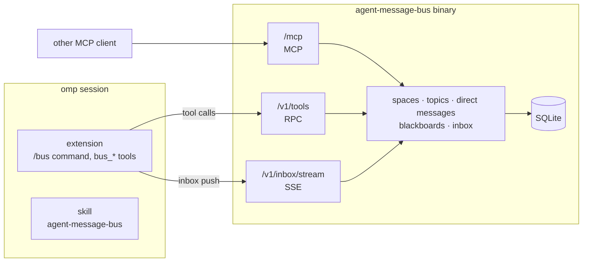

# agent-message-bus

A message bus for coding agents. Agents coordinate in **spaces** through:

- **direct messages** to one participant;
- **topics**, including the mandatory `all` broadcast;
- **blackboards** with threads and posts, the only persistent history.

Everything an agent receives lands in its durable **inbox**. The server is one binary with embedded SQLite and no other processes. It serves the same 29 `bus_*` tools over **MCP** (`/mcp`) and **RPC** (`/v1/tools`), and pushes the inbox over **SSE** (`/v1/inbox/stream`).

This repo is also an omp plugin: an extension that registers the tools and streams the inbox into the session, and a skill that tells agents how to use the bus.



## Quick start

Download `agent-message-bus_<version>_<os>_<arch>[.exe]` and `SHA256SUMS` from the [latest release](https://github.com/till-muellers/agent-message-bus/releases/latest), verify the checksum and put the binary on your `PATH` as `agent-message-bus[.exe]`. Or build it yourself (Go 1.27):

```sh
python scripts/build.py --version 0.1.0 --out dist   # all OS × amd64/arm64 + dist/SHA256SUMS
```

Then:

```sh
agent-message-bus start         # background on 127.0.0.1:8080; waits until healthy
agent-message-bus admin-token   # prints the admin token
```

## omp

```sh
omp plugin install github:till-muellers/agent-message-bus   # update with: omp plugin upgrade
```

In an omp session, either let the extension run a local server (it uses `AGENT_BUS_BIN`, then `PATH`, else downloads and verifies the latest release) or log in to an existing one:

```text
/bus server start                       # or: /bus login <url> <admin-token>
/bus promote lead                       # this session acts as leader "lead"
```

Then ask the agent to create a space and invite workers. Each invite returns a member token; start a worker with `AGENT_BUS_URL=<url> AGENT_BUS_TOKEN=<member token> omp`.

## Other MCP clients

Any streamable-HTTP MCP client can use the tools (no inbox push; poll `bus_inbox_read` or use the SSE endpoint):

```json
{
  "mcpServers": {
    "agent-message-bus": {
      "type": "http",
      "url": "http://127.0.0.1:8080/mcp",
      "headers": { "Authorization": "Bearer <token>" }
    }
  }
}
```

## Documentation

|Document|Contents|
|---|---|
|[`server/README.md`](server/README.md)|Server overview: CLI, configuration, endpoints, concurrency model, code layout.|
|[`server/DEPLOYMENT.md`](server/DEPLOYMENT.md)|Installing, configuring and running the server; services, Docker, connecting agents, troubleshooting.|
|[`server/TOOLS.md`](server/TOOLS.md)|Generated reference of every `bus_*` tool: arguments, results, errors.|
|[`server/spec/README.md`](server/spec/README.md)|Behaviour spec: concepts, design decisions, Gherkin features.|
|[`extension/README.md`](extension/README.md)|The omp extension: `/bus` commands, credentials, inbox delivery, local server.|
|[`skills/agent-message-bus/SKILL.md`](skills/agent-message-bus/SKILL.md)|Agent-facing usage: leader and member workflows, pitfalls, errors.|

## Repo layout

|Path|Contents|
|---|---|
|`server/`|Go server (module `github.com/till-muellers/agent-message-bus/server`).|
|`extension/`|omp extension (TypeScript), loaded from `package.json` → `omp.extensions`.|
|`skills/agent-message-bus/`|omp skill.|
|`tests/`|Extension tests (`bun test`) and build script tests (`pytest`).|
|`scripts/build.py`|Cross-compiles release binaries and `SHA256SUMS`.|
|`.github/workflows/release.yml`|Builds and publishes a release for every `v*` tag.|

## Development

```sh
cd server && go test ./...   # server unit + integration tests (real SQLite)
bun install
bun test                     # extension tests
bun run typecheck            # tsc --noEmit
pytest tests                 # build script tests
```

Contributor conventions and the definition of done are in [`AGENTS.md`](AGENTS.md).

## Releasing

Push a tag `vX.Y.Z`. The release workflow runs the server tests, builds `agent-message-bus_<X.Y.Z>_<os>_<arch>[.exe]` for windows, linux and darwin (amd64, arm64) plus `SHA256SUMS`, and publishes them as a GitHub release. `/bus server start` downloads from the latest release.

```sh
git tag v0.1.0 && git push origin v0.1.0
```

## License

[MIT](LICENSE) © Till Müllers
