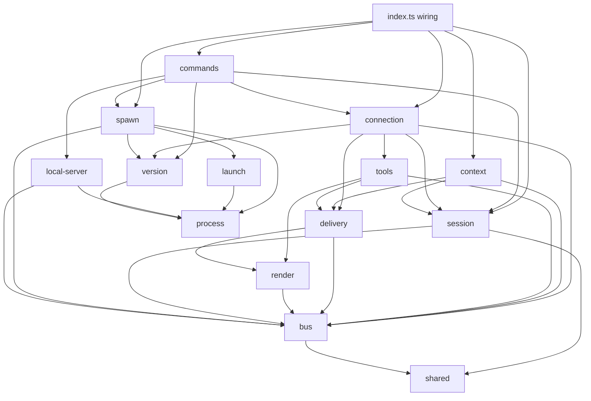
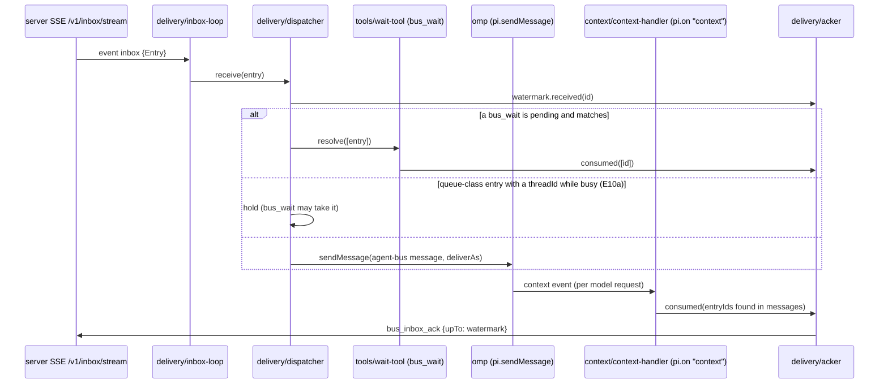

# Client architecture: the omp extension

> **Committed in slice 0.** Design paths use `docs/design/specs/…` and `docs/design/arch/…`. Spec paths without a prefix (e.g. `omp-parity/omp-delivery.feature`) are relative to `docs/design/specs/`.

Owner: Arch-client. Inputs: `docs/design/specs/**` (final), `docs/design/specs/REVIEW.md` (§11 slice ids), `docs/design/arch/contracts.md` (Arch-server), `.omp/AGENTS.md`, `.omp/RULES.md`.
omp facts are from `node_modules/@oh-my-pi/*` **18.12.6** (`pi-coding-agent/package.json:3`). Paths below that start with `CA/` are relative to `node_modules/@oh-my-pi/pi-coding-agent/src/`; `core/` = `node_modules/@oh-my-pi/pi-agent-core/src/`; `tui/` = `node_modules/@oh-my-pi/pi-tui/src/`.
PO decisions (final, see §0a) are marked `(PO-n)`. Claims not observed in code are marked `[INFERENCE]`.

Companion files: `gui.md` (web GUI), `pipeline.md` (CI/release/build), `slices-client.md` (PR slices).

---

## 0. Decisions in one table

| Topic | Decision | Section |
|---|---|---|
| Layout | `extension/lib/` becomes 12 feature folders; every file moves; tests mirror the folders | §1 |
| Credentials | One owner: `lib/session/session-credentials.ts` (findings item 1, option A); `session-identity.ts` keeps *persisting* `accepted` and calls the owner | §2 |
| Subagent identity (S15) | A root-identity registry created in the **closure of `createBusExtension`** (not module state), keyed by the root session key; injected into each session | §2.3 (PO-8 approved) |
| Delivery | Every entry carries a server **delivery class** (`interrupt` / `queue` / `deferred`); **one module** (`delivery/delivery-class.ts`) maps class × session phase → `steer` / `aside` / `nextTurn`, with no per-type cases; omp only, no upstream-pi fallback | §3.2 (PO-5, PO-6) |
| Ack | Contiguous **watermark** fed by the `context` event (an entry is consumed when a model request contains its message) and by local `bus_wait` | §3.3 |
| `bus_wait` | Local tool with the server schema; takes held entries from the dispatcher; falls back to the server tool without a stream | §3.4 |
| Envelope | Fenced `<agent-bus-entry …>` text with escaped body and a reply hint; structured `details` on every message | §4 |
| Renderer | `registerMessageRenderer("agent-bus")` built from `pi.pi.Text/Container/Markdown` (no deep import) | §4.3 |
| Context block | One `context` handler prepends a non-stored `agent-bus-context` custom message; identity cached, guide fetched once | §5 |
| Subagents | Allow-list of 5 tools at registration; local tools registered only in main sessions; `[via subagent <id>]` prefix | §6 |
| Tool presentation | Extension-local table: `loadMode` + `approval`; unknown tools → `discoverable` + `write`; `bus_inbox_ack` never registered; no `bus_cancel_invite` exists | §7 (PO-2, PO-3) |
| Protocol gate | `GET /healthz` header `Agent-Bus-Protocol` ≥ `MIN_SERVER_PROTOCOL` before redeeming or activating; worker skew check S1 at spawn | §8 (PO-11) |
| Skill | `skills/` deleted, `package.json` `files` updated, docs moved to guide + README | §9 |


## 0a. PO decisions applied

| PO | Decision | Effect on the client |
|---|---|---|
| PO-1 | One server log line per GUI change | GUI shows nothing extra (`gui.md`) |
| PO-2 | Approval tiers approved | §7 table as specified |
| PO-3 | **No `bus_cancel_invite` tool anywhere.** The GUI lists pending invites and cancels them through a web endpoint by invite id (contracts.md) | §7: 34 server tools, no cancel row; `gui.md` GUI-6 cancel action; `/bus spawn` exposes no cancel handle |
| PO-4 | GUI space delete with confirmation | `gui.md` confirm dialog |
| PO-5 | **Delivery class from the server on every entry**; one mapping module in the extension, no per-type cases | §3.2-3.3, §3.5 |
| PO-6 | omp only | no `followUp` fallback, no host detection; `aside` is assumed |
| PO-7 | Mail notice + hint approved | extension drops `mail` (§3.3) |
| PO-8 | S15 identity map approved | §2.3, slice E4b |
| PO-9 | Presence and receipts approved | E10d |
| PO-10 | Embedded TS SPA (b) with committed placeholder | `gui.md`, `pipeline.md` |
| PO-11 | S1, version check at spawn | §8.2, slice P2a |

---

## 1. Target module layout

Today `extension/lib/` is flat: 27 files plus `launch/` (15) and `shared/` (2) (`docs/design/specs/findings/analysis.md` item 2). Target: one folder per responsibility; `index.ts` stays pure wiring. `lib/shared/` is **unchanged** (no additions, so no approval needed).

### 1.1 Folders

| Folder | Responsibility | Depends on |
|---|---|---|
| `lib/bus/` | HTTP wire to the server: client, SSE parser, JSON-schema→zod, error wording, the `Entry` wire type, `/healthz` probe | `shared/` |
| `lib/session/` | Who this session is: credential store, env, the single credential owner, accepted identity + its file, root-identity registry, `createSession` | `bus/`, `shared/` |
| `lib/connection/` | Connect/disconnect: restart, tool on/off, 409 warning, server-protocol gate | `session/`, `tools/`, `delivery/`, `bus/`, `version/` |
| `lib/tools/` | Mirroring server tools: selection (allow-list/excludes), presentation (loadMode/approval), remote tool definition, local `bus_wait`, subagent attribution, tool-result shape | `bus/`, `delivery/` (wait only), `render/` (tool renderers) |
| `lib/delivery/` | Inbox → omp: stream loop, runner, dispatcher, delivery policy, ack watermark, acker, consumption observer, post-notice coalescing, `pi.events` publishing | `bus/`, `render/` |
| `lib/render/` | What the model and the user see: envelope text, escaping, message details, card renderer, tool call/result renderers, status line | `bus/` (types only) |
| `lib/context/` | The `agent-bus-context` block: identity cache, guide fetch, block text, `context` handler | `bus/`, `session/` (types), `delivery/` (consumption observer is composed here) |
| `lib/commands/` | `/bus` command logic and its sub-actions (accept, invite flag, status) | `session/`, `connection/`, `local-server/`, `spawn/`, `version/` |
| `lib/local-server/` | `/bus server start|stop|status`, binary resolution, release download | `process/`, `bus/` |
| `lib/spawn/` | Worker start: invite + launch, `bus_spawn_worker` tool, forwarded plugin flags, worker plugin-version check (S1) | `launch/`, `bus/`, `version/`, `process/` |
| `lib/launch/` | Terminal launchers (unchanged) | `process/` |
| `lib/process/` | Process runner (`execFile`, no shell) shared by launchers, local server and the installed-plugin probe | — |
| `lib/version/` | This plugin's version (from `package.json`), the installed plugin's version (`omp plugin list --json`), `MIN_SERVER_PROTOCOL`, comparisons | `process/` |
| `lib/shared/` | Unchanged: `command.ts`, `credential-store.ts` | — |

### 1.2 Move of every existing file

| Today | Target | Note |
|---|---|---|
| `index.ts` | `index.ts` | Wiring only; `createSession`/`Session` move out (item 4) |
| `lib/accept.ts` | `lib/commands/accept.ts` | E9b drops `Joined.task` |
| `lib/activation.ts` | `lib/connection/activation.ts` | |
| `lib/binary.ts` | `lib/local-server/binary.ts` | `findOnPath` is also used by `index.ts` for `which` |
| `lib/client.ts` | `lib/bus/client.ts` | E9a adds `probeProtocol`; E9b drops `task` |
| `lib/command.ts` | `lib/commands/command.ts` | status grows protocol/version lines (E9a, P2a) |
| `lib/conflict.ts` | `lib/connection/conflict.ts` | |
| `lib/connection.ts` | `lib/connection/connection.ts` | |
| `lib/credentials.ts` | `lib/session/stored-credentials.ts` | Keeps `StoredCredentials`, `ActiveCredentials`, `configDir`, `trimUrl`, `createCredentialStore`; `SessionCredentials` + `resolveActive` move to `session-credentials.ts` (E4a). Renamed so it is not confused with `lib/shared/credential-store.ts` |
| `lib/deliver.ts` | `lib/delivery/delivery-class.ts` | Rewritten as the class → mechanism mapping (E1); message building moves to `render/` |
| `lib/download.ts` | `lib/local-server/download.ts` | |
| `lib/env.ts` | `lib/session/env.ts` | |
| `lib/errors.ts` | `lib/bus/errors.ts` | |
| `lib/format.ts` | `lib/render/envelope.ts` | Rewritten in E5a |
| `lib/inbox-runner.ts` | `lib/delivery/inbox-runner.ts` | |
| `lib/inbox.ts` | `lib/delivery/inbox-loop.ts` + `lib/bus/entry.ts` | `Entry`/`EntryType` move to `bus/entry.ts` (wire type used by delivery, render, tools); the per-entry ack goes away in E2 |
| `lib/invite-flag.ts` | `lib/commands/invite-flag.ts` | |
| `lib/plugin-args.ts` | `lib/spawn/plugin-args.ts` | findings item 2 |
| `lib/runner.ts` | `lib/process/runner.ts` | |
| `lib/schema.ts` | `lib/bus/schema.ts` | |
| `lib/server.ts` | `lib/local-server/server-cli.ts` | renamed: "server" is ambiguous next to `bus/` |
| `lib/session-identity.ts` | `lib/session/session-identity.ts` | |
| `lib/session-store.ts` | `lib/session/session-store.ts` | |
| `lib/spawn.ts` | `lib/spawn/spawn.ts` | findings item 2 |
| `lib/spawn-tool.ts` | `lib/spawn/spawn-tool.ts` | findings item 2 |
| `lib/sse.ts` | `lib/bus/sse.ts` | |
| `lib/tool-result.ts` | `lib/tools/tool-result.ts` | |
| `lib/tools.ts` | `lib/tools/remote-tools.ts` | `INBOX_TOOLS` replaced by `tool-selection.ts` (E3) |
| `lib/launch/*` (15) | `lib/launch/*` | `run.ts` import `../runner.ts` → `../process/runner.ts` |
| `lib/shared/*` (2) | `lib/shared/*` | unchanged |

New files (by slice): `bus/entry.ts` (P1a), `bus/health.ts` (E9a); `session/session.ts`, `session/session-credentials.ts` (E4a), `session/root-identities.ts` (E4b); `connection/server-gate.ts` (E9a); `tools/tool-selection.ts` (E3), `tools/attribution.ts` (E3), `tools/presentation.ts` (E7), `tools/wait-tool.ts` (E6), `tools/membership-refresh.ts` (E8b); `delivery/dispatcher.ts` (E1), `delivery/ack-watermark.ts`, `delivery/acker.ts`, `delivery/consumption.ts`, `context/context-handler.ts` (E2), `delivery/post-notices.ts` (E10a), `delivery/bus-events.ts` (E10c); `render/escape.ts`, `render/details.ts` (E5a), `render/entry-card.ts` (E5b), `render/thread-view.ts`, `render/status-line.ts` (E10b), `render/send-receipt.ts` (E10d); `context/identity-cache.ts`, `context/guide.ts`, `context/context-block.ts` (E8b); `spawn/worker-version.ts` (P2a); `version/server-protocol.ts` (E9a), `version/plugin-version.ts`, `version/installed-plugin.ts` (P2a).

Tests mirror the folders: `tests/<folder>/<file>.test.ts` (today flat `tests/*.test.ts`; `tests/launch/` already mirrors). `tests/fakes.ts` stays the shared double and grows `events`, `registerMessageRenderer`, `on("context")` dispatch and an `isIdle` switch on the fake ctx.

### 1.3 Module dependencies



Rules: no cycles; `bus/` and `process/` are leaves (plus `shared/`); `render/` never imports `delivery/`; only `index.ts` and `session/session.ts` see the whole graph. A fitness test (`tests/layout.test.ts`, slice P1a) parses imports and fails on an edge not in this diagram.

---

## 2. Credentials and identity

### 2.1 The single owner (findings item 1, option A; REVIEW E4)

Today `SessionCredentials` is a mutable struct written from 11 sites in 5 modules (`extension/lib/command.ts:85,88,97-99`, `lib/accept.ts:28-29`, `lib/session-identity.ts:43,46-47,50,54,58`, `extension/index.ts:89,108`) and read by `resolveActive` (`lib/credentials.ts:77-83`). Target: one module owns the state; others call named operations.

```ts
// lib/session/session-credentials.ts
export type CredentialSource = "promote" | "env" | "accepted" | "stored-agent" | "stored-admin";
export interface ResolvedCredentials extends ActiveCredentials { source: CredentialSource; }

export interface SessionCredentials {
	/** `/bus promote`: a leader token for this session only, never stored. */
	promote(creds: ActiveCredentials): void;
	/** `/bus login`: a new stored login replaces the promoted token. */
	loggedIn(): void;
	/** An accepted invite replaces the promoted and env credentials. */
	inviteAccepted(): void;
	/** `/bus logout`: drops promote and env. */
	loggedOut(): void;
	/** Session end: drops promote. */
	ended(): void;
	/** Only `session-identity.ts` calls this. */
	setAccepted(creds: ActiveCredentials | undefined): void;
	/** Precedence: promote > env > accepted > stored agent token > stored admin token (E8a). */
	resolve(stored: StoredCredentials | undefined): ResolvedCredentials | undefined;
}
export function createSessionCredentials(env: ActiveCredentials | undefined): SessionCredentials;
```

- `accept.ts` gets `Pick<SessionCredentials, "inviteAccepted">` instead of the struct (fixes `lib/accept.ts:27-28` mutating another module's state).
- `command.ts` gets `Pick<…, "promote" | "loggedIn" | "loggedOut" | "resolve">`.
- `session-identity.ts` keeps the per-session file and calls `setAccepted` (it stays the single *persistence* owner of `accepted`).
- `source` feeds the subagent stop-gap (§6.2) and `/bus status`.
- **Admin-token sessions (E8a, `guidance/session-context.feature` rule 2):** `stored.adminToken` becomes the lowest-precedence source `stored-admin`, giving a full agent session. Today `resolveActive` returns `undefined` for admin-only (`lib/credentials.ts:76-83`).

### 2.2 `createSession` moves out of `index.ts` (findings item 4)

`extension/index.ts:86-116` (`createSession`) and the `Session` interface (`:71-83`) move to `lib/session/session.ts`. `index.ts` keeps only `createBusExtension` and its registration helpers.

```ts
// lib/session/session.ts
export interface SessionDeps {
	pi: ExtensionAPI; store: CredentialStore; busEnv: BusEnv; dir: string;
	roots: RootIdentities; options: BusExtensionOptions;
}
export interface Session extends Connection {
	client: BusClient;
	credentials: SessionCredentials;
	view: SessionView;           // mode, sub, agentId, isIdle()
	warn(message: string): void;
	accept(url: string, code: string): Promise<Joined>;
	join(joined: Joined): Promise<CommandResult>;
	shutdown(): void;
	setContext(ctx: SessionContext, change?: SessionChange): Promise<void>;
}
export function createSession(deps: SessionDeps): Session;
```

`SessionView` gains `agentId: string` (from `ctx.agent.id`) and `isIdle(): boolean` (bound to the latest `ctx.isIdle`, `CA/extensibility/extensions/types.ts:697`), both refreshed in `setContext`.

### 2.3 Subagent identity map, S15 (PO-8 approved)

Problem: a subagent's extension instance resolves its own credentials and misses env/promote credentials (`docs/design/specs/omp-parity/analysis.md` §2.6, R11).

omp facts: the root session imports the extension module once; each subagent "rebinds fresh Extension instances to its OWN ExtensionAPI … without re-evaluating the module graph" (`CA/extensibility/extensions/loader.ts:568-575`). The factory is the default export `createBusExtension()` (`extension/index.ts:208`), so **everything created in `createBusExtension` before `return async pi => …` is shared by the root session and its subagents of the same process**, while everything inside the returned function is per session.

Design: the registry lives in that closure, so there is no module-level mutable state; it is still shared state across sessions, which is what PO-8 approves.

```ts
// lib/session/root-identities.ts
export interface RootIdentities {
	/** Main session: publish the credentials it currently acts with (after every restart). */
	publish(rootKey: string, creds: ActiveCredentials): void;
	/** Main session: logout, revoke, shutdown. */
	withdraw(rootKey: string): void;
	/** Subagent session: read at every tool call; never the store, never the env. */
	lookup(rootKey: string): ActiveCredentials | undefined;
}
export function createRootIdentities(): RootIdentities;   // Map<string, ActiveCredentials>
```

- Key: `sessionKey(sessionFile, sub)` (`lib/session-store.ts:46-48`), which already resolves a subagent's file to its interactive root.
- A subagent's `resolve()` is `roots.lookup(rootKey)` only; its tools call `getActive()` per call, so a later `/bus promote` in the main session reaches the subagent's next call.
- A main session without a session file (`--no-session`) has no key: its subagents get no bus tools (logged once). `[INFERENCE: acceptable; rare]`
- Risk: if omp ever re-evaluates the module per subagent, `lookup` returns `undefined` and subagents get no tools (safe failure). Smoke step in E4b checks "subagent posts as the promoted leader".

---

## 3. Delivery pipeline

### 3.1 Flow



### 3.2 Delivery class mapping (E1; PO-5, PO-6; `omp-parity/omp-delivery.feature`)

The server stamps every entry with a **delivery class**: required field `class: "interrupt" | "queue" | "deferred"` on the one Entry shape (SSE, `bus_inbox_read`, `bus_wait`, `/web/api/inbox`; `docs/design/specs/mail/delivery-class.feature:12,43`; named `class` so it does not clash with the receipts' `delivery: live|queued`), derived by `inbox.ClassOf(type, critical)` in `server/internal/inbox/class.go`, server slice **D1**, shipped in the protocol-2 release (contracts.md §4.1). Server mapping: `critical` → `interrupt`; `topic_closed`, `thread_removed`, `blackboard_removed` → `deferred`; everything else → `queue`; unknown → `queue` on the client. The extension **never looks at `type` or `critical` to choose a mechanism**: one module maps class × session phase to an omp mechanism, and every other module (dispatcher, `bus_wait`, notices, events) asks it.

```ts
// lib/bus/entry.ts — wire type (bus/ is a leaf, so the class value lives here)
export type DeliveryClass = "interrupt" | "queue" | "deferred";
/** Wire value → class; a missing or unknown value is "queue" (never interrupts, never stalls the watermark). */
export function parseDeliveryClass(value: unknown): DeliveryClass;

// lib/delivery/delivery-class.ts — the only place that knows omp's delivery mechanisms
export type SessionPhase = "interactive-busy" | "interactive-idle" | "oneshot-busy" | "oneshot-idle";
export interface Mechanism { deliverAs: "steer" | "aside" | "nextTurn"; triggerTurn: boolean; }
/** tui and rpc are interactive; print, json and an unknown mode are one-shot (`ExtensionMode`, types.ts:512). */
export function phaseOf(mode: string | undefined, idle: boolean): SessionPhase;
export function mechanismFor(cls: DeliveryClass, phase: SessionPhase): Mechanism;   // a lookup in MECHANISMS
/** May the dispatcher hold an entry of this class for coalescing (E10a)? */
export function holdable(cls: DeliveryClass): boolean;                               // queue only
```

`MECHANISMS` (a `Record<DeliveryClass, Record<SessionPhase, Mechanism>>` constant):

| Class | interactive busy | interactive idle | one-shot busy | one-shot idle |
|---|---|---|---|---|
| `interrupt` | `steer` | `steer` + `triggerTurn` (starts a turn) | `steer` | `nextTurn` |
| `queue` | `aside` | `aside` (starts a turn; plan mode and post-Esc fold it) | `aside` | `nextTurn` |
| `deferred` | `nextTurn` | `nextTurn` (no turn) | `nextTurn` | `nextTurn` |

omp behaviour each cell relies on:

| Mechanism | Busy | Idle | Source |
|---|---|---|---|
| `steer` | delivered after the current tool, skips the rest of the batch | with `triggerTurn` → `#promptAgentInitiatedMessage` starts a turn | `core/agent.ts:1386`; `CA/session/agent-session.ts:9700-9706, 9767-9774` |
| `aside` | IRC aside queue, injected at the next step boundary, does not interrupt the batch, ends an interruptible `wait` | starts a turn regardless of `triggerTurn`; plan mode and a user interrupt fold it into context | `agent-session.ts:9686-9695, 9730-9765`; `CA/extensibility/extensions/types.ts:1846-1864` |
| `nextTurn` | hidden queue, consumed by the next turn | appended, no turn, hidden | `agent-session.ts:9682-9685, 9718-9728` |

Why one-shot idle is always `nextTurn`: `print`/`json` start their own prompt right after `session_start` (`CA/modes/print-mode.ts:167-168`); an idle `aside` or a triggered `steer` would start a competing turn. `nextTurn` puts every class into the one-shot run's first request (`first-prompt.feature:150-156`).

Ack per class (watermark rule of §3.3, identical for all classes; the class only changes *when* consumption happens):

| Class | Consumed when | Effect on the watermark |
|---|---|---|
| `interrupt` | the next model request (after the current tool) contains it | may be consumed before older `queue` entries → held behind them (contiguous rule) |
| `queue` | the request after the next step boundary contains it (or `bus_wait` returns it) | normal |
| `deferred` | the first request of the next turn contains it | holds the watermark until the next turn (accepted by spec: replay over loss) |

No upstream-pi fallback (PO-6): `followUp` is gone from the extension, and there is no host detection. Server dependency: D1; `MIN_SERVER_PROTOCOL = 2` (E9a) guarantees the field (D1 is in the protocol-2 release), so "unknown → queue" only protects against a *future* class value.

### 3.3 Dispatcher and ack watermark (E2; `mail/omp-mail-delivery.feature`, `omp-delivery.feature` ack rule)

```ts
// lib/delivery/dispatcher.ts — one per connection start; reset on restart (session switch drops asides, R2)
export interface Dispatcher {
	receive(entry: Entry): void;
	/** bus_wait: held entries matching `filter`, removed from the hold (never handed to omp afterwards). */
	takeHeld(filter: WaitFilter): Entry[];
	/** bus_wait: the next matching entry, routed to the waiter instead of omp; [] on timeout/abort. */
	waitNext(filter: WaitFilter, timeoutMs: number, signal?: AbortSignal): Promise<Entry[]>;
	/** First-prompt bounded wait (E9b): resolves when every id <= `id` was handed over, or after `ms`. */
	handedUpTo(id: number, ms: number): Promise<boolean>;
}
export interface WaitFilter { from?: string; threadId?: number; after?: number; }
export function createDispatcher(deps: { handOver(message: BusMessage, mechanism: Mechanism): void; watermark: AckWatermark; phase: () => SessionPhase; }): Dispatcher;
```

- **Replay dedupe:** the dispatcher keeps the ids it handed over in this connection; a stream reconnect replays unacked ids (`server/spec/inbox.feature:249-257`) and those are skipped. A connection restart (session switch/branch, login, promote) creates a new dispatcher, so asides dropped by omp on a generation change (`agent-session.ts:9687`) are delivered again.

```ts
// lib/delivery/ack-watermark.ts — pure
export interface AckWatermark {
	received(id: number): void;                  // ids arrive in ascending order on the stream
	consumed(ids: readonly number[]): number | undefined; // new upTo when it advanced, else undefined
}
// lib/delivery/acker.ts — calls bus_inbox_ack {upTo}; failures only warned (as today, lib/inbox.ts:58-66)
export function createAcker(deps: { client: BusClient; getActive(): ActiveCredentials | undefined; warn(m: string): void }): (upTo: number) => Promise<void>;
// lib/delivery/consumption.ts — pure: entry ids of agent-bus messages present in a model request
export function consumedEntryIds(messages: readonly AgentMessage[]): number[];
```

- **How "consumed" is observed:** the `context` event fires before **each** LLM request with the messages about to be sent (`CA/extensibility/shared-events.ts:184-196`; wired in `CA/sdk.ts:4360-4363` as `transformContext`, which `prepareProviderCall` runs per provider call, `core/agent-loop.ts:1938-1943`). Every `agent-bus` message carries `details.entryIds`; any id found is consumed. This covers aside, steer, `nextTurn`, plan-mode fold and post-Esc fold uniformly, because all of them end up in the next request's messages. omp gives extensions no stable message id (`pi-ai/src/utils/block-symbols.ts:176-212` is internal), so `details` is our id. `[INFERENCE: aside messages keep `details` through the IRC aside queue; smoke step E2-3 verifies an ack after an aside]`
- **Watermark:** `upTo` = the highest received id such that every received id ≤ it is consumed (an `interrupt` consumed before older `queue` entries acks nothing until they arrive, `omp-delivery.feature:153-159`).
- **Consumption from `bus_wait`:** returned ids are consumed at once, whatever their class (§3.4).
- **Stuck `deferred`/one-shot `nextTurn`:** accepted (spec): later ids stay unacked and replay after a crash.
- **No `mail` hint in omp:** `client.callTool` already returns only `body.result` (`extension/lib/client.ts:82-84`), so the sibling `mail` field (contracts.md, slice 13) never reaches the model. E7 adds the regression test (`mail/mail-hint.feature:117-123`).

### 3.4 Local `bus_wait` shadow (E6; `omp-tools.feature` `bus_wait` rule)

```ts
// lib/tools/wait-tool.ts
export function waitToolDefinition(pi: ExtensionAPI, deps: {
	dispatcher(): Dispatcher | undefined;           // undefined when this session holds no stream
	forward(args: WaitArgs, signal?: AbortSignal): Promise<Entry[]>; // server bus_wait, no ack
	consumed(ids: readonly number[]): void;
	schema: JsonSchema;                              // the server's bus_wait inputSchema from GET /v1/tools
}): ToolDefinition;
```

- Registered only in **main** sessions, by `registerRemoteTools` in place of the server's `bus_wait` (same name, the server's `inputSchema` from `GET /v1/tools`); `tool-selection.ts` excludes the server tool from mirroring. Subagents never register it.
- Order: `takeHeld(filter)` → non-empty returns at once; else `waitNext(filter, timeoutSeconds*1000, signal)`. Entries already handed to omp are never returned (omp has no retraction API for extensions: `AgentSession.clearQueue` is not on `ExtensionAPI`, `CA/session/agent-session.ts:9876`).
- Without a stream (409 conflict, or stream not open) → `forward` to `POST /v1/tools/bus_wait`, and no ack.
- Cancellation: the `execute` `signal` (`CA/extensibility/extensions/types.ts:925-933`) aborts the wait; nothing is consumed.
- Server dependency: slice 9 (server `bus_wait`, contract `{"result":[Entry…]}`) for the schema and the fallback; it ships under protocol 2 (contracts.md §6), so `MIN_SERVER_PROTOCOL` stays 2.

### 3.5 Blackboard notices (E10a; `omp-blackboards.feature`; PO-5)

- Coalescing is a **rendering** concern, not a delivery decision: while the session is busy, the dispatcher holds entries for which `holdable(class)` is true (`queue` only) and that carry a `threadId`, per `(space, blackboard, threadId)`, for a short window (proposal 1.5 s), then hands them over as **one** message whose `details.entryIds` lists every merged id, with the mechanism `mechanismFor(class, phase)` gives. Held entries are what `bus_wait` can take. No `type` switch: the grouping key is the entry's thread fields.
- Notice text: whole post if ≤ 20 lines / 2 KiB, else head + "N lines left out; read the full thread with bus_read_thread {space, threadId}" (omp-parity Q6 proposal).
- `interrupt` entries are never held (the mapping says so), so a critical post steers in full; `deferred` entries are `nextTurn` by the mapping (the lifecycle-notice rule of `omp-blackboards.feature:52-70` holds without special code).
- Status line (E10b): `ctx.ui.setStatus("agent-bus", "bus: 2 new posts in plan/7")` (`types.ts:346`); counts kept per thread from handed-over notices; cleared per thread by a successful `bus_read_thread`, all on logout.
- `[INFERENCE: omp has no "step boundary is near" event for extensions; the window is a debounce, not a boundary sync. Smoke step E10a-2 measures that 3 rapid posts to a busy agent arrive as one notice.]`

### 3.6 `pi.events` (E10c; `omp-events.feature`)

`delivery/bus-events.ts` (E10c) publishes `agent-bus:entry` `{entry, deliverAs}` after hand-over and `agent-bus:connection` `{state, agent, space}`; emits are wrapped in try/catch (`CA/utils/event-bus.ts:3-33` fans out synchronously). Two-copy handshake on `agent-bus:instance`: at load each copy emits `{instanceId}` and listens; a copy that hears another id **before** its own first `session_start` defers (registers no tools, opens no stream, logs). `[INFERENCE: both copies share one event bus only if loaded in the same `loadExtensions` call, `CA/extensibility/extensions/loader.ts:501-512`; smoke step E10c-3 with `-e` + installed plugin]`

---

## 4. Envelope and renderer (E5; `omp-parity/omp-rendering.feature`)

### 4.1 Message shape

```ts
// lib/render/details.ts
export interface BusMessageDetails {
	entryIds: number[];          // the ack key (§3.3); >1 only for coalesced post notices
	entries: Entry[];            // id, space, type, from, critical, createdAt, body, topic?, blackboard?, threadId?, threadTitle?
	notice?: "posts" | "lifecycle";
}
export type BusMessage = { customType: "agent-bus"; content: string; display: true; details: BusMessageDetails };
```

omp sends custom messages to the model as **developer-role** messages (`core/compaction/messages.ts:214-227`); `content` is the model-facing text, `details` is kept in the session and given to the renderer (`tui/chat/messages.ts:229-239`).

### 4.2 Envelope text (model-facing)

```ts
// lib/render/envelope.ts
export function envelope(entry: Entry): string;              // one entry
export function postNotice(entries: readonly Entry[]): string; // E10a
// lib/render/escape.ts
export function escapeBody(body: string): string;
```

Shape (exact wording is owned by `omp-rendering.feature`; this is the structure):

```text
<agent-bus-entry space="alpha" type="direct_message" from="peer" id="42">
[agent-bus] alpha · direct · from peer
<escaped body>
Reply: bus_send_direct {space: "alpha", to: "peer"}.
</agent-bus-entry>
```

- Critical: `critical="true"` on the opening tag and `· CRITICAL` in the header line; both come from `entry.critical`, never from the body.
- Reply hints per type: direct → `bus_send_direct` to sender; topic → `bus_send_topic` on topic or `bus_send_direct` to sender; thread post → `bus_read_thread` for the full thread, answer with `bus_add_post`; lifecycle notices → no hint.
- Escaping (forgery scenarios): in the body, `<agent-bus-entry`, `</agent-bus-entry`, `<agent-bus-context` and `</agent-bus-context` become `&lt;…` (same idea as omp's `escapeHarnessTags`, `CA/session/irc-bridge.ts:201-205`). A body line `[agent-bus] … · CRITICAL` stays inside the fence, so it is plainly body text. The `[agent-bus]` header line keeps `omp-mail-delivery.feature:29` true.
- Plain-text modes (`rpc`, print) see the same `content` (`omp-rendering.feature:59-62`).

### 4.3 Card renderer (TUI)

```ts
// lib/render/entry-card.ts
export function registerEntryCard(pi: ExtensionAPI): void;  // pi.registerMessageRenderer("agent-bus", render)
```

- API: `registerMessageRenderer<T>(customType, renderer)` (`CA/extensibility/extensions/types.ts:1827-1828`); renderer `(message: CustomMessage<T>, {expanded}, theme) => Component | undefined` (`tui/chat/extension-types.ts:12-19`). omp uses it on live render and on resume (`CA/modes/utils/ui-helpers.ts:370-374`), so "a card survives resuming the session" needs nothing extra.
- Components from the injected SDK: `pi.pi.Container`, `pi.pi.Text`, `pi.pi.Markdown`, `pi.pi.Spacer` (`CA/index.ts:8`; `pi: typeof PiCodingAgent`, `types.ts:1641`). No deep import of `@oh-my-pi/pi-tui/tools/wait` (R4 in omp-parity analysis).
- Card: title `"<from> → you · <space> · <where>"` (`where` per the outline table in `omp-rendering.feature:37-48`), body quoted and collapsed to 3 lines unless `expanded`, warning tone + label `critical` from `theme`.
- The renderer is a pure function of `details`; tests assert the component tree via a fake `pi.pi` (no TTY).

---

## 5. Context block (E8b; `guidance/session-context.feature`)

```ts
// lib/context/identity-cache.ts
export interface BusIdentity { kind: "admin" | "leader" | "member"; name: string; url: string;
	spaces: { name: string; role: "admin" | "leader" | "member" }[]; leadersOfSpace?: string[]; allSpaces?: string[]; }
export interface IdentityCache {
	current(): BusIdentity | undefined;  // synchronous; never blocks a model call
	refresh(): Promise<void>;            // bus_whoami (+ bus_list_participants for a member, + bus_list_spaces for an admin)
	clear(): void;
}
// lib/context/guide.ts — GET /v1/guide once per connection; 404/failure → undefined + one log line
export function createGuide(fetchGuide: () => Promise<string>, warn: (m: string) => void): { text(): string | undefined; load(): Promise<void> };
// lib/context/context-block.ts — pure text
export function mainBlock(id: BusIdentity, guide: string | undefined): string;
export function subagentBlock(id: BusIdentity, agentId: string): string;
// lib/context/context-handler.ts
export function registerContextHandler(pi: ExtensionAPI, deps: {
	block(): string | undefined;                    // undefined when not connected → no block
	onConsumed(ids: readonly number[]): void;       // §3.3
}): void;
```

- omp API: `pi.on("context", handler)` returning `{messages}` (`CA/extensibility/extensions/types.ts:1515-1517, 1673`); fired before each LLM call, session messages unchanged (`CA/extensibility/shared-events.ts:184-196`; runner `CA/extensibility/extensions/runner.ts:2101-2166`). Precedent: `CA/../examples/extensions/plan-mode.ts:330`.
- **One handler** does two things in order: report consumed entry ids (§3.3), then return `[blockMessage, ...event.messages]`. It must return the **original message objects** after the block: the runner maps history indexes by object identity/position and marks changed messages as per-call (`runner.ts:2129-2160`); cloning them would defeat its bookkeeping and the provider prompt cache.
- Block message: `{role: "custom", customType: "agent-bus-context", content, display: false, timestamp}`; `display` does not affect model conversion (`core/compaction/messages.ts:214-227`), so it reaches the model as a developer message and is never stored or compacted.
- The handler is synchronous in effect (cache lookups only); runner handlers run under a timeout (`CA/extensibility/extensions/runner.ts:134-167`, `extensionHandlerTimeoutMs`), so no network call happens inside it. Refreshes run on connection restart and after a successful `bus_create_space`, `bus_join_space`, `bus_leave_space`, `bus_delete_space` (wrapper in `tools/membership-refresh.ts`, not a `tool_result` subscription, so it is testable without omp events). A failed refresh keeps the last identity (`session-context.feature:227-232`).
- Why not `before_agent_start`: it is emitted only while preparing a user prompt (`CA/session/agent-session.ts:8283`; guidance spec cites `:8177-8206` for the surrounding preparation); bus-started turns skip it (guidance analysis T6).
- Subagents: `subagentBlock` (no guide) when the subagent has tools (§6); none otherwise.
- Server dependencies: whoami/participants/list_spaces shapes after slice 4 and `GET /v1/guide` after slice 11 (contracts.md §guide: bearer, `text/markdown`, 404 on old servers).

---

## 6. Subagents (E3 + E4b; `omp-parity/omp-subagents.feature`)

### 6.1 Registration-time allow-list

omp enables every tool a subagent's own extension instance registers unless it is `defaultInactive`/`hidden` (`CA/sdk.ts:4235-4248`, later registrations `CA/sdk.ts:5013-5045`, per omp-parity §2.6); `filterActiveTools` only strips `todo` (`CA/task/executor.ts:4787, 4886`). So withholding happens at registration:

```ts
// lib/tools/tool-selection.ts — pure
export const SUBAGENT_TOOLS: readonly string[] = ["bus_list_blackboards", "bus_list_threads", "bus_read_thread", "bus_create_thread", "bus_add_post"];
export const SHADOWED_TOOLS: readonly string[] = ["bus_wait"];      // local tool in omp (E6)
export const WITHHELD_TOOLS: readonly string[] = ["bus_inbox_ack"]; // extension owns the ack (E7)
export function selectTools(remote: readonly RemoteTool[], kind: "main" | "sub"): RemoteTool[];
```

- Main: everything except `SHADOWED_TOOLS` and `WITHHELD_TOOLS`. Sub: exactly `SUBAGENT_TOOLS ∩ remote` (an allow-list, so a future server tool stays main-only).
- **Local tools** never reach a subagent instance (`omp-subagents.feature:39-75` requires "does not register", not just "inactive"): `bus_spawn_worker` moves from load time (`extension/index.ts:202`) to the first `session_start` with `ctx.agent.kind === "main"` (`types.ts:522-540`); the local `bus_wait` is registered by `registerRemoteTools` in main sessions only (§3.4). Flags stay registered at load (omp parses them before `session_start`).
- Restricted subagents (seance) bind no extension tools at all (`CA/sdk.ts:3546, 5062`); nothing to do.

### 6.2 Identity: stop-gap, then S15

- E3 (stop-gap R11): a subagent registers the five tools only when its `resolve()` source is `accepted` (root-keyed invite); otherwise none, one log line.
- E4b (S15): a subagent resolves only through `RootIdentities.lookup(rootKey)` (§2.3); it registers the five tools when that returns credentials. The `@needs-S15` scenarios of `session-context.feature` land here.

### 6.3 Attribution

```ts
// lib/tools/attribution.ts — pure
export const ATTRIBUTED_TOOLS = ["bus_add_post", "bus_create_thread"] as const;
export function attribute(args: Record<string, unknown>, agentId: string): Record<string, unknown>; // body → "[via subagent <id>]\n" + body
```

Applied in the remote tool's `execute` for subagent sessions only; `agentId` = `ctx.agent.id` (real ids are names like `SwiftFalcon` or `Parent.Child`, `CA/task/output-manager.ts:81-91`; the `"0-Explore"` in the spec is the doc example of `types.ts:527`). The server's body limit applies to the prefixed body (`omp-subagents.feature:153-155`).

---

## 7. loadMode and approval tiers (E7; `omp-tools.feature` rules 1-2; PO-2 approved, PO-3)

```ts
// lib/tools/presentation.ts — pure table
export interface Presentation { loadMode: "essential" | "discoverable"; approval: "read" | "write" | "exec"; }
export const ESSENTIAL_TOOLS = ["bus_send_direct", "bus_send_topic", "bus_wait", "bus_read_thread", "bus_add_post"] as const;
export function presentationOf(toolName: string): Presentation;   // unknown tool → {discoverable, write}
```

- Fields: `loadMode?: ToolLoadMode` and `approval?: ToolApproval` on `ToolDefinition` (`CA/extensibility/extensions/types.ts:898-907`); `ToolLoadMode = "essential" | "discoverable"`, tiers `"read" | "write" | "exec"` (`core/types.ts:1045-1054`). Omitted approval means `exec`, omitted loadMode means `discoverable` for extension tools (`types.ts:898, 904-906`).
- The tier table is the one in `omp-tools.feature:81-120` **minus `bus_cancel_invite`**, which does not exist (PO-3: the server registry ends at 34 tools; invite cancel is a web endpoint only); the same row is dropped from the discoverable list (`omp-tools.feature:63`) and the subagent "never gets" list (`omp-subagents.feature:74`). `bus_spawn_worker` is `exec`. An unknown (future) server tool gets `discoverable` + `write`, so "every registered bus tool has an explicit tier" holds and nothing new runs unprompted as `read`.
- Kept in the extension, not in server metadata: `loadMode` is omp-only, and one table next to `SUBAGENT_TOOLS` is simpler than a new server field. (omp-parity S4 suggested server annotations for approval; not needed for any spec scenario.)
- Subagents use the same table (their `bus_read_thread`/`bus_add_post` are essential).

---

## 8. Protocol check and version-skew safeguard

### 8.1 Server protocol gate (E9a; `findings/plugin-version-skew.feature` rule 4)

Contract (contracts.md, Arch-server): `GET /healthz` → `200 ok` + header `Agent-Bus-Protocol: N`; constant `Protocol` in `server/internal/server/protocol.go`; starts at **2** in slice 7; a header-less server is "none". Bumps at most once per release.

```ts
// lib/bus/health.ts
export function probeProtocol(fetchFn: FetchLike, url: string): Promise<number | undefined>;  // undefined = no header
// lib/version/server-protocol.ts
export const MIN_SERVER_PROTOCOL = 2;   // raised in the PR that starts depending on a newer server
export function tooOld(found: number | undefined): string | undefined; // the refusal text of the spec, or undefined
// lib/connection/server-gate.ts — caches one probe per url per connection start
export interface ServerGate { check(url: string): Promise<"ok" | { refused: string }>; last(): { url: string; protocol: number | undefined } | undefined; }
```

- Checked **before** `/v1/invites/accept` (accept path in `commands/accept.ts`) and **before** registering/activating tools in `connection.restart()`. Refusal: no tools activated, no stream, notify `agent-bus: the server at <url> is too old (protocol none, this plugin needs 2); upgrade the agent-message-bus server`.
- A network failure of the probe is not a refusal: the normal path fails/retries as today.
- `/bus status` adds `server protocol N (minimum M)`.

### 8.2 Worker plugin skew, S1 (P2a; same feature, rules 1-2; PO-11)

```ts
// lib/version/plugin-version.ts — this plugin's package.json version, read once at load
export function pluginVersion(packageJsonPath?: string): Promise<string>;
// lib/version/installed-plugin.ts — `omp plugin list --json` via process/runner
export function installedPluginVersion(run: Runner): Promise<string | undefined>;
// lib/spawn/worker-version.ts
export function workerPluginVersion(deps: { forwardedExtension?: string; installed(): Promise<string | undefined> }): Promise<string | undefined>;
export function skewError(worker: string | undefined, own: string): string | undefined;  // undefined → proceed
```

- `spawnWorker` (`extension/lib/spawn.ts:41-49`) checks after `requireLauncher` and **before** `invite`, so a refused spawn stores no code and opens no terminal.
- Forwarded extension wins (`plugin-args.ts` yields the `-e`/`--extension` path; its `package.json` is two levels up from `extension/index.ts`); else the installed plugin; unknown → proceed (spec).
- Version source of truth: root `package.json` `version` (findings R2); see `pipeline.md` §3.
- `/bus status` shows `extension <own>`, `installed plugin <v>` and the warning line of the spec.
- omp API: none beyond `pi.exec`-free process running (we keep our own runner, `extension/lib/runner.ts`); omp's version is available as `pi.pi.VERSION` (`CA/index.ts:10`) but is not needed by any scenario.

---

## 9. Skill retirement (E8c; guidance analysis §6) 

- Delete `skills/agent-message-bus/SKILL.md` and `skills/`. omp finds plugin skills by directory convention only (`CA/discovery/omp-plugins.ts:65-79`); the manifest has no `skills` key (`CA/extensibility/plugins/types.ts:29-52`), so deleting the folder unregisters it.
- `package.json` `files`: drop `"skills"` (`package.json:28-33`). (REVIEW R3 put this in P2; it moves into E8c so that no PR leaves a `files` entry for a missing folder. The version bump stays in P2b.)
- Docs per guidance analysis §6 table: `README.md:11,17,93,101`, `extension/README.md:9,15` (+ a "Context block" section), `server/README.md:11`, `server/DEPLOYMENT.md:9,155,201`, `.omp/AGENTS.md:7,17,84` (X2).
- Must ship in the same PR as the context block (E8b) or after it, never before: the block is the replacement.

---

## 10. Key types and signatures (summary)

```ts
// index.ts — wiring only
export function createBusExtension(options?: BusExtensionOptions): (pi: ExtensionAPI) => Promise<void>;
//   closure (shared by root + subagents): roots = createRootIdentities(), pluginVersion promise
//   per session: createSession, registerBusCommand, registerSessionEvents, registerContextHandler, registerEntryCard

// lib/connection/connection.ts
export interface Connection {
	getActive(): ActiveCredentials | undefined;
	restart(): Promise<void>;   // gate → resolve → publish/withdraw root identity → register selected tools → new dispatcher + stream → activate
	logout(): Promise<void>;
	stop(): void;
	dispatcher(): Dispatcher | undefined;
}

// lib/tools/remote-tools.ts
export function registerRemoteTools(pi: ExtensionAPI, options: RemoteToolsOptions & {
	kind: "main" | "sub"; agentId: string; onMembershipChange(): void;
}): Promise<number>;

// lib/bus/entry.ts
export type EntryType = "direct_message" | "topic_message" | "topic_closed" | "thread_post" | "thread_removed" | "blackboard_removed";
export interface Entry { id: number; space: string; type: EntryType; from: string; critical: boolean;
	class: DeliveryClass;      // server-derived (D1), wire field `class`; parsed with parseDeliveryClass
	topic?: string; blackboard?: string; threadId?: number; threadTitle?: string; body?: string; createdAt: string; }
export function parseEntry(json: unknown): Entry;   // narrows unknown; today `JSON.parse(...) as Entry` (lib/inbox.ts:71)
```

---

## 11. omp APIs per piece

| Piece | omp API | Source (18.12.6) |
|---|---|---|
| Delivery | `pi.sendMessage(msg, {deliverAs: "steer"|"nextTurn"|"aside", triggerTurn})` (`followUp` unused) | `CA/extensibility/extensions/types.ts:1846-1864`; `CA/session/agent-session.ts:9682-9695, 9700-9706, 9728-9774` |
| Idle / mode | `ctx.isIdle()`, `ctx.mode` | `types.ts:697`, `types.ts:512` |
| Ack (consumption) | `pi.on("context")` → `{messages?}` | `types.ts:1515-1517, 1673`; `CA/extensibility/shared-events.ts:184-196`; `CA/extensibility/extensions/runner.ts:2101-2166`; `CA/sdk.ts:4360-4363` |
| Context block | same handler; custom → developer role | `core/compaction/messages.ts:214-227` |
| Renderer | `pi.registerMessageRenderer`, `pi.pi.{Container,Text,Markdown,Spacer}` | `types.ts:1827-1828`; `tui/chat/extension-types.ts:12-19`; `CA/index.ts:8`; `CA/modes/utils/ui-helpers.ts:370-374` |
| Message shape | `CustomMessage {customType, content, display, details}` | `tui/chat/messages.ts:229-239` |
| Tools | `registerTool({loadMode, approval, defaultInactive, renderCall, renderResult, execute(id, params, signal, onUpdate, ctx)})` | `types.ts:884-985` (fields `:894-912`, execute `:925-933`); `core/types.ts:1045-1054` |
| Tool on/off | `getActiveTools`, `setActiveTools` | `types.ts:1878-1884`, used in `extension/lib/activation.ts` |
| Subagent detection | `ctx.agent {kind, id, parentId}` | `types.ts:522-540` |
| Subagent binding | per-session re-bind, shared module graph | `CA/extensibility/extensions/loader.ts:568-575`; `CA/sdk.ts:2759-2793` |
| Subagent admission | registered tools auto-enabled | `CA/sdk.ts:4235-4248, 5013-5045` (omp-parity §2.6) |
| Status line | `ctx.ui.setStatus(key, text)` | `types.ts:346` |
| Event bus | `pi.events` (`EventBus.emit/on`) | `types.ts:1964`; `CA/utils/event-bus.ts:3-33` |
| Flags | `registerFlag`, `getFlag` | `types.ts:1808, 1821`; used `extension/index.ts:200-201` |
| Session lifecycle | `session_start` (awaited before print runs), `session_switch`, `session_branch`, `session_shutdown` | `CA/modes/runtime-init.ts:212`; `CA/modes/print-mode.ts:167-168`; `CA/extensibility/shared-events.ts:30-105` |
| Skills discovery | `<root>/skills` directory convention | `CA/discovery/omp-plugins.ts:65-79`; `CA/extensibility/plugins/types.ts:29-52` |

---

## 12. Contract requests (to Arch-server)

Mirror of `contracts.md` §12 "Contract requests ledger", which is authoritative (decided by the architecture lead, 2026-10-26). Every request is checked against `docs/design/arch/contracts.md`; "Slice" names the server slice that implements or pins it, then the client slice(s) that consume it.

| Id | Request | Decision | Section (contracts.md) | Slice |
|---|---|---|---|---|
| CR-1 | `/healthz` protocol header, source, start, bump policy | Accepted | §6 | 7; E9a (`MIN_SERVER_PROTOCOL` = 2; 8/9/11/12/13 ship under protocol 2, no bump for E6/E8b) |
| CR-2 | `bus_wait` result and one Entry shape | Accepted | §2.5, §4 | 9, D1; E6 |
| CR-3 | whoami / participants / list_spaces shapes | Accepted | §3.2 | 4a, 4d, 12; E8a, E8b |
| CR-4 | `GET /v1/guide` | Accepted | §7.1 | 11; E8b |
| CR-5 | receipts and `mail` | Accepted | §3.4, §9 | 12, 13b; E10d, E7 (`mail` stripped by construction, `extension/lib/client.ts:82-84`, regression test in E7) |
| CR-6 | accept response without `task` | Accepted | §5 | 7; E9b |
| CR-7a | web session, reads, admin area, mutations, static assets | Accepted | §10.1-10.5 | W1a, W1b, W2, W3; GUI-1…GUI-6 |
| CR-7 | `bus_wait` survives a 300 s call | Accepted as "no server write/idle timeout"; pinned by a slice-9 test; proxies ≥ 310 s | §2.5 Timeouts | 9; E6 (transport timeout `timeoutSeconds + 10 s`) |
| CR-8 | SSE ascending id order, backlog first, replay from the lowest unacked id | Accepted (today's behaviour, pinned) | §4.2 Order and replay | D1 (reconnect case), 13b (keeps it green); E2 (watermark over **received** ids, never assumes contiguity; test case "gaps") |
| CR-9 | `GET /v1/tools` lists `bus_wait` and `bus_inbox_ack` with schemas | Accepted (today's behaviour, pinned per token kind) | §2.5 Registry | 9; E6 (copies the schema), E7 (withholds `bus_inbox_ack` locally) |
| CR-10 | `//go:embed all:dist` + `dist/.gitkeep` + Go fallback page | Accepted ([AD-14], within PO-10 b) | §10.5 | W1a (incl. root `.gitignore` `dist/` → `/dist/`); GUI-1 |
| CR-11 | cookie `Path=/web` | Accepted | §10.1 | W1a; GUI-2 (calls only `/web/session` and `/web/api/*`) |
| CR-G1 | `GET /web/session` → `{kind, name, space?, csrf}` | Accepted | §10.1 | W1a; GUI-2 |
| CR-G2 | dev-only `AMB_WEB_DIR` | Rejected (declined; Q-A7) | §10.5 | — (`gui.md` keeps rebuild + restart) |
| CR-G3 | CSP and cache headers on `/web/*` | Accepted | §10.5 | W1a; GUI-1 (no inline script/style, no `<base>`, no cross-origin `<form action>`) |
| CR-G4 | `GET /web/api/inbox` scope = `bus_inbox_read` | Accepted | §10.2 | W1b; GUI-4 |
| CR-12 | delivery class on every entry (PO-5) | Accepted | §4.1 | D1; E1 |
| CR-13 | invite list and cancel by id (PO-3) | Accepted | §10.2, §10.6 | W1b, 10; GUI-6 |

No contract request is open.

---

## 13. DoR review (client)

Review of `docs/design/arch/definition-of-ready.md` (Arch-server) for the client slices (E*, P*, GUI-*, PL-*). Its R1-R11 and DoD 1-11 apply with the adaptations below, plus the client-only criteria C1-C8.

### 13.1 How R1-R11 read for client slices

| Server criterion | Client reading |
|---|---|
| R1 slice described | the entry in `slices-client.md` (goal, specs, files, tests, docs, deps, size, risks, smoke) |
| R2 spec scenarios approved | scenarios named by feature file; scenarios **superseded by a PO decision** are listed as "not implemented" in the slice: the `bus_cancel_invite` rows (PO-3: `omp-tools.feature:63,115`, `omp-subagents.feature:74`), the upstream-pi rule (PO-6: `omp-delivery.feature:189-198`), and per-type delivery wording now expressed through the class (PO-5) |
| R3 no open PO question | all PO-1…PO-11 are decided; still open for client slices (`QUESTIONS.md`): Q-P1 (Docker GUI build; variant A needs no approval, only variant B blocks PL-2), Q-P2/Q-P3 (CI settings, non-blocking) |
| R4 contracts fixed and acknowledged | reverse direction: the server shapes the slice consumes are in `contracts.md` (not only in a message). All client requests are decided in `contracts.md` §12 (mirrored in §12 here); none blocks a slice |
| R5 dependencies merged | server slices **and** the protocol level: a slice that raises `MIN_SERVER_PROTOCOL` needs the server slices of that protocol merged (E9a ← 7 + D1; today no client slice raises it above 2). Client slices may depend on client slices |
| R6 shared code | `extension/lib/shared/` stays untouched; the S15 registry is approved (PO-8) and lives in the `createBusExtension` closure, not in `lib/shared/` |
| R7 no new dependency | root `package.json` deps unchanged; `gui/package.json` has only `typescript` + `@types/bun` (covered by PO-10); an `oven/bun` Docker stage (PL-2 variant B only) needs Q-P1 |
| R8 acceptance tests named | bun test file + test names + the RED reason (e.g. E1: "`delivery-class.test.ts` fails: module missing; then fails: `queue`/one-shot-idle maps to `aside`") |
| R9 schema | always "—" |
| R10 docs listed | `extension/README.md` sections, root `README.md`, `.omp/AGENTS.md` lines (X1 → E3, X2 → E8c), `server/spec/README.md:40` + `ledger_tail.md.tmpl:37` + TOOLS.md regen (E1) |
| R11 size | same scale as the server (S ≈ ≤ 300 changed lines incl. tests, M ≈ ≤ 800); `slices-client.md` uses this scale |

### 13.2 Client-only criteria

| # | Criterion | How to check |
|---|---|---|
| C1 | **omp API verified**: every omp API the slice relies on is cited with file:line against the installed omp (`node_modules/@oh-my-pi/pi-coding-agent/package.json` `version` = 18.12.6), and every `[INFERENCE]` it relies on has a named smoke step that settles it (E2: an aside's `details` reach the `context` event; E4b: subagents share the `createBusExtension` closure; E10a: coalescing window vs step boundary; E10c: `-e` and installed copies share `pi.events`) | §11 table + slice "Smoke" |
| C2 | **Smoke procedure defined** with `.omp/AGENTS.md` "Running it locally": throwaway server (`AMB_ADDR`, `AMB_DB_PATH`, `AMB_ADMIN_TOKEN`), `omp -e <repo>/extension/index.ts`, credentials via `OMP_AGENT_BUS_DIR`/`credentials.json`, `tui` for wake-up behaviour (print never wakes), expected transcript and log lines | slice "Smoke" (S0-S4 of `slices-client.md`) |
| C3 | **Fakes ready**: the omp surface needed exists in `tests/fakes.ts` `boot()` or is added in the first RED commit (`on("context")` dispatch, `registerMessageRenderer`, `events`, `ctx.isIdle`, `ctx.agent`, `pi.pi` components) | slice "Tests" |
| C4 | **Protocol stated**: the slice says whether it raises `MIN_SERVER_PROTOCOL` and to which value; `tests/version/protocol-sync.test.ts` stays green | slice "Depends on" |
| C5 | **Layout rule**: files only in the `client.md` §1 folders; `tests/layout.test.ts` edges unchanged or the diagram in §1.3 updated in the same PR | slice "Files" |
| C6 | **Delivery rule (PO-5)**: no module outside `delivery/delivery-class.ts` chooses `steer`/`aside`/`nextTurn` or branches on `type`/`critical` for delivery | fitness assertion in `delivery-class.test.ts` |
| C7 | **Two-copy hazard**: the smoke says whether an installed plugin is loaded; registration-changing slices (E3, E6, E7, E8a, E10c) are smoked with it disabled or upgraded | slice "Smoke" |
| C8 | **GUI safety**: no raw-HTML API in `gui/src` (`no-raw-html.test.ts`), no token in browser storage, mutations send `X-CSRF-Token` | GUI slice "Tests" + smoke |

### 13.3 DoD additions for client slices

- Local checks add `cd gui && bun test && bun run typecheck` once `gui/` exists; CI adds the `web` job (`pipeline.md` §2).
- The PR description records the smoke run (steps, omp version, result), next to the RED evidence.
- Branch `slice/<id>-<slug>` as for server slices (e.g. `slice/E1-delivery-class`).

### 13.4 Readiness of client slices now

| State | Slices |
|---|---|
| Ready once slice 0 merges | P1a; then P1b, E4a, P2a after P1a (PO-11 decided) |
| Waits for client slices only | E3 (E4a), E4b (E3), E5a (E1, E2), E5b (E5a), E7 (E6), E10a (E2, E5a, E6), E10b (E10a), E10c (E2) |
| Waits for server slices | E9a (7, D1; P1a), E1 (D1, E9a), E2 (E1), E6 (9), E8a (4a, 4b, 4c, 4d, 6a), E8b (4d, 11), E8c (11), E9b (7), E10d (12), GUI-1 (W1a), GUI-2 (GUI-1, W1a), GUI-3/GUI-4 (W1b), GUI-5 (W2), GUI-6 (W3, 10) |
| Waits for an approval | none under the recommended Q-P1 variant A; PL-2 variant B only with Q-P1 approval |

Note on Arch-server's DoR §3: slice 10 is no longer blocked by PO-3 (decided: invite id + web endpoint, no tool, registry 34), and CR-G2 (`AMB_WEB_DIR`) is declined there (Q-A7); `gui.md` keeps the rebuild-per-change dev loop.
