# Lifecycles and events

Purpose: one place that shows how the bus entities and the extension connection change state, and which events each change produces. Scope: server lifecycles (space, membership and tokens, invite, topic, board/thread/post, admin, agent connection) and extension lifecycles (session, connection, delivery ledger, `bus_wait`). State as of v0.5.0 (`develop`). Behaviour is specified in [`server/spec/`](../../../server/spec/); contracts in [`contracts.md`](contracts.md); schema in [`schema.md`](schema.md). This document links to code and does not restate it.

## Server

### Space

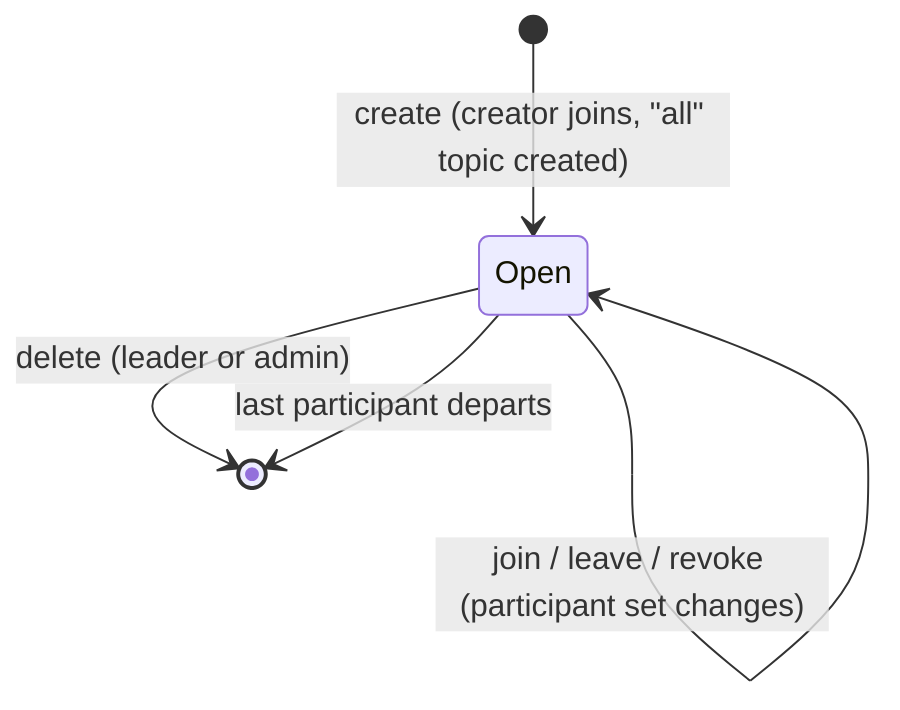

A space ends when a leader deletes it or when its last participant departs; the delete cascades participants, space tokens, topics, blackboards, inbox rows and invites. Create, delete and last-departure produce no inbox entry; delete wakes the participants' streams.

Source: [`server/internal/spaces/service.go:162-167`](../../../server/internal/spaces/service.go), [`:233-251`](../../../server/internal/spaces/service.go); spec `server/spec/no-empty-spaces.feature`.

### Membership and departure

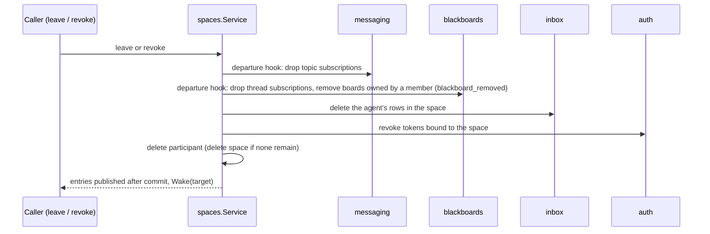

Leader and admin tokens are bound to no space, so leaving or being revoked from a space leaves them valid. The last leader cannot leave.

Source: [`service.go:233-270`](../../../server/internal/spaces/service.go), [`revoke.go:17-30`](../../../server/internal/spaces/revoke.go), [`auth/revoke.go:15-19`](../../../server/internal/auth/revoke.go); spec `membership.feature`.

### Invite

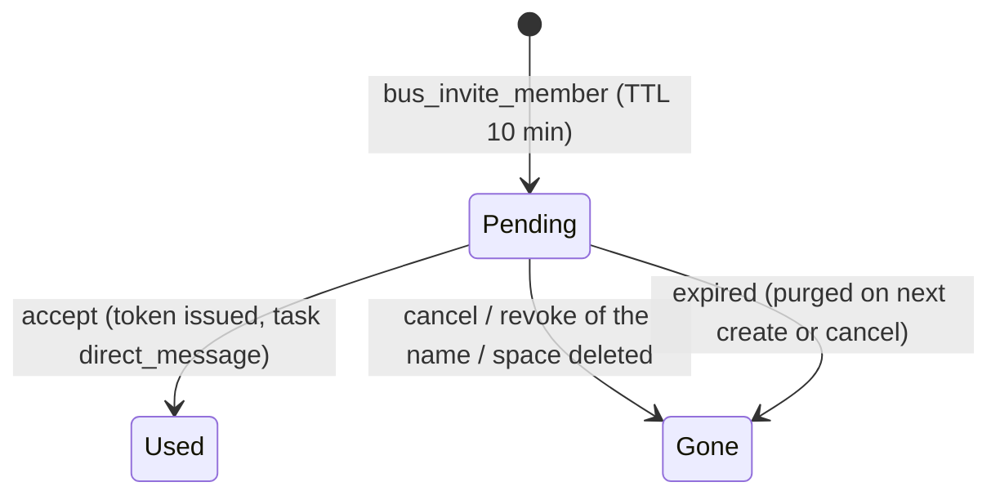

A failed admission rolls back and keeps the code.

Source: [`invites/service.go:28`](../../../server/internal/invites/service.go) (TTL), [`:95`](../../../server/internal/invites/service.go), [`:122-123`](../../../server/internal/invites/service.go); spec `invites.feature`.

### Topic

```mermaid
stateDiagram-v2
  [*] --> Open: create (creator subscribed if joined)
  Open --> Open: subscribe / unsubscribe / send
  Open --> Closed: close (creator or leader; subscriptions deleted)
  Closed --> [*]: name reusable
```

`all` is created with the space; it cannot be created or subscribed to by hand and reaches every participant.

Source: [`messaging/topics.go:84-85`](../../../server/internal/messaging/topics.go), [`:159`](../../../server/internal/messaging/topics.go).

### Board, thread, post

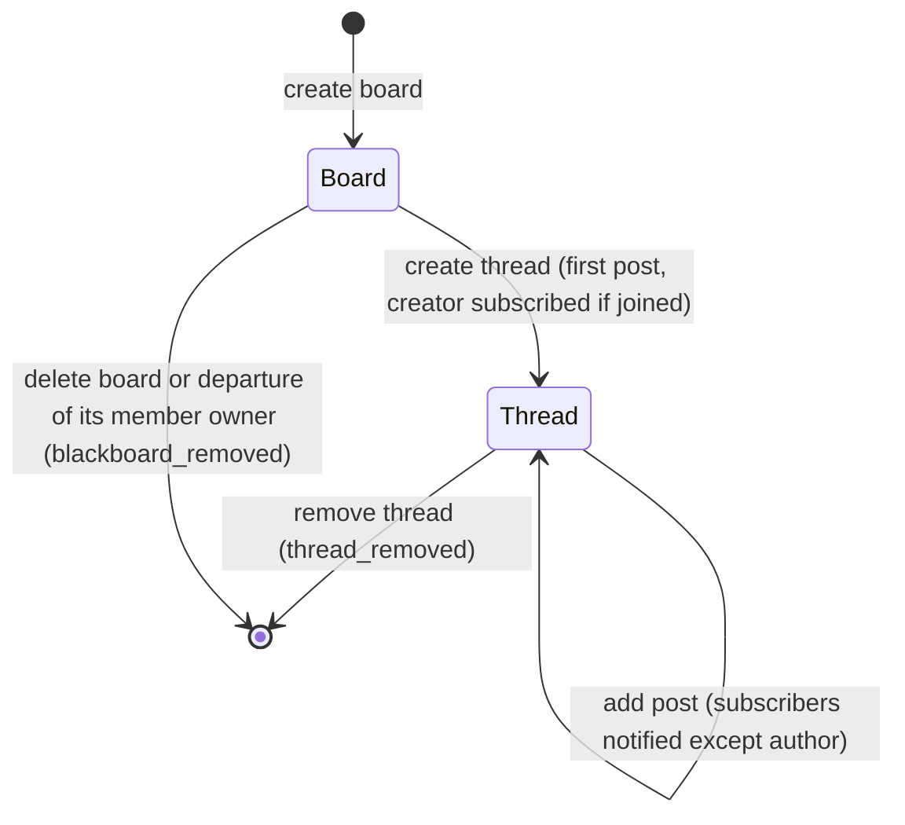

Notices go to thread subscribers; there is no board-level subscription.

Source: [`blackboards/posts.go:36-37`](../../../server/internal/blackboards/posts.go), [`threads.go:143-144`](../../../server/internal/blackboards/threads.go), [`boards.go:85`](../../../server/internal/blackboards/boards.go), [`departure.go`](../../../server/internal/blackboards/departure.go).

### Admin

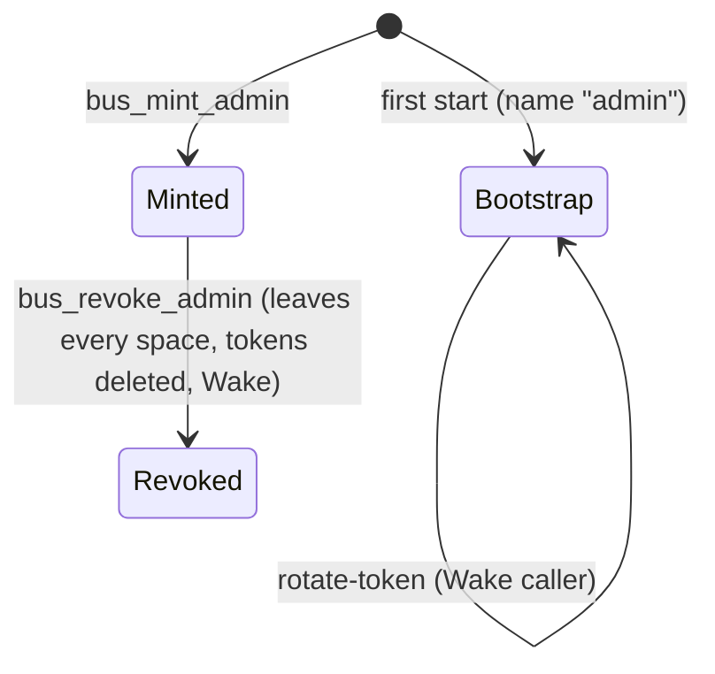

Source: [`spaces/admins.go:34-37`](../../../server/internal/spaces/admins.go), [`admin/handler.go:55-64`](../../../server/internal/admin/handler.go); spec `admin-tokens.feature`.

### Agent connection (stream and wait)

```mermaid
stateDiagram-v2
  [*] --> Idle
  Idle --> Streaming: GET /v1/inbox/stream (one slot per agent)
  Streaming --> Streaming: signal drains entries; 20 s ping revalidates token
  Streaming --> Idle: token invalid / write stall / cancel
  Idle --> Waiting: bus_wait (1-300 s)
  Waiting --> Idle: match / timeout / token invalid
```

A second concurrent stream gets 409 Conflict. `Wake` publishes a bare signal so streams and waits revalidate their token without a database write. A waiting `bus_wait` counts as live for delivery.

Source: [`inbox/handler.go:18`](../../../server/internal/inbox/handler.go), [`:36`](../../../server/internal/inbox/handler.go), [`service.go:140-143`](../../../server/internal/inbox/service.go), [`sse.go`](../../../server/internal/inbox/sse.go), [`wait.go`](../../../server/internal/inbox/wait.go), [`presence.go`](../../../server/internal/inbox/presence.go).

## Extension

### Session and connection

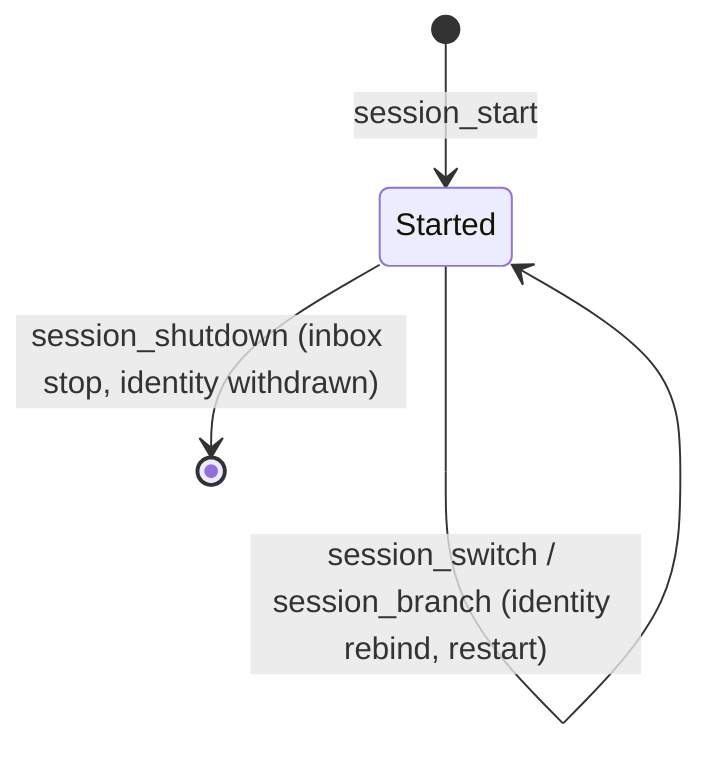

`restart()` runs in this order: clear inbox state, clear gate cache, resolve credentials, connect tools (gate probe, register remote tools once), refresh the context block, activate tools, open the inbox (main session only). The tools are active before the stream opens, so the turn a first entry starts lists the `bus_*` tools. A refused gate or missing credentials deactivates the tools and opens no inbox; a failed activation opens none either. A probe failure counts as `ok`.

Source: [`extension/index.ts:131-153`](../../../extension/index.ts), [`connection/connection.ts:44-66`](../../../extension/lib/connection/connection.ts).

### Inbox stream loop

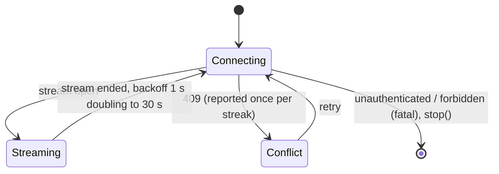

Backoff resets when an `inbox` frame is consumed.

Source: [`delivery/inbox-loop.ts:30-31`](../../../extension/lib/delivery/inbox-loop.ts), [`:61`](../../../extension/lib/delivery/inbox-loop.ts), [`conflict.ts`](../../../extension/lib/delivery/conflict.ts), [`inbox-runner.ts`](../../../extension/lib/delivery/inbox-runner.ts).

### Delivery ledger and handover

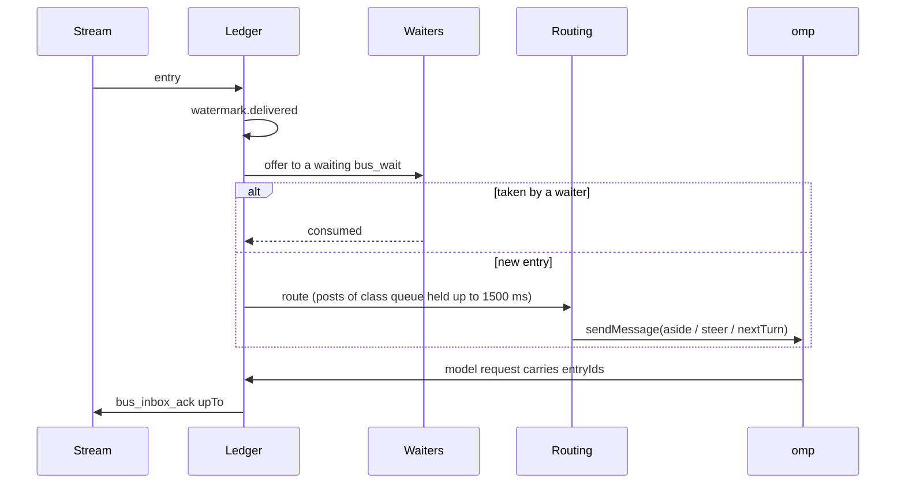

The mechanism per class and phase:

|Class|interactive busy|interactive idle|one-shot busy|one-shot idle|
|---|---|---|---|---|
|interrupt|steer|steer, triggers a turn|steer|nextTurn|
|queue|aside|aside|aside|nextTurn|
|deferred|nextTurn|nextTurn|nextTurn|nextTurn|

Entries are acknowledged when a model request carries them. `stop()` drops held notices unacknowledged; the server replays them on the next start.

Source: [`delivery/delivery-class.ts:18-43`](../../../extension/lib/delivery/delivery-class.ts), [`inbox-ledger.ts`](../../../extension/lib/delivery/inbox-ledger.ts), [`entry-routing.ts`](../../../extension/lib/delivery/entry-routing.ts), [`post-notices.ts:13`](../../../extension/lib/delivery/post-notices.ts), [`consumption.ts`](../../../extension/lib/delivery/consumption.ts).

### Local `bus_wait`

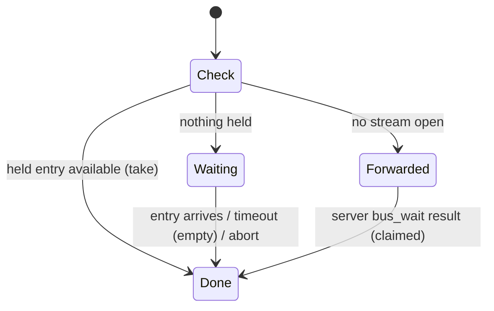

Default 30 s, maximum 300 s. Entries already handed to omp as asides do not end a wait.

Source: [`extension/lib/tools/wait-tool.ts`](../../../extension/lib/tools/wait-tool.ts).

### Tools activation and subagents

A main session registers all server tools except the withheld `bus_inbox_ack` and the shadowed `bus_wait` (replaced by the local tool). A subagent looks up its main session's published identity, receives an allow-list of blackboard tools, never opens an inbox and prefixes its posts with `[via subagent <id>]`.

Source: [`tools/tool-policy.ts:96-107`](../../../extension/lib/tools/tool-policy.ts), [`connection/connection-identity.ts`](../../../extension/lib/connection/connection-identity.ts), [`session/root-identities.ts`](../../../extension/lib/session/root-identities.ts).

## Event inventory

Delivery classes: see [`inbox/class.go`](../../../server/internal/inbox/class.go); class is derived from type and `critical`, which only direct and topic messages honour.

|Event|Producer|Consumer|Delivery class|Ledger effect|
|---|---|---|---|---|
|`direct_message`|`bus_send_direct`; invite accept (task)|recipient|queue; interrupt if critical|handed over by class and phase; acked on model request|
|`topic_message`|`bus_send_topic` (incl. `all`)|topic subscribers except sender|queue; interrupt if critical|same|
|`thread_post`|`bus_add_post`|thread subscribers except author|queue|queue-class posts are grouped per thread within 1500 ms into one notice|
|`topic_closed`|`bus_close_topic`|subscribers except closer|deferred|nextTurn; acked on model request|
|`thread_removed`|`bus_remove_thread`|thread subscribers except remover|deferred|same|
|`blackboard_removed`|`bus_delete_blackboard`; member-owner departure|subscribers of the board's threads|deferred|same|
|Wake signal|delete space, leave, revoke, revoke admin, rotate token|the agent's stream and waits|none (no entry)|stream or wait revalidates the token; no ledger change|
|Mail notice (`mail` key)|first result after mail reaches an empty mailbox, or a critical entry|calling agent via tool results|n/a|none; `bus_inbox_read`, `bus_wait` or the stream count as told|
|`agent-bus:entry`|ledger, per handed-over entry|other extension code via the pi events|n/a|published after handover|

Sources: [`inbox/entry.go:7-12`](../../../server/internal/inbox/entry.go), [`inbox/notice.go`](../../../server/internal/inbox/notice.go), [`extension/lib/delivery/bus-events.ts`](../../../extension/lib/delivery/bus-events.ts).

## Open design questions

D4 (bead `agent-message-bus-3jq.9`): what happens to threads and participants whose agent is gone.

- `owner_id`, `created_by` and `author_id` columns carry no cascade; they may reference an agent that departed.
- Boards owned by a leader or admin stay when that agent departs; boards owned by a member are removed.
- A leader's or admin's token is bound to no space, so it stays valid after the agent leaves or is revoked from a space; its mailbox scope and stream slot persist.
- Departure entries are discarded when the departure empties the space.
- Subscribers receive no notice when an agent leaves other than `blackboard_removed` for member-owned boards.
