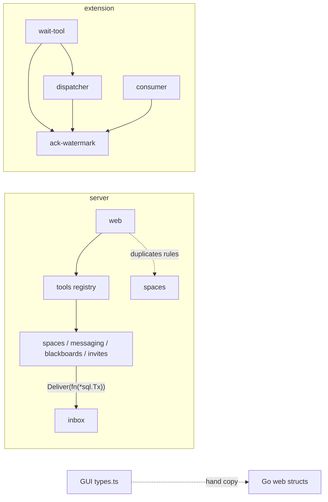

# Architecture review, November 2026

Snapshot: `main` at `668f73d` (after v0.2.0, W3, slice 10, M2 client and M3 GUI). Point-in-time document: it is not kept current; findings that are accepted move to beads.

Method: the `codebase-design` vocabulary (module, interface, depth, seam, adapter, leverage, locality, deletion test, "the interface is the test surface"). Four read-only assessments (server features, server transports, extension, GUI + pipeline) compared the code with `docs/design/arch/*` and `.omp/AGENTS.md`; the high-severity claims were spot-checked against the code. Dependency categories for each recommendation: 1 in-process, 2 local-substitutable, 3 remote-but-owned, 4 true external.

## Verdict

The solution is in good shape for its size: no function over ~30 lines on the server, features own their tables, transports are thin, and several modules are genuinely deep (`inbox.DeliverReceipts`, the tool registry, `session-credentials`, the GUI's `http`/`decode`/`poller`). The weaknesses cluster in four themes:

1. **Contracts written twice.** The tool argument schema and its decoder, the Go and TS wire types, and the tool-name policy tables each exist in two or more places with nothing tying them together. Drift between them is invisible to CI.
2. **State without one owner.** The extension's delivery ids live in four modules; the last three bug fixes (#65, #66, #67) were all ownership bugs in that split.
3. **Seams in the wrong place.** On the server, `inbox` owns the transaction for every feature. Most consumer-side interfaces have one adapter, so they are hypothetical seams that add ceremony without substitutability.
4. **Tests past the interface and stale "current state" docs.** Some feature tests count rows in other features' tables. The "Current state (verified)" sections of `server.md` and the import graph in `client.md` describe an older codebase.

## Recommendations, ranked by leverage per effort

| # | Recommendation | Area | Severity | Effort | Category |
|---|---|---|---|---|---|
| 1 | Contract fixtures shared by Go and the GUI (G1) | GUI/server | high | S | 1 |
| 2 | Tie the tool schema to the decoder (T1) | transports | medium | S | 1 |
| 3 | Release gated on the full CI (P1) | pipeline | high | S | — |
| 4 | One owner for the extension's delivery state: an inbox ledger (X1, X2, X10) | extension | high | M | 1 |
| 5 | Transaction seam out of `inbox` (S1) | server | high | M | 1 |
| 6 | Explicit capability field instead of `invites !== undefined` (G3) | GUI/contract | medium | S | 1 |
| 7 | One table for the extension's tool-name policy (X5) | extension | medium | S | 1 |
| 8 | Web reuses the space rights rule and moves its read composition into `overview` (T2, T7) | transports | medium | S–M | 1 |
| 9 | Overview resolves the membership once (S2) | server | medium | M | 1 |
| 10 | Feature tests assert through interfaces (S7) | server | medium | S | 2 |
| 11 | Decide the "define interfaces at the consumer" rule (S3) | server | medium | decision | — |
| 12 | Refresh the "current state" docs and import graph (§ Doc drift) | docs | low | S | — |

## Strengths to keep

- **The tool registry is a real seam with four consumers** (rpc, mcpserver, web in-process, `cmd/tooldoc`). A `Tool` carries schema, access sentence, result sketch, decoder and call. The rpc and MCP transports stay at 50–150 lines (`rpc/handler.go:24-70`, `mcpserver/server.go:36-58`). Web mutations call the same registry, so rules and error kinds match `/v1/tools` by construction (`web/mutations.go:139-148`).
- **`inbox.DeliverReceipts` is deep:** one call does the transaction, the insert, recipient naming, receipts from presence and publishing after commit (`inbox/deliver.go:20-40`).
- **Single decision points with fitness tests:** `inbox.ClassOf` (`inbox/class_test.go:40-75` fails on an unclassified entry type) and `delivery/delivery-class.ts` (`tests/delivery/delivery-class.test.ts:76-83`).
- **`spaces.Membership.Leads()/Joined()`** is the one home of the leader/admin/participant rule (`spaces/membership.go:31-34`).
- **`overview` owns no table** and reads only through services. The guide is one embedded text served three ways, with a golden test.
- **Tests run on real SQLite** (`platform/db/dbtest`, real migrations). That is category 2, and cross-feature cascades are really exercised.
- **Extension host seams are real**, each with a production and a test adapter: HTTP (`BusClient`), omp (`ExtensionAPI`), process (`Runner`) and events (`EventChannels`). `session-credentials.ts` collapsed 11 mutation sites into one deep module.
- **GUI core:** `api/decode.ts` narrows unknown JSON without casts, `api/http.ts` hides the cookie, CSRF and the error envelope, and `poll/poller.ts` hides backoff, generations and visibility behind three methods. `Clock`, `FetchFn` and `Reads`/`Mutations` are real seams.

## Findings

### Server features (S)

**S1 — `inbox` is the transaction manager of every feature (high).** `spaces` (`service.go:121,157,186,211`, `revoke.go:18`, `admins.go:21`) and `invites/service.go:121` open their transaction through `s.ib.Deliver(ctx, func(tx *sql.Tx) ([]inbox.Entry, error))`; `messaging` and `blackboards` reach it through their `inSpace` helpers. `spaces.Create` calls `Deliver` with zero entries only to get a transaction (`spaces/service.go:121-123`).
- *Diagnosis:* dependency direction (a feature owns the transaction for all features) and a leaked internal seam (`*sql.Tx` and inbox's row type are in every feature's interface).
- *Contradicts:* `.omp/AGENTS.md` "inside the caller's transaction".
- *Recommendation:* the caller opens the transaction with `db.InTx`. Inbox offers `Stage(tx, entries) (Staged, error)` and `Publish(Staged) []Receipt` after commit. A helper `inbox.InTx(ctx, db, fn func(tx) ([]Entry, error))` can stay the one-liner for the common case. Feature interfaces then depend on `db.DBTX` only.
- *Tests:* the existing feature tests stay; fixtures move from `*sql.Tx` to `db.DBTX`.

**S2 — `overview` resolves the same membership five times per read (medium).** `overview/service.go:66` resolves, then `spaces.Participants`, `messaging.ListTopics`, `blackboards.List` and `blackboards.RecentThreads` each resolve and authorize again.
- *Diagnosis:* the "may I see this space" rule is applied in four packages for one call.
- *Recommendation:* membership-scoped reads (`Participants(ctx, m)`, `ListTopics(ctx, m)`, …), with `overview` resolving once. The four consumer-side interfaces in `overview/service.go:17-32` shrink accordingly.

**S3 — Most consumer-side interfaces have one adapter (medium, needs a decision).**
- *One adapter (hypothetical seams):* `spaces.accounts` → `auth.Service`, `invites.admission` → `spaces.Service`; the three "deliverer" interfaces and the four in `overview` are the same kind, and web defines six more.
- *Real seams (keep):* `inbox.publisher`, `admin.TokenSetter`, `spaces.inboxStore`.
- *Duplicated:* `Noticer` is defined twice, identically (`rpc/mail.go:12-14`, `mcpserver/hint.go:16-18`).
- *Recommendation:* keep interfaces where a second adapter exists and accept concrete types elsewhere. This contradicts the AGENTS.md rule "Accept interfaces … define them at the consumer", so the owner decides: either amend the rule to "define an interface at the consumer when a second adapter exists", or keep it and accept the ceremony.

**S4 — `messaging` and `blackboards` duplicate "resolve and deliver in one transaction" (medium, small).** `messaging/service.go:41-58` and `blackboards/service.go:38-56` are the same `inSpace`/`inSpaceReceipts` pair. It disappears with S1. Without S1, extract one helper.

**S5 — `Resolve`/`ResolveTx` duality; `Membership.Notify` writes inbox fields (medium).** `Resolve` is just `ResolveTx(ctx, r.db, …)` (`spaces/resolver.go:40-42`). The rule "never call `Resolve` inside a transaction" is therefore a caller-visible constraint at about 15 sites. `spaces/membership.go:73-81` sets `AgentID` and `SpaceID` on `inbox.Entry`.
- *Recommendation:* one `Resolve(ctx, q db.DBTX, …)`; build notifications through a constructor owned by `inbox`.

**S6 — `inbox.Entry` is the hub type (medium).**
- *Evidence:* about nine packages import `inbox`, and `Entry` mixes wire fields, storage fields and the derived `Class` (`inbox/entry.go:18-33`).
- *Recommendation:* a neutral message type that inbox maps to rows; the JSON shape of `contracts.md` §4 stays unchanged.
- *Priority:* do it only together with S1, since alone the gain is small.

**S7 — Tests count other features' rows (medium).** `spaces/no_empty_test.go:16-22` counts `invites`, `tokens` and `inbox` rows; `overview/service_test.go:244-260` reads `sqlite_master`; `blackboards/admin_test.go:89` and `auth/service_test.go:158,247` read tables directly.
- *Diagnosis:* tests past the interface. A schema change in one feature breaks another feature's tests.
- *Recommendation:* assert through the services (`invites.ListPending`, `inbox.Count`, `spaces.Participants`). Keep one deliberate schema-level cascade test.

**S8 — Two of three `spaces.Hooks` have one production adapter; `invites.Revocation` bypasses `invites.Service` (low–medium).** Departure has two adapters, Creation and Revocation one each (`server/build.go:40-44`). `invites/revocation.go:13-18` calls `deleteForName` directly, which gives the invites table a second write path.
- *Recommendation:* route Revocation through an `invites.Service` method. Decide whether `CreationHook` earns its keep or is inlined.

**S9 — `auth` surface shaped by `spaces` (low–medium).** `spaces` needs five auth methods (`spaces/service.go:18-23`). A deeper `auth.AdmitMember(ctx, tx, spaceID, name)` plus `auth.Revoke(ctx, tx, agentID, scope)` would leave two.

**S10 — `inbox.Read` vs `ReadMarking` (low).** The difference is one policy bit, so it belongs in a parameter, not a second method.

### Server transports (T)

**T1 — The tool argument contract exists twice: JSON Schema and decoder (medium).**
- *Evidence:* `tools/schema.go:10-22` plus the per-tool `props` maps, against `tools/decode.go:15-26` plus the per-tool structs. `registry_test.go:30-60` checks only the shape.
- *Impact:* a renamed Go field silently breaks agents.
- *Recommendation (category 1):* derive the schema from the argument struct's tags, or add one invariant test that every schema property and `required` entry matches the struct's `json` tags. Small change, high leverage: this is the contract agents see.

**T2 — Web re-implements the leader-rights rule twice (medium).** `web/state.go:93-95` (`leadsListed`) and `web/state.go:103` (`Role == RoleLeader`) duplicate `Membership.Leads()` and `invites.AuthorizeInvites`.
- *Recommendation:* one predicate from `spaces` (e.g. `MaySeeInvites`), asked once. The rights cases move from `web_reads_test.go` to a `spaces` table test.

**T3 — Tool lookup by string literal in web, unknown tool → 500 (medium).** `web/reads.go:22,30`, `web/admins.go:16,26,36` and `web/mutations.go:44-112` look tools up by name, and an unknown name becomes a plain `fmt.Errorf`, i.e. internal error (`web/reads.go:48`). rpc answers 404 for the same case.
- *Recommendation:* exported name constants and `Registry.Call(ctx, p, name, args)` returning `apperr.NotFound`.

**T4 — Error mapping differs per transport (medium–low).** The unknown-tool case (rpc 404, web 500) is one example. Web's bad body says "invalid request body" while the tool says "invalid arguments", and MCP formats errors its own way (`mcpserver/server.go:63-72`).
- *Recommendation:* typed `apperr` kinds at the registry, so all transports map identically.

**T5 — Mail-notice policy duplicated in rpc and MCP (low–medium).** `rpc/mail.go:31-44` and `mcpserver/hint.go:27-41` both implement "take notice after success, log and swallow on failure". One `inbox` helper and one `Noticer` would replace them.

**T6 — Route table declared twice (low).** `server/routes.go:29-30` and `rpc/handler.go:24-25` register the same two paths, and `rpc.callTool` re-checks the principal that the middleware already set (`rpc/handler.go:41-45`).

**T7 — The GUI state read is composed in the transport, with one transaction per space (medium).**
- *Evidence:* `web/state.go:40-52,88-97` calls `invites.CountPending` per space.
- *Recommendation:* move the composition into `overview`, which already owns read composition, and count with one query. `web/state.go` then only maps.

**T8 — `cmd/tooldoc` builds the registry a second way (low–medium).** `tools.New(tools.Deps{})` relies on the convention "services are only used inside `Call`" (`tools/deps.go:26-27`).
- *Recommendation:* split metadata (`tools.Metadata()`) from the callable registry.

**T9 — `main.go` holds listener lifecycle (low).** `server/main.go:133-179` (`serve`, `listen`, `closeListeners`) belongs next to `server.Run`, per AGENTS.md "wiring and CLI dispatch only".

### Extension (X)

**X1 — The delivery state has no owner; an inbox ledger module is hiding here (high).**
- *Evidence:* the delivery ids live in four places:
  - `dispatcher.ts:106-107` (`handedOver`, `claimed`)
  - `ack-watermark.ts:17-20` (`received`, `known`, `consumed`, index)
  - `consumer.ts`
  - `wait-tool.ts:29-38`, which takes four dependencies
- *Diagnosis:* bugs #65 (lifetime per start), #66 (claim against stream) and #67 (ack on arrival) were each an ownership bug in this split. The invariant "ids arrive ascending and claimed ids are always streamed later" is stated in neither interface and not tested as such.
- *Recommendation (category 1):* one `delivery/inbox-ledger.ts` owning received, handed-over, claimed, consumed, the contiguous `upTo`, held notices and waiters. Its interface: `deliver(entry)`, `awaitEntry(filter, ms, signal)`, `takeHeld(filter)`, `claimFromServer(entries)`, `consumed(ids)`, `upTo()`, `stop()`. One ledger per connection start, so the lifetime that #65 fixed becomes structural.
- *Tests:* `ack-watermark.test.ts` and the claim/watermark assertions in `dispatcher.test.ts` are replaced by one ledger suite that states the ordering invariant explicitly.

**X2 — `Dispatcher` is a wide union; every addition ripples into fakes (medium).** It has six methods (`dispatcher.ts:22-38`). `inbox-loop.test.ts:24` and `inbox-runner.test.ts:7` each hand-write a full fake, and both changed when #66 added `claim`. Consumers should see narrow views (`EntrySink`, `WaitSource`). This is subsumed by X1.

**X3 — `ActiveCredentials` lives in `session/` (medium–high).** `session/stored-credentials.ts:29-34` has 14 importers across six folders, five of them edges that `client.md` §1.3 does not allow; they are whitelisted as "transitional" in `tests/layout.test.ts:78-90`.
- *Recommendation:* move the wire shape to `bus/credentials.ts`. No behaviour change, and five transitional edges disappear.

**X4 — `delivery/` ↔ `connection/` cycle (medium).** `delivery/inbox-runner.ts:6` imports `connection/conflict.ts`, while `connection.ts` imports `delivery/*`. The 409 is an inbox-stream fact, so `conflict.ts` belongs in `delivery/`.

**X5 — Tool-name policy scattered over five modules (medium).** The policy lives in `tools/presentation.ts:20-55`, `tools/tool-selection.ts:10-22`, `tools/attribution.ts:9`, `tools/membership-refresh.ts:7` and `render/outgoing-card.ts:12`.
- *Recommendation:* one table keyed by tool name with load mode, approval, subagent, shadow, withhold, attribution, membership refresh and receipt. Three test files become one table test.
- *Relation to T1:* T1 removes a duplicated contract on the server; this removes duplicated policy on the client.

**X6 — `index.ts` hand-assembles a 13-field command dependency bag (medium–low).** The bag is built at `index.ts:107-142`. `commands/command.ts` should take the `Session` and build the bag itself. `createConnection` (~95 lines, `connection.ts:90-186`) and `createSession` (~60) are the two functions furthest over the 30-line rule.

**X7 — `root-identities.ts` mixes a shared registry with per-connection publication state (low–medium).** `RootPublication` (`:53-76`) is the per-connection half and belongs in `connection/`.

**X8 — Gate and version lifetimes differ from the doc (low).** The protocol gate is per session (`index.ts:190`), while `client.md` §8.1 says per connection start. `package.json` is read per session (`index.ts:213`), while `pipeline.md` §3.1 says once at load.

**X9 — Two notions of "post" (low–medium).** Three render modules switch on `EntryType`, while `post-notices.ts:18-20` decides by thread id plus class. One `render/entry-label.ts` would hold the type interpretation for all three.

**X10 — `delivery/consumer.ts` fails the deletion test (low).** It is 20 lines of pass-through to the watermark. Fold it into the ledger (X1).

### GUI (G)

**G1 — No Go↔TS contract check (high).**
- *Evidence:* `gui/src/api/types.ts` is a hand copy of the Go structs in `web/state.go`, `spaces`, `blackboards`, `inbox` and `invites`. Go tests assert against Go structs, TS tests against hand-written literals. Already drifted: the GUI's `Entry` lacks `class` (`gui/src/api/types.ts:117-129`), which `contracts.md` §4.1 says every `Entry` carries.
- *Recommendation (category 1):* commit `server/internal/web/testdata/*.json` marshalled from the real handlers. A Go golden test keeps them current, and `gui/tests/api/contract.test.ts` decodes the same files. The literal fixtures in `gui/tests/fixtures.ts` and `decode-state.test.ts` are replaced.

**G2 — The DOM patcher is the deepest and least-tested module (medium).** In `view/mount.ts` only `samePlace` is tested; `gui.md:229` says so too.
- *Recommendation:* extract a pure `planPatch(prev, next)`, test it, and keep `mount.ts` as a thin applier.

**G3 — Authorization inferred from an optional field (medium).** `views/space.ts:84` and `views/spaces.ts:15` decide on leader UI from `invites !== undefined`. If the server ever sends `invites: []` to everyone, every session gains revoke and delete buttons.
- *Recommendation:* an explicit capability (`"mayManage": true`) in `contracts.md` §10.2.

**G4 — Closed vocabularies and duplicated constants (medium).**
- `oneOf(...ROLES)` and `oneOf(...AGENT_KINDS)` throw on an unknown value, so one new server role breaks the space page and the login.
- `INBOX_LIMIT = 500` duplicates the server's `maxLimit`.
- *Recommendation:* decode roles and kinds as text, and publish the limit in the state contract.

**G5 — Intent interfaces written twice (medium–low).** Five consumer-side interfaces in `views/*` face three provider modules, and `main.ts:38-52` re-lists all 12 methods. One view-owned `Intents` interface would remove the second copy.

**G6 — No layering fitness for `gui/src` (low–medium).** `gui.md:14` says only four files touch browser globals. That is true today but not enforced.
- *Recommendation:* `gui/tests/layout.test.ts` (browser globals, `state` → `views`, cycles), mirroring `tests/layout.test.ts`.

**G7 — Stale-load policy has two owners (low).** `poll/poller.ts:35,82,107` uses a generation counter, and `state/reducer.ts:58,60` a `sameRoute` guard. Route staleness belongs in the reducer and superseded requests in the poller.

### Pipeline (P)

**P1 — The release runs only `go test` (high, mitigated).**
- *Evidence:* `release.yml:32-34` runs no `bun test`/typecheck for `gui/` or `extension/` and no ruff, and the workflow has no dependency on `ci`.
- *Mitigation and gap:* tags are cut from `main`, which has required checks. But `web` is not yet a required check (Q-P2), and the v0.2.0 tag push bypassed the ref-creation rule.
- *Recommendation:* trigger the release only for a commit whose `ci` run passed (check the `ci` run of the tagged SHA as the first step, or run the `typescript` and `web` jobs in `release.yml` too).

**P2 — Version facts weaker than documented (low–medium).** `pipeline.md:126` says plugin and server of one tag always match (`protocol-sync`), but `tests/version/protocol-sync.test.ts:10-13` only asserts `MIN_SERVER_PROTOCOL ≤ Protocol`. The GUI has no protocol gate.
- *Recommendation:* reword the doc, or test the property it claims.

**P3 — Consistency nits (low).**
- The `typescript` CI job installs bun unpinned, while `web` and `release` pin it via `gui/package.json`.
- `ruff.toml` has no `required-version` to match the CI pin `ruff==0.17.3`.
- The root scripts `test:gui` and `build:gui` never run in CI.

**P4 — Test support parses the binary git index (low).** `tests/git-index.ts` (58 lines, #71) reads index versions 2–4 so that `tests/package.test.ts` does not spawn `git`. The fix removed a flaky timeout, but the parser itself has no test; it was verified by hand.
- *Alternative:* one `git ls-files` in a `beforeAll` with an explicit timeout, which is boring and has no format knowledge. Keep the parser only if spawn cost keeps mattering.

## Doc drift

| Where | Says | Code |
|---|---|---|
| `.omp/AGENTS.md` Architecture; `server.md` §2.1 | only `tools` and `server` import `overview` | `web/state.go:10` imports it |
| `.omp/AGENTS.md` | cross-feature effects "inside the caller's transaction" | `inbox.Deliver` opens it (S1) |
| `.omp/AGENTS.md` | `repository.go` with "interfaces defined where they are used" | no repository interfaces; SQL is package functions over `db.DBTX` |
| `.omp/AGENTS.md` | `platform/` only for things used by 2+ packages | `httpserver`, `broker` (production), `instance`, `detach` have one consumer |
| `.omp/AGENTS.md` | `lib/shared/` not tied to the bus | `shared/command.ts:7-13` defines the bus `CommandResult` |
| `server.md` §1 "Current state (verified)" | 29 tools, no `Tool.Access`, no MCP instructions | 34 tools, both exist |
| `server.md:352`, §3.3 | `Build(ctx, …) (api, web, error)`, `StreamHandler()`, `Wait(ctx,p,f,timeout)` | `Build(streamRoot, conn, adminToken, shutdown) (Handlers, error)`, `StreamHandler(root)`, `Wait(ctx,p,WaitQuery)` |
| `server.md:298` | `guide.Text()` | `var` in `guide/guide.go:11` |
| `protocol.go:5-7` | protocol-2 history lists slices 1–7 | `contracts.md:215` lists more (bus_wait, overview, mail notice, receipts, guide) |
| `server/TOOLS.md:3` | "two transports" | three runtime consumers plus the generator |
| `client.md` §1.3 | import graph | eight more edges, whitelisted as "transitional" with no plan |
| `client.md` §8.1 | `tooOld(found)`; cache per connection start | `tooOld(found, url)`; cache per session |
| `gui.md:163`, `contracts.md:333` | GUI reads `GET …/invites` | GUI never calls it |
| `gui.md:166` | `inbox?after=&limit=` | GUI never sends `after` |
| `pipeline.md:126` | one tag always matches (protocol-sync) | test checks only `≤` (P2) |

The tool count 34 is written in five places (`registry_test.go:11`, `TOOLS.md`, `transports.feature:62`, `spec/README.md`, `server/README.md`). That is acceptable, since the golden test and the registry test catch a mismatch.

## Metrics

| Area | Files (impl / test) | Largest impl files (lines) | Functions > ~30 lines |
|---|---|---|---|
| Server features + platform | ≈95 / ≈120 | `spaces/service.go` 293, `blackboards/repository.go` 251, `inbox/repository.go` 226 | none |
| Server transports | `tools` 14, `web` 14, `server` 5 | `main.go` 179, `web/mutations.go` 149, `web/web.go` 120 | none (largest `server.Build` 30) |
| Extension | 81 / 66 | `index.ts` 223, `connection.ts` 186, `command.ts` 165 | `createConnection` ~95, `createSession` ~60, `createBusExtension` ~42, `registerBusCommand` ~36, `registerSessionEvents` ~35, `createDispatcher` ~35 |
| GUI | 45 / 36 | `api/types.ts` 151, `views/layout.ts` 126, `poll/poller.ts` 113 | none |

Highest fan-in: server `auth` ≈12 and `inbox` ≈9 packages; extension `bus/client.ts` 17 and `session/stored-credentials.ts` 14 files; GUI `api/types.ts` and `state/app-state.ts` 12 each.

## Suggested order

1. **Fitness first, cheap:** G1 (contract fixtures), T1 (schema ↔ decoder), P1 (release gate), G6 (GUI layering test), P3 nits. These lock contracts before anything moves.
2. **Extension ledger (X1 with X2 and X10):** the area with the most recent defects; one M-sized slice with its own test suite.
3. **Server transaction seam (S1 with S4 and S5):** M-sized, no behaviour change. S6 only if S1 shows the hub type still hurts.
4. **Rule locality:** T2 + T7 (web uses `spaces` and `overview`), S2, G3 (needs a `contracts.md` change, so it gets a protocol note).
5. **Decision:** S3, the consumer-interface rule in `.omp/AGENTS.md`.
6. **Docs:** refresh the drift table in one docs PR, and give the "transitional" import edges in `tests/layout.test.ts` either a slice or a place in the documented graph.
