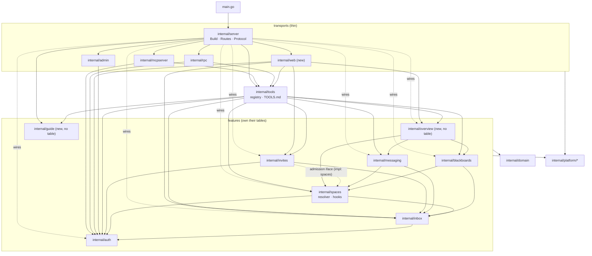

# Server architecture — agent-message-bus (milestone after the spec round)

> **Committed in slice 0.** Design paths use `docs/design/specs/…` and `docs/design/arch/…`. Spec paths without a prefix (e.g. `admin/analysis.md`) are relative to `docs/design/specs/`.

Owner: Arch-server. Inputs: `docs/design/specs/**` (final), `docs/design/specs/REVIEW.md` (§11 order, PO-1..PO-11).
Companion files: [`schema.md`](schema.md), [`contracts.md`](contracts.md), [`slices.md`](slices.md), [`definition-of-ready.md`](definition-of-ready.md).
Client side (extension, GUI frontend, release pipeline): Arch-client, `docs/design/arch/client.md`.

PO decisions of 2026-10-26 are applied (PO-1 log line, PO-2, PO-4, PO-7/8/9, PO-10 (b), PO-11 S1 as recommended; **PO-3: no `bus_cancel_invite` tool, web-only cancel by invite id; PO-5: delivery class on every entry; PO-6: omp only**). Architect decisions that the specs leave open are marked **[AD-n]** and listed in §8.

Every code claim below is anchored to the repo as of `526635d` (`git log -1`).

---

## 1. Current state (verified)

| Area | Fact | Anchor |
|---|---|---|
| Wiring | `Build(streamRoot, conn, adminToken, shutdown) http.Handler` builds every service and calls `Routes`. Hooks: departure = messaging, blackboards; creation = messaging; revocation = `invites.Revocation{}` | `server/internal/server/build.go:21-37` |
| Routes | `GET /healthz`, `/mcp`, `GET /v1/tools`, `POST /v1/tools/{name}`, `POST /v1/invites/accept`, `GET /v1/inbox/stream`, `admin.Mount` | `server/internal/server/routes.go:20-37` |
| Admin principal | Instance token compared in memory, returns `Principal{Kind: Admin}` with AgentID 0 and no name | `server/internal/auth/service.go:31-44` |
| Admin locked out of spaces | `requireAgent` in the resolver and in inbox | `server/internal/spaces/resolver.go:19-25`, `server/internal/inbox/service.go:99-104`, `server/internal/inbox/handler.go:46-52` |
| Leader authority checks | `m.Role != RoleLeader` / `m.Role == RoleLeader` at 6 sites | `spaces/service.go:95-100`, `messaging/service.go:57`, `messaging/topics.go:79,124`, `blackboards/boards.go:55`, `blackboards/threads.go:108` |
| Auto-subscribe on create | topic creator, thread creator | `messaging/topics.go:52`, `blackboards/threads.go:76` |
| Departure | `removeParticipant` runs departure hooks, deletes inbox rows, space tokens, participant row | `spaces/service.go:202-219` |
| Last leader | `Leave` refuses the last leader unconditionally | `spaces/service.go:189-196` |
| Revoke | leader targets refused (`conflict`) | `spaces/revoke.go:70-79` |
| Invite task | `Accept` returns `task` in `Admission` (omitempty); task validated with `ValidBody` (wrong field name in the error) | `invites/service.go:30-37,53-60,93-115` |
| `AdmitMember` | returns `(space, token, err)` — no agent id | `spaces/admission.go:25-38` |
| Inbox | `Deliver` = tx + insert + publish after commit; `Read` caps at 500; ack is cumulative `DELETE … id <= ?` | `inbox/deliver.go:12-27`, `inbox/service.go:72-92`, `inbox/repository.go:24` |
| Stream | subscribe → drain → forward; one slot per agent; root ctx passed per handler | `inbox/stream.go:16-28`, `inbox/slots.go`, `inbox/handler.go:22-44` |
| Tool | `Tool{Name, Description, Result, Group, Schema, Call}` — no `Access`; ledger derives access from first sentence | `tools/registry.go:21-31`, `tools/doc.go:70-77` |
| Tool count | 29, asserted in tests | `tools/registry_test.go:11`, `rpc/handler_test.go:159`, `spec/transports.feature:54-57,191` |
| MCP | `mcp.NewServer(&mcp.Implementation{…}, nil)` — no instructions; stateless, JSON responses | `mcpserver/server.go:20-29` |
| MCP user id | `fmt.Sprintf("%s:%d", p.Kind, p.AgentID)` → today `admin:0` | `mcpserver/verifier.go:27` |
| Admin endpoints | guard = loopback + `Kind == Admin` | `admin/guard.go:14-26`, `admin/handler.go:22-25` |
| Instance token | already `amb_admin_` prefixed when generated | `platform/config/token.go:48-55` |
| Leader/member tokens | `amb_` prefix | `auth/token.go:11-18` |
| Migrations | `0001_init`, `0002_invites` (+ down files); runner reads only `NNNN_*.up.sql`, one tx each | `server/migrations/*`, `platform/db/migrate.go:14,21-81` |
| DB | one connection (`SetMaxOpenConns(1)`), `InTx` must use only tx | `platform/db/db.go:24`, `platform/db/dbtx.go:17-32` |
| Shutdown | `cancelStreams()` then `srv.Shutdown` with 10 s | `platform/httpserver/serve.go:14,27-31` |
| Broker | in-process, topic `inbox/<agentID>`, slow subscriber dropped (channel closed) | `platform/broker/memory.go:59-71` |
| Listen default | `127.0.0.1:8080` | `platform/config/config.go:16,31` |
| go-sdk | v1.8.0 (`ServerOptions.Instructions` available) | `server/go.mod:6` |

---

## 2. Target package structure

```
server/
  main.go                       wiring only (handles Build error; server.NewHTTPServer) [4a, 9]
  cmd/tooldoc/                  unchanged
  migrations/                   0001_schema (+ named migrations, numbered at merge) [1,7,13a,10]
  internal/
    auth/                       agents, tokens; bootstrap + minted admins     [4a,6a,6b,W1a]
    spaces/                     spaces, participants; resolver; seam B        [4b–4d,5,6b]
    invites/                    invites; id + cancel; ListPending; task→inbox [2,7,10,W1b]
    messaging/                  topics, topic_subscriptions                   [4b,4c,12]
    blackboards/                blackboards, threads, posts, thread_subs      [4b,4c,8,12]
    inbox/                      inbox; class; Deliver; stream; Wait; presence; notice [D1,4d,9,12,13]
    overview/        NEW        read composition, owns no table               [8]
    guide/           NEW        embedded guide.md, owns no table              [11]
    tools/                      registry (+Access), descriptions, TOOLS.md    [3,…]
    rpc/                        JSON RPC transport (+`mail` sibling)          [13b]
    mcpserver/                  MCP transport (+instructions, +hint block)    [11,13b]
    admin/                      loopback admin endpoints (bootstrap-only swap)[6a]
    web/             NEW        GUI transport: sessions, CSRF, /web/api, embed[W1a,W1b,W2,W3,10]
    server/                     Build, Routes, Protocol constant              [4a,7,11,W1a]
    domain/                     + ValidText (approved)                         [2]
    platform/                   + config.WebAddr (AMB_WEB_ADDR; PO-approved)  [W1a]
```

### 2.1 Ownership table (who writes which table)

| Package | Writes | Reads from others (read-only joins, existing precedent `blackboards/repository.go:56-57`) | Hooks it implements | Hooks/services it calls |
|---|---|---|---|---|
| `auth` | `agents`, `tokens` | `participants`, `spaces` (only `ListAdmins.spaces`) | — | — |
| `spaces` | `spaces`, `participants` | `agents` | defines `CreationHook`, `DepartureHook`, `RevocationHook` | `auth` (accounts iface), `inbox` (Deliver, DeleteSpaceEntries), hooks |
| `invites` | `invites` | — | `spaces.RevocationHook` (`invites.Revocation`) | `spaces` (admission iface), `inbox.Deliver` **[7]** |
| `messaging` | `topics`, `topic_subscriptions` | `agents` | `CreationHook`, `DepartureHook` | resolver, `inbox.Deliver`, `inbox.Receipts` **[12]** |
| `blackboards` | `blackboards`, `threads`, `posts`, `thread_subscriptions` | `agents` | `DepartureHook` | resolver, `inbox.Deliver`, `inbox.Receipts` **[12]** |
| `inbox` | `inbox` | `spaces` (name join), `agents` (kind for notice scope **[13a]**, names for receipts **[12]**) | — | broker |
| `overview` | none | via services only | — | resolver, spaces, messaging, blackboards |
| `guide` | none | — | — | — |
| `web` | none (sessions in memory) | via services/registry only | — | auth, tools registry, overview, invites, inbox |

Cross-feature *writes* happen only through hooks or service methods inside the caller's transaction (unchanged rule, `.omp/AGENTS.md:36`). New cross-feature write paths and how they stay legal:

| Effect | Path | Tx |
|---|---|---|
| Invite accept writes a `direct_message` inbox row | `invites.Accept` runs inside `inbox.Deliver(fn)`; `fn` returns the entry; inbox inserts it | one tx (Deliver) |
| Last participant leaves → space deleted | `spaces.removeParticipant` → `countParticipants` → `deleteSpace` (spaces' own table; FK cascades remove other features' rows) | caller's Deliver tx |
| Admin revoked → tokens deleted | `spaces.RevokeAdmin` → `accounts.RevokeAgentTokens` (auth method, tx passed in) | one Deliver tx |
| Admin revoked → leaves every joined space | `spaces.RevokeAdmin` → `removeParticipant` per space (departure hooks run) | same tx |

The FK cascade on `deleteSpace` is the one sanctioned exception to "writes only its own tables": it is declared in `0001_schema` and already relied on by `bus_delete_space` (`spaces/service.go:161-180`, `spec/README.md:87`).

---

## 3. Key types and signatures

Signatures are the contract between slices. Unexported helpers are omitted unless they are a seam.

### 3.1 `internal/auth` [4a, 6a, 6b, W1a]

```go
// principal.go
type Principal struct {
    Kind      Kind   // admin | leader | member
    AgentID   int64  // set for every kind after 4a (bootstrap admin included)
    AgentName string // "admin" for the bootstrap admin
    SpaceID   int64  // members only
    Bootstrap bool   // true only for the instance admin token
}

// bootstrap.go (new) [4a]
const BootstrapName = "admin"
// Bootstrap ensures agent "admin" of kind admin exists and caches its id. Called once by server.Build.
func (s *Service) Bootstrap(ctx context.Context) error
// Authenticate: instance-token match → Principal{Kind: Admin, AgentID: cached, AgentName: "admin", Bootstrap: true}.
func (s *Service) Authenticate(ctx context.Context, token string) (Principal, error)
// AuthenticateHash is Authenticate for an already hashed token (web sessions keep only the hash). [W1a]
func (s *Service) AuthenticateHash(ctx context.Context, hash string) (Principal, error)

// token.go [6a]
const TokenPrefix, AdminTokenPrefix = "amb_", "amb_admin_"
func NewToken(prefix string) (string, error)

// admins.go (new) [6a, 6b]
type AdminInfo struct {
    Name      string   `json:"name"`
    Bootstrap bool     `json:"bootstrap"`
    Tokens    int      `json:"tokens"`
    Spaces    []string `json:"spaces"`
}
func (s *Service) MintAdmin(ctx context.Context, p Principal, name string) (string, error)        // logs "admin minted" after commit
func (s *Service) ListAdmins(ctx context.Context, p Principal) ([]AdminInfo, error)
func (s *Service) AdminAgent(ctx context.Context, q db.DBTX, name string) (id int64, found, bootstrap bool, err error) // [6b]
func (s *Service) RevokeAgentTokens(ctx context.Context, q db.DBTX, agentID int64) (int64, error)                   // [6b]
func RequireAdmin(p Principal) error // forbidden "admin token required"; shared by MintLeader/MintAdmin/ListAdmins
```

- Kind-conflict message becomes article-aware: `agent ops is an admin agent` vs `agent lead is a leader agent` (`auth/service.go:110` uses `a %s`). [4a]
- `MintLeader` stays, any admin may call it (already true: `auth/service.go:48` checks `Kind`). [4a: name "admin" → `conflict "agent admin is an admin agent"` falls out of `agentOfKind`].
- `SetAdminToken` unchanged; the bootstrap agent id survives rotation because only the hash is swapped (`auth/admin_token.go:11-18`).

### 3.2 `internal/spaces` — seam B [4b, 4c, 4d, 5, 6b]

```go
// membership.go
const (
    RoleAdmin  Role = "admin" // participant row of a joined admin [4b const, used from 4d]
    RoleLeader Role = "leader"
    RoleMember Role = "member"
)
type Membership struct {
    SpaceID   int64
    SpaceName string
    AgentID   int64
    AgentName string
    Role      Role // participant role; "" when an admin has not joined
    Admin     bool // caller is an admin principal (authority without participation)
}
func (m Membership) Leads() bool  { return m.Admin || m.Role == RoleLeader } // every authority site [4b]
func (m Membership) Joined() bool { return m.Role != "" }                    // every receive/subscribe site [4c]
```

Resolver admin branch [4c] (`resolver.go:53-75` today):

```go
// ResolveTx: Admin principal → space must exist (not_found "space X not found");
// participant row optional; returns Membership{…, Role: row role or "", Admin: true}.
// requireAgent is deleted (resolver.go:19-25).
func (r *Resolver) ResolveTx(ctx context.Context, q db.DBTX, p auth.Principal, space string) (Membership, error)
func requireJoined(m Membership) error // forbidden "join space X first; only participants receive messages"
```

Lifecycle and listing [4d, 5]:

```go
type SpaceInfo struct {
    Name    string   `json:"name"`
    Leaders []string `json:"leaders"`
    Admins  []string `json:"admins"`  // joined admins [4d]
    Members int      `json:"members"` // role member only
    Joined  bool     `json:"joined"`
}
func (s *Service) Create(ctx, p, name) error  // admins allowed; creator row role = roleFor(p) (admin|leader)
func (s *Service) Join(ctx, p, name) error    // admins allowed; uses m.Joined() instead of the forbidden probe (service.go:146-152)
func (s *Service) Delete(ctx, p, name) error  // m.Admin skips countOtherLeaders
func (s *Service) Leave(ctx, p, space) error  // !m.Joined() → forbidden "not a participant of space X";
                                              // last-leader refusal only while countParticipants > 1 [5]
// removeParticipant (service.go:202-219) gains, after deleteParticipant: [5]
//   n := countParticipants(tx, spaceID); n == 0 → deleteSpace(tx, spaceID) and drop the hook entries.
func (s *Service) RevokeAdmin(ctx context.Context, p auth.Principal, name string) (bool, error) // admins.go [6b]

type accounts interface { // renamed from memberAccounts (service.go:16-21)
    MintMember(ctx context.Context, tx db.DBTX, name string, spaceID int64) (agentID int64, token string, err error)
    RevokeSpaceTokens(ctx context.Context, q db.DBTX, agentID, spaceID int64) error
    CheckMemberName(ctx context.Context, q db.DBTX, name string) error
    AdminAgent(ctx context.Context, q db.DBTX, name string) (int64, bool, bool, error) // [6b]
    RevokeAgentTokens(ctx context.Context, q db.DBTX, agentID int64) (int64, error)    // [6b]
}

// admission.go [7]: AdmitMember also returns the member's agent id (invites addresses the task entry).
func (s *Service) AdmitMember(ctx context.Context, tx db.DBTX, spaceID int64, name string) (agentID int64, space, token string, err error)
```

Revoke matrix [4c/4d] (`revoke.go:30-79`): leader caller → member targets only (unchanged); admin caller (`m.Admin`) → member and leader targets incl. the last leader; target with role `admin` → `conflict "ops is an admin of space demo; admins cannot be revoked from a space"` for every caller.

Participant order [4d] (`repository.go:145-146`): `CASE role WHEN 'admin' THEN 0 WHEN 'leader' THEN 1 ELSE 2 END, name`.

### 3.3 `internal/inbox` [4d, 9, 12, 13a, 13b]

```go
// class.go (new) [D1] — the single place that decides how an entry is delivered (PO-5)
type Class string
const (
    Interrupt Class = "interrupt" // steer in omp
    Queue     Class = "queue"     // aside in omp
    Deferred  Class = "deferred"  // nextTurn in omp
)
var classByType = map[Type]Class{ // every Type must appear (test enumerates the Type constants)
    DirectMessage: Queue, TopicMessage: Queue, ThreadPost: Queue,
    TopicClosed: Deferred, ThreadRemoved: Deferred, BlackboardRemoved: Deferred,
}
// ClassOf: critical → Interrupt; else classByType[t].
func ClassOf(t Type, critical bool) Class
// Entry gains field Class (json "class", delivery-class.feature:12); set by insert (service.go:44-57) and scanEntries
// (repository.go:49-63), so SSE, Read, Wait and the web all carry it. Not a column [AD-15].

// service.go — constructor takes the stream root so Wait and Stream share one shutdown signal [9]
func NewService(root context.Context, conn *sql.DB, pub publisher, now func() time.Time) *Service
func (s *Service) StreamHandler() http.Handler // root no longer passed per call (handler.go:22) [9]

// requireAgent deleted (service.go:99-104, handler.go:46-52) [4d]; admins read across spaces (spaceFilter 0).
func (s *Service) Read(ctx context.Context, p auth.Principal, after int64, limit int) ([]Entry, error) // pure listing; never marks
func (s *Service) Ack(ctx context.Context, p auth.Principal, upTo int64) (int64, error)               // unchanged semantics
func (s *Service) Count(ctx context.Context, p auth.Principal) (int, error)                           // unacked entries in p's scope; web state [W1b]

// wait.go (new) [9]
type Filter struct {
    After    int64
    From     string // sender name; "" = any
    ThreadID int64  // 0 = any
}
const MaxWaitEntries = 100
// Wait subscribes to inbox/<agentID>, then reads matching entries; returns at once when any match,
// else blocks until a matching entry, the timeout, ctx, the service root, or a dropped subscription
// (then reads once more). Never acks; never takes the stream slot; registers the caller as a waiter (presence).
func (s *Service) Wait(ctx context.Context, p auth.Principal, f Filter, timeout time.Duration) ([]Entry, error)

// presence.go (new; absorbs slots.go) [12, waiter count from 9]
func (s *Service) Connected(agentID int64) bool // stream slot held OR ≥1 active Wait
type Delivery string
const (Live Delivery = "live"; Queued Delivery = "queued")
type Receipt struct {
    To       string   `json:"to"`
    Delivery Delivery `json:"delivery"`
}
// DeliverReceipts is Deliver plus one receipt per distinct recipient of the stored entries,
// names read in the tx, presence sampled right after commit, sorted by name. [12]
func (s *Service) DeliverReceipts(ctx context.Context, fn func(tx *sql.Tx) ([]Entry, error)) ([]Receipt, error)

// notice.go (new) [13a, 13b] — PO-7 approved
type Notice struct {
    Waiting  int      `json:"waiting"`
    Critical int      `json:"critical"`
    Spaces   []string `json:"spaces"`
}
// insert (service.go:44-57) computes edge per recipient scope inside the Deliver tx:
//   scope = (agent) for leader/admin kind, (agent, space) for member kind;
//   edge = scope had no row before this tx's first insert for it, or the entry is critical (PO-7 re-notify).
func (s *Service) TakeNotice(ctx context.Context, p auth.Principal) (Notice, bool, error) // returns+marks unnoticed edges of p's scope [13b]
func (s *Service) ReadMarking(ctx context.Context, p auth.Principal, after int64, limit int) ([]Entry, error) // Read + mark returned edges noticed [13b]
```

`bus_inbox_read` and `bus_wait` use the marking path; the SSE stream marks the edge rows it sends (a channel told the agent, `mail/analysis.md:149`); the web GUI uses `Read` (never marks, `mail/mail-hint.feature:104-115`). **[AD-6]**

### 3.4 `internal/invites` [2, 7, 10, W1b]

```go
type admission interface { // invites/service.go:14-17
    AuthorizeInvite(ctx context.Context, tx db.DBTX, p auth.Principal, space, name string) (int64, error)
    AdmitMember(ctx context.Context, tx db.DBTX, spaceID int64, name string) (agentID int64, space, token string, err error) // [7]
    AuthorizeInvites(ctx context.Context, q db.DBTX, p auth.Principal, space string) (int64, error)                      // list/cancel gate [W1b, 10]
}
type deliverer interface { // [7]
    Deliver(ctx context.Context, fn func(tx *sql.Tx) ([]inbox.Entry, error)) error
}
func NewService(conn *sql.DB, a admission, ib deliverer, now func() time.Time) *Service

type Admission struct { // POST /v1/invites/accept body; Task removed [7]
    Name  string `json:"name"`
    Space string `json:"space"`
    Token string `json:"token"`
}
func (s *Service) Create(ctx, p, space, name string, task *string) (Invite, error) // ValidText("task") [2]; stores invited_by = p.AgentName [7]
func (s *Service) Accept(ctx context.Context, code string) (Admission, error)      // runs in ib.Deliver; task → direct_message from invited_by [7]
func (s *Service) Cancel(ctx context.Context, p auth.Principal, space, id string) (name string, cancelled bool, err error) // [10] PO-3: by invite id, web only, no tool; name feeds the log line
type Pending struct {
    ID        string `json:"id"`        // opaque invite id [10]; absent before slice 10
    Name      string `json:"name"`
    InvitedBy string `json:"invitedBy"`
    ExpiresAt string `json:"expiresAt"` // RFC3339 UTC
}
func (s *Service) ListPending(ctx context.Context, p auth.Principal, space string) ([]Pending, error) // never the code [W1b]
```

`spaces.AuthorizeInvites`: resolve, `Leads()` else `forbidden "only leaders may list or cancel invites"` (`gui-invite-cancel.feature:106-116`). `Create` generates the invite id (8 random bytes, hex) from slice 10 on; `bus_invite_member`'s result does not expose it.

### 3.5 `internal/overview` (new) [8]

```go
type Overview struct {
    Space         string                    `json:"space"`
    You           You                       `json:"you"`
    Participants  []spaces.Participant      `json:"participants"`
    Topics        []messaging.TopicInfo     `json:"topics"`
    Blackboards   []blackboards.BoardInfo   `json:"blackboards"`
    RecentThreads []blackboards.RecentThread `json:"recentThreads"`
}
type You struct {
    Name string       `json:"name"`
    Role *spaces.Role `json:"role"` // null for an unjoined admin
}
type Service struct{ /* consumer-side interfaces below */ }
func NewService(r resolver, sp participantLister, tp topicLister, bb boardReader) *Service
func (s *Service) Space(ctx context.Context, p auth.Principal, space string) (Overview, error)
```

Needs one new blackboards read: `func (s *Service) RecentThreads(ctx, p, space string, limit int) ([]RecentThread, error)` — `RecentThread = ThreadInfo + Blackboard + Subscribed`, space-wide, `lastPostAt DESC, MAX(post id) DESC`, LIMIT 10. And `messaging.listTopics` must report `subscribed:false` on `all` for an unjoined admin (`messaging/repository.go:78` forces `all` true) — done in 4c with the admin branch.

### 3.6 `internal/guide` (new) [11]

```go
//go:embed guide.md
var text string
func Text() string // ≤ 4000 characters, asserted by a test
```

Consumers: `mcpserver.NewHandler(reg, a, guide.Text())` → `mcp.ServerOptions{Instructions: …}`; `server.Routes` → `GET /v1/guide`; `tools.RenderMarkdown` → "Working on the bus" section.

### 3.7 `internal/tools` [3, …]

```go
type Tool struct {
    Name        string
    Description string // full text served over MCP and GET /v1/tools: purpose first, contains Access
    Access      string // exact access sentence; TOOLS.md "Access" column [3]
    Result      string
    Group       string
    Schema      map[string]any
    Call        func(ctx context.Context, p auth.Principal, args json.RawMessage) (any, error)
}
func define[A any](name, access, desc, result string, required []string, props map[string]any,
    call func(ctx context.Context, p auth.Principal, a A) (any, error)) Tool // access added [3]
type Deps struct { Auth; Spaces; Messaging; Blackboards; Inbox; Invites; Overview *overview.Service /*[8]*/ }
```

Registry test (table-driven) asserts for every tool: `Access != ""`, `strings.Contains(Description, Access)`, Description does not start with Access **[AD-3]**. `splitDescription` (`doc.go:70-77`) is deleted.

### 3.8 Transports

| Package | Change |
|---|---|
| `server` | `Build(ctx, streamRoot, conn, adminToken, shutdown) (api, web http.Handler, error)` — calls `authSvc.Bootstrap(ctx)` [4a]; `web` is the GUI mux (only `/web/*`) [W1a]. `protocol.go`: `const Protocol = 2`; `healthz` sets `Agent-Bus-Protocol` [7]. `httpserver.go`: `NewHTTPServer(h http.Handler) *http.Server` with only `ReadHeaderTimeout: 10s`, so `bus_wait` and streams are never cut by a write/idle timeout (CR-7, `contracts.md` §2.5) [9]; reused for the GUI server [W1a]. `run.go`: `Run` serves the API and the GUI server on their own listeners via `httpserver.Serve` and shuts both down gracefully; the first error stops both [W1a]. `GET /v1/guide` [11]. |
| `admin` | token-swap handler requires `p.Bootstrap` else `forbidden "only the bootstrap admin may replace the instance admin token"`; shutdown: any admin [6a] |
| `rpc` | success body `{"result": …, "mail"?: Notice}` via `inbox.TakeNotice` [13b] |
| `mcpserver` | `NewHandler(reg, a, instructions string)` [11]; trailing hint `TextContent` [13b] |
| `web` (new) | see §5 |

---

## 4. Dependency direction



Rules kept: no feature imports a transport; `invites` still does not import `spaces` (consumer-side `admission` iface, `invites/service.go:14-17`); `inbox` imports only `auth` + platform, so every feature may depend on it without a cycle. `overview` is a feature-level read composer, imported only by `tools` and `web`.

---

## 5. `internal/web` (backend transport) [W1a, W1b, W2, W3]

| File | Responsibility |
|---|---|
| (listener) | the GUI has its own `http.Server` on `AMB_WEB_ADDR` (default `127.0.0.1:8081`, `off`/empty = disabled) [AD-16]; the API listener has no `/web` route |
| `embed.go` | `//go:embed all:dist`; tracked `dist/.gitkeep` + `server/internal/web/.gitignore` (`dist/*`, `!dist/.gitkeep`); Arch-client's build writes the bundle **[AD-14]** |
| `assets.go` | `GET /web/` → `index.html` or a built-in fallback page when not built; `GET /web/assets/*`; CSP/nosniff/referrer headers and cache policy (`contracts.md` §10.5) |
| `sessions.go` | in-memory store: opaque id (32 random bytes) → {token hash, csrf, created}; absolute expiry 8 h **[AD-8]** |
| `session_handler.go` | `POST /web/session` (Bearer header), `GET /web/session` (restore after reload), `DELETE /web/session`; cookie `amb_session`, `Path=/web` |
| `authn.go` | middleware: cookie → session → `auth.AuthenticateHash` on every request (re-validation) → principal in ctx; 401 otherwise |
| `csrf.go` | `X-CSRF-Token` must equal the session's token on every non-GET except `DELETE /web/session` [W2] |
| `limit.go` | failed sign-ins: ≤ 5 per remote IP per minute, then 429 `{"error":{"code":"rate_limited",…}}` **[AD-9]** |
| `state.go` | `GET /web/api/state[?space=]` (overview + `invites.ListPending` + inbox waiting count) [W1b] |
| `reads.go` | thread list / thread read via the registry (`bus_list_threads`, `bus_read_thread`) [W1b] |
| `inbox.go` | `GET /web/api/inbox` → `inbox.Read` (never marks, never acks) [W1b] |
| `admins.go` | admin area via registry (`bus_list_admins`, `bus_mint_admin`, `bus_revoke_admin`); 403 for non-admin sessions [W2] |
| `mutations.go` | invite / revoke (confirm) / post / send / delete space (confirm) via registry; one `slog.Info "web mutation"` line each (PO-1, PO-4) [W3] |
| `invites.go` | `GET /web/api/spaces/{space}/invites` → `invites.ListPending`; `DELETE /web/api/spaces/{space}/invites/{id}` → `invites.Cancel` (PO-3: the only cancel path; no tool) [10] |

The web transport calls the registry in-process (`reg.Get(name).Call(ctx, p, args)`), so rules, decoding and error kinds are identical to `/v1/tools`, and the `mail` sibling (added only by `rpc`) never reaches the GUI. It never touches `GET /v1/inbox/stream` and never acks. Mutating methods on any `/web/*` route return 405 until W2/W3 register them.

---

## 6. Shared code touched (`internal/platform`, `internal/domain`)

| Package | Change | Slice | Status |
|---|---|---|---|
| `internal/domain/text.go` | `ValidText(field, v string) error` → `"<field> must be 1..65536 bytes"`; `ValidBody(v)` = `ValidText("body", v)`; `ValidTitle` unchanged | 2 | **Approved** (`findings/analysis.md:127-131`) |
| `internal/platform/config/config.go` | `Config.WebAddr string` from `AMB_WEB_ADDR` (any `host:port`; empty or `off` → disabled; unset → `DefaultWebAddr = "127.0.0.1:8081"`); equal to `Addr` → config error | W1a | **Approved** (PO ruling replacing Q-A1, 2026-10-26) |
| `internal/platform/db/dbtest/seed.go:21,33` | none. Its doc comments say `"leader" or "member"`; tests seed admins with the same helpers (kind is a plain string), so the comment is left alone rather than touching shared code for wording | — | — |
| `internal/platform/db` (runner) | none — reset is a file swap (`admin/analysis.md:256`) | 1 | — |
| `internal/platform/broker` | none (GUI live updates poll; `space/<id>` topic family deferred, `web/analysis.md:352-359`) | — | — |
| `internal/platform/apperr`, `httpx` | none. The web rate limit writes its 429 locally instead of adding an `apperr` kind **[AD-9]** | — | — |
| `internal/platform/httpserver` | none — `bus_wait` ends on the inbox root that `cancelStreams` already cancels (`serve.go:27`) | 9 | — |
| `internal/platform/instance` | none in code; `rotate-token` keeps swapping only the instance token (now = bootstrap admin) | 4a | — |

Not shared code, explicitly kept out of `platform`/`domain`: the protocol constant (`internal/server/protocol.go`, sole consumer `healthz`), the guide (`internal/guide`), `inbox.Receipt`/`Notice`.

---

## 7. Cross-cutting concerns

- **Transactions.** Every new mutation runs in one `inbox.Deliver` (or `DeliverReceipts`) transaction; the pool has one connection, so nothing inside `fn` may touch `*sql.DB` (`platform/db/dbtx.go:18`). `overview` and web reads run outside transactions (read-only, like today's list tools).
- **Audit lines.** `slog.InfoContext` after commit only: `admin minted` / `admin revoked` [6a/6b] (D14); `web mutation` [W3, 10] (PO-1). Never tokens or codes.
- **Shutdown.** `bus_wait` and streams watch `inbox.Service.root` (= `streamRoot`), so `Serve`'s `cancelStreams()` ends them before the 10 s shutdown budget (`serve.go:27-31`).
- **Protocol bumps.** `server.Protocol` starts at 2 in slice 7; bumped at most once per release by the first slice after a release tag that adds or changes a contract the extension depends on; `protocol.go` carries one history line per value **[AD-1]**.

---

## 8. Architect decisions (spec gaps closed here)

| # | Decision | Why |
|---|---|---|
| AD-1 | `Agent-Bus-Protocol` starts at **2**; header-less server = legacy; bump ≤ once per release | matches the literal scenario `plugin-version-skew.feature:121-124`; one number per release keeps the extension's minimum meaningful |
| AD-2 | `invites.invited_by TEXT NOT NULL DEFAULT ''` (spec: `TEXT`) | no NULL branch in Go; the 10-minute window of pre-0002 codes delivers the task with `from ""` (`inbox.from_name` is NOT NULL) |
| AD-3 | `Tool.Description` stays the full served text; `Tool.Access` is a separate exact sentence contained in it | `tool-descriptions.feature:15-19` needs both; avoids composing descriptions at runtime |
| AD-4 | `AdmitMember` returns the agent id (no extra lookup) | the accept tx already has it from `MintMember` (`spaces/admission.go:27`) |
| AD-5 | `inbox.NewService` takes the root ctx; `StreamHandler()` loses its parameter | `Wait` (a tool call) needs the same shutdown signal as streams |
| AD-6 | `Read` never marks; `ReadMarking` marks; the SSE stream marks the edges it sends | keeps the GUI's read pure (`mail-hint.feature:104-115`) and the rule inside `inbox` |
| AD-7 | Receipts via `inbox.DeliverReceipts`, presence sampled right after commit | "slot at commit time" (`presence.feature:53-57`) without leaking slots to other features |
| AD-8 | Web sessions in memory, 8 h absolute, opaque 32-byte id, store token hash only | "short expiry" (`gui-access.feature:26-28`); restart = sign in again |
| AD-9 | Web sign-in rate limit local to `web`, 429 `rate_limited` | avoids a new `apperr` kind (shared code) |
| AD-10 | Web reads beyond `state` go through the registry in-process | one rule path; drops `mail` by construction |
| AD-11 | New spec files keep their design-folder names in `server/spec/`; web files go to `server/spec/web/` | web Q10 open (Q-A6); flat files for server features, a folder for the GUI transport |
| AD-12 | Notice edge columns: `edge`, `noticed` (INTEGER 0/1) + partial index | `mail/analysis.md:157` names the concept, not the columns |
| AD-13 | Access sentences for every tool (`contracts.md` §3.1); only 5 rows are spec-verbatim (`tool-descriptions.feature:64-69`) | the TOOLS.md Access column needs one exact sentence per tool; the rest follow the admin analysis' wording rules (`admin/analysis.md:223`) |
| AD-14 | Web assets: `//go:embed all:dist` with a tracked `.gitkeep` and a Go fallback page instead of a tracked placeholder `index.html` | local GUI builds would otherwise dirty a tracked file (Arch-client CR-10); still satisfies PO-10's "go build works without bun" |
| AD-15 | Delivery class is **derived** (`inbox.ClassOf(type, critical)`), not stored | it is a pure function of two stored columns: storing would duplicate data that can drift and cost a migration; deriving applies a policy change uniformly to backlog and every surface. New types only add one `classByType` row (test-enforced). Store it only when a future entry needs a per-entry choice |
| AD-16 | The GUI listens on its own address `AMB_WEB_ADDR`, default `127.0.0.1:8081` (API default `127.0.0.1:8080` + 1) | PO ruling on Q-A1: the operator controls exposure by the address; a separate port keeps `/web` off the API listener and needs no loopback detection |
