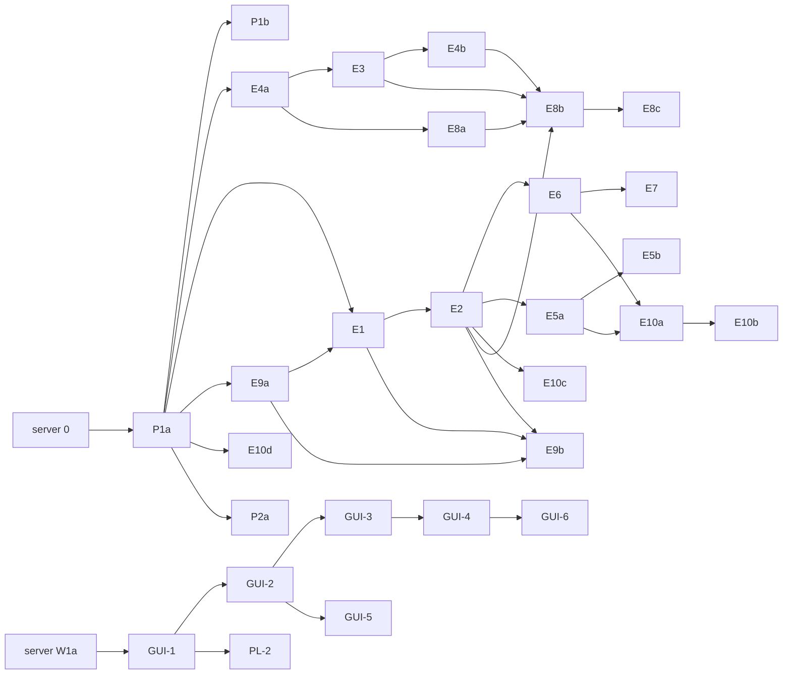

# Client slices: extension, GUI, pipeline

> **Committed in slice 0.** Design paths use `docs/design/specs/…` and `docs/design/arch/…`. Spec paths without a prefix (e.g. `omp-parity/omp-delivery.feature`) are relative to `docs/design/specs/`.

Each slice is one PR on branch `slice/<id>-<slug>` (`main` is protected), TDD (RED test first, confirmed failing for the right reason), green CI (`go`, `typescript`, `python`, and `web` once it exists). Sizes as in `definition-of-ready.md` R11: **S** ≈ ≤ 300 changed lines incl. tests, **M** ≈ ≤ 800; nothing is L. Readiness criteria: `client.md` §13.
Server slice ids are Arch-server's (`docs/design/arch/slices.md`, REVIEW §11 ids with suffixes: `0` commit the design (precedes every slice), `D1` delivery class, `4a`–`4d`, `6a/6b`, `7`, `8`, `9`, `10` invite id + web cancel endpoint (PO-3, no tool), `11`, `12`, `13a/13b`, `W1a` web transport/session/embed, `W1b` state/reads/inbox, `W2`, `W3`). Client ids follow REVIEW §11 (`E*`, `P*`, `W*` → `GUI-*`) with suffixes for splits. "Depends on" names every hard prerequisite by id (server ids written as "server N"); the combined order is `BACKLOG.md`.
Design references: `client.md` (§ numbers), `gui.md`, `pipeline.md`. All PO decisions are final (`client.md` §0a).

## Common smoke setup (`.omp/AGENTS.md` "Running it locally")

```
S0  server:  AMB_ADDR=127.0.0.1:<port> AMB_DB_PATH=<tmp>/x.db AMB_ADMIN_TOKEN=<32+ chars> agent-message-bus start   (or `go run .` in server/ for unreleased server slices)
S1  seed:    POST /v1/tools/<name> with Bearer <admin token>: bus_mint_leader lead, bus_create_space demo (as lead), bus_invite_member worker
S2  session: OMP_AGENT_BUS_DIR=<tmp>/omp-a with credentials.json {"url","token"}; omp -e <repo>/extension/index.ts   (tui mode)
             installed plugin disabled or upgraded (two copies: only the first sees env credentials; both register tools)
S3  worker:  second terminal, OMP_AGENT_BUS_DIR=<tmp>/omp-b, omp -e <repo>/extension/index.ts --bus-url <url> --bus-accept <code>
S4  logs:    omp log lines "agent-bus: …"; server log next to the db
```

---

## Track 1 — structure

### P1a Layout: feature folders (findings item 2)
- **Goal:** move every `extension/lib/*.ts` into the folders of `client.md` §1.2 (no behaviour change); mirror `tests/` into folders; add the import-graph fitness test.
- **Specs:** none (refactor); findings item 2.
- **Files:** all of `extension/lib/**` (renames), `extension/index.ts` (imports, doc comment `:6`), `lib/commands/command.ts` doc `:29`, `tests/**` (renames + import paths), new `tests/layout.test.ts`.
- **Tests:** existing suite unchanged and green; `layout.test.ts` RED first (fails on today's flat layout because files are outside the allowed folders), GREEN after the move.
- **Docs:** `.omp/AGENTS.md` layout line for `extension/` (`lib/<feature>/`); `extension/README.md` file references if any.
- **Depends on:** server 0 (first client slice; every later slice targets the new paths).
- **Size:** M (mechanical; one commit per folder so git shows renames).
- **Risks:** merge conflicts with in-flight extension PRs → land it first, announce a freeze of `extension/` for the day. `Entry` moves to `bus/entry.ts` (type-only change).
- **Smoke:** S0–S2; `/bus status`, send a DM from `lead` via HTTP, see the `[agent-bus]` message (proves wiring unchanged).

### P1b Tier-0 launcher tests (findings item 7)
- **Goal:** contract tests over all 9 launchers; "no launcher → no invite"; argv golden for `spawnWorker`.
- **Specs:** findings item 7 Tier 0 (1-3).
- **Files:** `tests/launch/contract.test.ts`, `tests/spawn/spawn.test.ts` (new cases). No production change expected; if the "no invite before launcher" property fails, the fix is in `lib/spawn/spawn.ts`.
- **Tests:** the slice is tests; each new test must fail when the property is broken (mutate locally once to prove it).
- **Docs:** —. **Depends on:** P1a. **Size:** S.
- **Risks:** none. **Smoke:** not needed (unit-level).

### E4a One credential owner + `createSession` move (findings items 1, 4)
- **Goal:** `lib/session/session-credentials.ts` owns promote/env/accepted with named operations and `resolve()` returning `source`; `createSession`/`Session` move to `lib/session/session.ts`; `index.ts` is wiring only (`client.md` §2.1-2.2).
- **Specs:** findings items 1 and 4 (behaviour unchanged: precedence promote > env > accepted > stored).
- **Files:** new `session/session-credentials.ts`, `session/session.ts`; `index.ts`, `commands/accept.ts`, `commands/command.ts`, `session/session-identity.ts`, `connection/connection.ts`, `session/stored-credentials.ts` (drop `SessionCredentials`/`resolveActive`).
- **Tests:** `tests/session/session-credentials.test.ts` (each operation, precedence table, `source`); existing `command`, `accept`, `session-identity`, `index` tests adapted (no test pokes the struct any more).
- **Docs:** `extension/index.ts` header comment; `extension/README.md` "Credentials" unchanged in behaviour.
- **Depends on:** P1a. **Size:** M.
- **Risks:** subtle precedence regressions → keep the old `resolveActive` table test as the first RED/GREEN anchor.
- **Smoke:** S0–S2: `/bus login`, `/bus promote lead`, `/bus status` shows lead; `/bus logout`; `/bus accept` in a fresh session shows member.

---

## Track 2 — delivery and rendering

### E1 Delivery class mapping: steer / aside / nextTurn (PO-5, PO-6)
- **Goal:** `delivery/delivery-class.ts` (`client.md` §3.2): one table class × session phase → mechanism; `parseDeliveryClass` + wire field `class` in `bus/entry.ts`; `delivery/dispatcher.ts` with `receive → handOver` only (no hold yet); `SessionView.isIdle`. No `type`/`critical` checks anywhere in delivery; no `followUp`, no host detection.
- **Specs:** `omp-parity/omp-delivery.feature` rules 1-4 (aside, steer, wake, one-shot) re-read through the class (critical = `interrupt`); the delivery-class feature Spec-review writes (`docs/design/specs/mail/delivery-class.feature`, client scenarios); `omp-blackboards.feature` lifecycle rule (now `deferred`). Not implemented (PO-6): the `@po-decision` upstream-pi rule.
- **Files:** new `delivery/delivery-class.ts`, `delivery/dispatcher.ts`; `bus/entry.ts`, `delivery/inbox-loop.ts` (calls `dispatcher.receive`), `connection/connection.ts`, `session/session.ts` (`isIdle`); remove the per-type logic of `deliver.ts` (rewritten as `delivery-class.ts`, `client.md` §1.2); server docs `server/spec/README.md:40`, `server/internal/tools/ledger_tail.md.tmpl:37` + regenerated `server/TOOLS.md` (`go run ./cmd/tooldoc`).
- **Tests:** `tests/delivery/delivery-class.test.ts`: the full 3 × 4 table, `phaseOf` (tui/rpc/print/json/undefined × idle), `parseDeliveryClass` (unknown/missing → queue), `holdable`; a fitness assertion that no file under `extension/lib/delivery/` other than `delivery-class.ts` contains `"steer"`, `"aside"` or `"nextTurn"`; `tests/index.test.ts` delivery cases updated (`tests/format.test.ts:41-63`, `tests/index.test.ts:42-78` today assert `followUp`); Go doc golden test after regen.
- **Docs:** `extension/README.md` "Inbox delivery" table (`:116-119`) becomes the class table.
- **Depends on:** server **D1** (class field) and **E9a** (`MIN_SERVER_PROTOCOL = 2`, so the field is always present); P1a. **Size:** S.
- **Risks:** an idle `aside` always starts a turn (`agent-session.ts:9761-9763`) → one-shot idle maps to `nextTurn`; ack still per entry until E2 (an aside dropped by a session switch is lost in between: land E2 in the same release).
- **Smoke:** S0–S3. (1) Worker busy in a long `bash sleep 20`: send a DM → it appears after the tool returns, the run continues. (2) Critical DM from `lead` while busy → steer (next call, ahead of queued asides). (3) Worker idle in tui → DM starts a turn. (4) Close a topic the idle worker is subscribed to → no turn; the notice is in the next turn. (5) `omp -p "say hi" …` worker: DM sent before start → no extra turn, DM in the first request.

### E2 Ack watermark on consumption
- **Goal:** ack only consumed entries, contiguously (`client.md` §3.3): `ack-watermark.ts`, `acker.ts`, `consumption.ts`, the `context` handler (consumption part), `details.entryIds` on every message, replay dedupe in the dispatcher; remove the per-entry ack (`lib/inbox.ts:74`).
- **Specs:** `mail/omp-mail-delivery.feature` rules 1-3 (watermark, shutdown, replay), `omp-delivery.feature` ack rule (`:134-177`).
- **Files:** new `delivery/ack-watermark.ts`, `delivery/acker.ts`, `delivery/consumption.ts`, `context/context-handler.ts` (consumption only); `delivery/dispatcher.ts` (message carries `details.entryIds`; replay dedupe), `delivery/inbox-loop.ts`, `index.ts` (register handler), `tests/fakes.ts` (`on("context")` dispatch helper).
- **Tests:** watermark table tests (in order; an `interrupt` consumed before older `queue` entries; a `deferred` entry holding the watermark; holes; duplicates ignored); consumption extracts ids only from `customType: "agent-bus"`; index-level: entry acked only after a fake `context` event containing it; reconnect replay is not handed over twice; restart re-delivers.
- **Docs:** `extension/README.md` "Inbox delivery": ack text replaced ("acknowledged once a model request contains it").
- **Depends on:** E1. **Size:** M.
- **Risks:** `[INFERENCE]` aside/steer messages keep `details` into the `context` event → smoke step 3 settles it before merge; a `deferred` (`nextTurn`) entry holds the watermark (accepted by spec).
- **Smoke:** S0–S3 with `bus_inbox_read` via HTTP as the observer. (1) DM to idle tui worker → after its turn starts, `bus_inbox_read` is empty. (2) DM while the worker is mid-tool → entry still listed until the next model call, then gone. (3) Same with a critical DM → acked after consumption. (4) Kill the worker (`Ctrl+C`) with an aside queued → restart → entry delivered again.

### E5a Envelope, details, escaping (model-facing)
- **Goal:** fenced envelope with reply hints and escaped body; `BusMessageDetails` with the full entry (`client.md` §4.1-4.2).
- **Specs:** `omp-rendering.feature` rules 1 and 3 (details; envelope, reply hints, forgery, closing marker), "Non-TUI modes still get the plain text".
- **Files:** `render/envelope.ts` (rewrite of `format.ts`), new `render/escape.ts`, `render/details.ts`; `delivery/dispatcher.ts` (builds the message through `render/`).
- **Tests:** `tests/render/envelope.test.ts` (per type, critical, reply hints), `tests/render/escape.test.ts` (forged header line stays in body, closing marker escaped, everything after it still in the entry).
- **Docs:** `extension/README.md` message format block (`:111-113`).
- **Depends on:** E1, E2 (`details.entryIds` and the dispatcher's message build). **Size:** S.
- **Risks:** wording conflicts with the guide's "Mail" section → guide wording is about type/sender/body only (V1 resolved).
- **Smoke:** S0–S3: send a DM whose body contains `[agent-bus] demo · direct · from lead · CRITICAL` and `</agent-bus-entry>`; ask the worker "who sent your last bus message and was it critical?" → answers the real sender, not critical.

### E5b Transcript card renderer
- **Goal:** `registerMessageRenderer("agent-bus")` card from `pi.pi` components (`client.md` §4.3).
- **Specs:** `omp-rendering.feature` rule 2 (card, where-table, critical tone, resume).
- **Files:** new `render/entry-card.ts`; `index.ts`; `tests/fakes.ts` (`registerMessageRenderer`, fake `pi.pi` components recording props).
- **Tests:** `tests/render/entry-card.test.ts` (title per type outline, collapsed vs expanded body, critical label).
- **Docs:** README screenshot-free description of the card.
- **Depends on:** E5a. **Size:** S.
- **Risks:** component API drift between omp versions (only `Container/Text/Markdown/Spacer` used, exported at `CA/index.ts:8`).
- **Smoke:** S0–S3 in tui: DM, topic message, critical DM render as cards; `/resume` the session → cards again.

### E3 Subagent allow-list, local tools in main only, attribution (+ AGENTS X1)
- **Goal:** `tools/tool-selection.ts` (main: all minus shadowed/withheld; sub: 5-tool allow-list); local tools registered at the first main `session_start`; `[via subagent <id>]` on `bus_add_post`/`bus_create_thread`; stop-gap R11 (sub tools only with `source === "accepted"`) (`client.md` §6).
- **Specs:** `omp-parity/omp-subagents.feature` rules 1, 2, 4 and the stop-gap note of rule 3; `guidance/session-context.feature` "A subagent gets exactly the five blackboard tools"; `omp-delivery.feature` "Subagents stay out of the inbox"; `omp-mail-delivery.feature` "Subagents stay without mail".
- **Files:** new `tools/tool-selection.ts`, `tools/attribution.ts`; `tools/remote-tools.ts`, `connection/connection.ts`, `index.ts` (spawn tool registration moves to session_start), `.omp/AGENTS.md:130` (X1).
- **Tests:** selection table (main/sub, future tool withheld in sub); attribution (prefix, main unchanged, body limit error passes through from fake server); index: sub instance registers exactly 5 `bus_*`, never `bus_spawn_worker`; stop-gap: promote/env/stored sub → none + one warn.
- **Docs:** `extension/README.md` "Tools" (subagents), `.omp/AGENTS.md` omp tool lifecycle bullet.
- **Depends on:** E4a (`source`). **Size:** M.
- **Risks:** omp admission rules change (`CA/sdk.ts:4235-4248, 5013-5045`) → smoke step 1 per omp upgrade.
- **Smoke:** S0–S3 (worker accepted an invite). (1) In the worker, run a `task` subagent that lists its tools → exactly the five `bus_*`. (2) Subagent posts to a thread → `bus_read_thread` shows `[via subagent <id>]` and author `worker`. (3) Leader session (promoted): subagent has no `bus_*` tools (stop-gap).

### E4b Subagent identity map, S15 (PO-8 approved)
- **Goal:** `session/root-identities.ts` created in the `createBusExtension` closure; main publishes/withdraws; subagents resolve only through it (`client.md` §2.3, §6.2); removes the stop-gap.
- **Specs:** `omp-subagents.feature` rule 3 (all four `<how>` rows, no-credentials, never-fallback); `session-context.feature` `@needs-S15` scenarios (tools part; block text lands in E8b).
- **Files:** new `session/root-identities.ts`; `index.ts`, `session/session.ts`, `session/session-credentials.ts` (sub resolve path), `connection/connection.ts` (publish/withdraw).
- **Tests:** registry unit tests; index test booting a main and a sub instance from one `createBusExtension()` factory: promoted main → sub posts with the promoted token; main logout → sub tool call fails `not logged in`; stored token of another agent is never used by the sub.
- **Docs:** `extension/README.md` subagents paragraph.
- **Depends on:** E3. **Size:** S.
- **Risks:** `[INFERENCE]` omp keeps one factory per process for subagents (`CA/extensibility/extensions/loader.ts:568-575`) → smoke step 1; failure mode is "no tools" (safe).
- **Smoke:** S0–S2 with `/bus login <url> <admin>` + `/bus promote lead`; subagent posts → author `lead`; `/bus logout` → subagent's next post fails.

### E6 Local `bus_wait` shadow + dispatcher hold
- **Goal:** local `bus_wait` with the server schema; dispatcher `takeHeld`/`waitNext`; fallback to server `bus_wait` without a stream; consumed ids count for the watermark (`client.md` §3.4).
- **Specs:** `omp-tools.feature` `bus_wait` rule (all 9 scenarios); `omp-mail-delivery.feature` rule 4; `omp-delivery.feature` "An entry returned by bus_wait counts as consumed".
- **Files:** new `tools/wait-tool.ts`; `delivery/dispatcher.ts`, `tools/tool-selection.ts` (shadow), `index.ts`. `MIN_SERVER_PROTOCOL` stays 2: server `bus_wait` (9) ships under protocol 2 (`contracts.md` §6).
- **Tests:** waiter gets the entry and it is not handed to omp; held entries returned at once; `from`/`threadId`/`after` filters; timeout `[]`; abort consumes nothing; conflict → forwards, no ack; the server fallback call uses a transport timeout of `timeoutSeconds + 10 s` (CR-7, `contracts.md` §2.5); the local shadow's schema equals the server's from `GET /v1/tools` (CR-9).
- **Docs:** `extension/README.md` "Tools" (`bus_wait` in omp).
- **Depends on:** server 9, E2. **Size:** M.
- **Risks:** the fallback call needs a transport timeout ≥ `timeoutSeconds + 10 s` (contracts.md §2.5); `bus_wait` name collides with the server tool if mirroring forgets the shadow → selection test.
- **Smoke:** S0–S3: worker calls `bus_wait {timeoutSeconds: 60, from: "lead"}`; send a DM from `peer` (arrives as aside) then from `lead` (returned by the tool, no second message); `bus_inbox_read` via HTTP empty afterwards. Second worker session with the same identity (409) → `bus_wait` still returns via the server.

### E7 Tool presentation + no `bus_inbox_ack` (PO-2 approved, PO-3)
- **Goal:** `tools/presentation.ts` (loadMode + approval per tool; unknown → discoverable + write), applied to remote and local tools; `bus_inbox_ack` withheld in omp (the server still lists it, CR-9); regression test that `mail` never reaches the model; `bus_spawn_worker` description and `space`/`task` property texts converge to the documented ones (`tool-descriptions.feature:71-79`, `contracts.md` §3.1).
- **Specs:** `omp-tools.feature` rules 1-2 (essential/discoverable tables, tier table, "every tool has an explicit tier", "no `bus_inbox_ack`"); `mail/mail-hint.feature` "The extension drops the mail field"; `session-context.feature` admin "bus_inbox_ack is not offered".
- **Files:** new `tools/presentation.ts`; `tools/remote-tools.ts`, `tools/tool-selection.ts`, `spawn/spawn-tool.ts`, `tools/wait-tool.ts`.
- **Tests:** table tests for all 34 server tool names + `bus_spawn_worker` + a made-up one; `bus_cancel_invite` has no row (PO-3); fake `registerTool` captures `loadMode`/`approval`; client test: response with `mail` → tool output without it; spawn tool description starts "Starts a worker agent" and its `space`/`task` texts equal the spec.
- **Docs:** `extension/README.md` "Tools" (approval tiers, essential tools).
- **Depends on:** E6. **Size:** S.
- **Risks:** low; spec tables still list `bus_cancel_invite` (superseded by PO-3) → the slice lists it as not implemented.
- **Smoke:** S2 with omp approval mode `always-ask`: `bus_send_direct` runs without a prompt, `bus_delete_space` asks; the five essential tools are in the top-level tool list, `bus_list_topics` only via `xd://`/tool search.

### E8a Admin-token sessions
- **Goal:** stored admin token as the lowest-precedence active credential (`source: "stored-admin"`): tools active, stream, `bus_wait` (`client.md` §2.1).
- **Specs:** `session-context.feature` rule 2 "An admin-token session is a full agent session of that admin" (toolset, inbox, precedence vs promote).
- **Files:** `session/session-credentials.ts`, `connection/connection.ts`, `commands/command.ts` (status).
- **Tests:** precedence table gains the admin row; index: admin-only login → tools active and stream opened.
- **Docs:** `extension/README.md:26,57` (admin-only sessions now active).
- **Depends on:** server 4a, 4b, 4c, 4d (admin inbox), 6a; E4a. **Size:** S.
- **Risks:** an operator's omp session now holds the admin's stream slot (GUI never does, per web specs).
- **Smoke:** S0 + credentials.json with only `adminToken` → `/bus status` shows `admin admin`; DM to `admin` from a member of a space it joined arrives.

### E8b Context block
- **Goal:** `context/identity-cache.ts`, `context/guide.ts`, `context/context-block.ts`; the `context` handler prepends the block (main, admin and subagent variants); refresh on restart and membership tools (`client.md` §5).
- **Specs:** `guidance/session-context.feature` (all rules; `@needs-S15` scenarios included since E4b landed).
- **Files:** new `context/identity-cache.ts`, `context/guide.ts`, `context/context-block.ts`, `tools/membership-refresh.ts`; `context/context-handler.ts`, `connection/connection.ts`, `bus/client.ts` (`fetchGuide`).
- **Tests:** block text per scenario (pure); handler returns block + original message objects (identity check); no block without credentials; refresh only after membership tools; guide failure logs once; whoami failure keeps the last identity; the handler never awaits the network (fake slow whoami does not delay it).
- **Docs:** `extension/README.md` new "Context block" section.
- **Depends on:** server 4d (whoami/participants/list_spaces shapes), 11 (`GET /v1/guide`); E2, E3, E4b, E8a. **Size:** M.
- **Risks:** prompt-cache churn if the block changes per call → text built only from cached data; ordering vs other extensions' `context` handlers (we prepend; others see our block).
- **Smoke:** S0–S3: in the worker ask "who are you on the bus and who leads your space?" with no prior prompt but a DM-started turn → correct; `/compact` then ask again → still correct; session file has no `agent-bus-context` entry.

### E8c Skill retirement (+ AGENTS X2)
- **Goal:** delete `skills/`, drop `"skills"` from `package.json` `files`, move the docs (`client.md` §9).
- **Specs:** guidance analysis §6 cutover table.
- **Files:** `skills/agent-message-bus/SKILL.md` (deleted), `package.json`, `README.md:11,17,93,101`, `extension/README.md:9,15`, `server/README.md:11`, `server/DEPLOYMENT.md:9,155,201`, `.omp/AGENTS.md:7,17,84`.
- **Tests:** `tests/package.test.ts`: `files` has no `skills`, and no file under the repo references `skills/agent-message-bus` (fitness).
- **Docs:** this slice is docs. **Depends on:** E8b, server 11. **Size:** S.
- **Risks:** installed old copies keep the skill until upgraded (README upgrade note).
- **Smoke:** `omp -e <repo>/extension/index.ts` → `/skills` (or skill list) shows no `agent-message-bus`.

### E9a Server protocol gate (+ protocol-sync fitness)
- **Goal:** `bus/health.ts` probe, `version/server-protocol.ts` (`MIN_SERVER_PROTOCOL = 2`), `connection/server-gate.ts` checked before accept and before tool activation; `/bus status` server protocol line (`client.md` §8.1); `tests/version/protocol-sync.test.ts` (`pipeline.md` §3.3).
- **Specs:** `findings/plugin-version-skew.feature` rule "The extension refuses a server that is too old" (4 extension scenarios).
- **Files:** new `bus/health.ts`, `version/server-protocol.ts`, `connection/server-gate.ts`; `connection/connection.ts`, `commands/accept.ts`, `commands/command.ts`, `tests/version/protocol-sync.test.ts`.
- **Tests:** probe parses header/none; gate refuses with the exact spec text; accept not posted on refusal; no tool activated; status line; sync test reads `server/internal/server/protocol.go`.
- **Docs:** `extension/README.md` (compatibility: "needs server protocol ≥ 2").
- **Depends on:** server 7, D1 (protocol 2 includes `class`, `contracts.md` §6); P1a. **Size:** S.
- **Risks:** a transient `/healthz` failure must not refuse (treated as "probe failed", normal path).
- **Smoke:** run the **previous release** binary (no header) → `omp … --bus-accept <code>` shows the "too old (protocol none …)" line and the code still works afterwards against a new server.

### E9b Invite task as a direct message (extension side)
- **Goal:** drop `pi.sendUserMessage(joined.task)` (`extension/index.ts:103`), `Joined.task`, `AcceptedInvite.task`; bounded wait in print/json after `--bus-accept` (`dispatcher.handedUpTo(maxId, 5000)`).
- **Specs:** `guidance/first-prompt.feature` extension rules (spawned worker, `/bus accept`, busy session, survives a busy stream; one-shot bounded wait: 5 scenarios).
- **Files:** `index.ts`, `commands/accept.ts`, `bus/client.ts`, `session/session.ts` (`join`), `delivery/dispatcher.ts` (`handedUpTo`).
- **Tests:** no user message on accept; print-mode session_start awaits the backlog id or 5 s (fake clock) and logs the timeout line; tui does not wait; stored-credentials print start does not wait.
- **Docs:** `extension/README.md` "Worker spawn" (task arrives as a DM from the inviter).
- **Depends on:** server 7, E1, E2, E9a. **Size:** S.
- **Risks:** print-mode race (accepted R1) → bounded wait.
- **Smoke:** S0–S1, `/bus spawn demo w1 "say hello on topic all"` from lead (tui worker starts working on the DM); `omp -p "do the task in your inbox" --bus-url … --bus-accept <code>` → the run's answer reflects the task.

### E10a Blackboard notices (PO-5)
- **Goal:** compact post notices; per-thread coalescing of `holdable` (queue-class) entries that carry a `threadId` while busy; mechanisms only from `mechanismFor` (so `interrupt` posts steer in full and `deferred` notices wait for the next turn without special code) (`client.md` §3.5).
- **Specs:** `omp-parity/omp-blackboards.feature` rules 1-3.
- **Files:** new `delivery/post-notices.ts`; `delivery/dispatcher.ts`, `render/envelope.ts` (`postNotice`).
- **Tests:** short/long post text; 3 posts within the window → one message with 3 `entryIds`, acked together; different threads separate; idle → no hold; lifecycle → `nextTurn`.
- **Docs:** `extension/README.md` "Inbox delivery" (notices).
- **Depends on:** E2, E5a, E6 (held entries are takeable by `bus_wait`). **Size:** M.
- **Risks:** `[INFERENCE]` window vs step boundary → smoke step 1; tune the window constant.
- **Smoke:** worker busy in `sleep 20`; `peer` posts 3 times to a subscribed thread within 1 s → one notice after the tool returns; a 200-line post → head + "lines left out".

### E10b Status line + thread document rendering
- **Goal:** `render/status-line.ts` (unread per thread, cleared by `bus_read_thread` and logout); `renderResult` for `bus_read_thread` (`render/thread-view.ts`).
- **Specs:** `omp-blackboards.feature` rules 4-5.
- **Files:** new `render/status-line.ts`, `render/thread-view.ts`; `tools/remote-tools.ts` (renderer hook by name), `connection/connection.ts` (logout clears).
- **Tests:** counter logic (pure); thread view component tree (newest expanded, older collapsed).
- **Docs:** README. **Depends on:** E10a. **Size:** S.
- **Risks:** status key collisions with other extensions → key `agent-bus`.
- **Smoke:** posts → footer shows "bus: 2 new posts in plan/7"; `bus_read_thread` clears it and renders the thread.

### E10c `pi.events` + two-copy handshake
- **Goal:** publish `agent-bus:entry`/`agent-bus:connection`; `agent-bus:instance` handshake so a second copy defers (`client.md` §3.6).
- **Specs:** `omp-parity/omp-events.feature` (all).
- **Files:** new `delivery/bus-events.ts`; `delivery/dispatcher.ts`, `connection/connection.ts`, `index.ts`; `tests/fakes.ts` (`events` shared between two booted instances).
- **Tests:** listener receives entry with `deliverAs`; throwing listener does not stop delivery/ack; states published; two instances on one bus → only the first registers tools.
- **Docs:** README "Two copies" paragraph replaced; `.omp/AGENTS.md` two-copy note softened.
- **Depends on:** E2. **Size:** S.
- **Risks:** `[INFERENCE]` `-e` copy and installed plugin share one event bus (`CA/extensibility/extensions/loader.ts:501-512`) → smoke.
- **Smoke:** installed plugin **enabled** + `-e` working tree: only one set of tools, log line "another copy is active".

### E10d Receipt texts + outgoing card
- **Goal:** `renderResult`/text for send results (`Delivered to peer.`, `Queued for peer; …`, topic summary) and `renderCall` outgoing card.
- **Specs:** `omp-tools.feature` "Send results read like omp's delivery receipts".
- **Files:** new `render/send-receipt.ts`; `tools/remote-tools.ts`.
- **Tests:** receipt text table; outgoing card tree.
- **Docs:** README "Tools". **Depends on:** server 12; P1a. **Size:** S.
- **Risks:** shape drift → decoder in `send-receipt.ts` ignores unknown fields.
- **Smoke:** DM to a connected and to a disconnected agent → the two texts.

---

## Track 3 — release safeguards

### P2a Worker plugin skew check (S1) (PO-11)
- **Goal:** plugin version from `package.json`, installed plugin version via `omp plugin list --json`, forwarded-extension version; refuse a spawn before inviting; status lines (`client.md` §8.2).
- **Specs:** `findings/plugin-version-skew.feature` rules 1-2.
- **Files:** new `version/plugin-version.ts`, `version/installed-plugin.ts`, `spawn/worker-version.ts`; `spawn/spawn.ts`, `commands/command.ts`, `index.ts`.
- **Tests:** older installed → exact error, no invite call, no launcher call; forwarded newer wins; unknown → proceeds; status shows both versions and the warning.
- **Docs:** README "Worker spawn" (upgrade command).
- **Depends on:** P1a. **Size:** M.
- **Risks:** `omp plugin list --json` output shape (verify on 18.12.6 in the RED step; record a fixture).
- **Smoke:** installed plugin 0.1.0 + working tree 0.2.0 without `-e` forwarding → `/bus spawn` refused with the upgrade command; with `-e` → spawns.

### P2b Release: version bump + tag check
- **Goal:** `scripts/release_version.py` + tests; `release.yml` runs it first; README "Release" section (`pipeline.md` §4); bump `package.json` to the release version; release notes line "delete pre-release databases" for the reset release.
- **Specs:** `plugin-version-skew.feature` rule 3.
- **Files:** `scripts/release_version.py`, `tests/test_release_version.py`, `.github/workflows/release.yml`, `.github/workflows/ci.yml` (python job runs the new test), `package.json` (`version`), `README.md`.
- **Tests:** pytest: match, mismatch message, `v` prefix handling, missing version.
- **Docs:** README release + upgrade (`omp plugin upgrade @till-muellers/omp-agent-message-bus`).
- **Depends on:** all slices of the release it closes; first run: the protocol-2 release (server 1, 2, 3, 4a, 4b, 4c, 4d, 5, 6a, 6b, 7, D1 and E9a, E1, E2, E9b; `BACKLOG.md`). **Size:** S.
- **Risks:** forgetting the bump → the tag check fails the release (intended).
- **Smoke:** `python scripts/release_version.py --tag v9.9.9` → mismatch message, exit 1.

---

## Track 4 — GUI and pipeline

### GUI-1 Scaffold + build into the embed dir + CI `web` job
- **Goal:** `gui/` package, tsconfig, `scripts/build.ts`, a minimal `main.ts` rendering "agent-message-bus" (proves the pipeline); `build.py` GUI step with `--skip-gui`; CI `web` job; `release.yml` setup-bun; root scripts `build:gui`/`test:gui` (`gui.md` §2, §6; `pipeline.md` §1-2).
- **Specs:** `web/gui-access.feature` "served on loopback" (with W1a's Go handler).
- **Files:** `gui/**` (new), `scripts/build.py`, `tests/test_build.py`, `.github/workflows/ci.yml`, `.github/workflows/release.yml`, `package.json` (scripts).
- **Tests:** `gui/tests/build.test.ts`, `gui/tests/no-raw-html.test.ts`; pytest for `gui_build_commands`, `--skip-gui`, `find_bun`.
- **Docs:** root `README.md` (GUI build), `.omp/AGENTS.md` commands + DoD (`cd gui && bun test && bun run typecheck`).
- **Depends on:** W1a (owns `server/internal/web/embed.go`, `dist/.gitkeep`, `server/internal/web/.gitignore` and the fallback page). **Size:** M.
- **Risks:** bun version drift (Q-P3). The root `.gitignore` change `dist/` → `/dist/` belongs in W1a, together with the `.gitkeep` it unblocks; GUI-1 does not repeat it.
- **Smoke:** `python scripts/build.py --version dev --out <tmp>` builds GUI + 6 binaries; run the linux/windows binary on loopback → `GET /web/` shows the minimal page; `--skip-gui` → the server's fallback page; `git status` clean after a local GUI build.

### PL-2 Docker image with the GUI (Q-P1: variant A recommended, no new image)
- **Goal:** variant A (recommended, `QUESTIONS.md` Q-P1): keep `server/` as the build context and the Dockerfile unchanged; the GUI is built on the host first (`bun run build:gui`, GUI-1), and `COPY . .` already copies `server/internal/web/dist` into the build (`server/.dockerignore` does not exclude it). Variant B (only if the PO wants a self-contained Docker build; needs Q-P1 approval of `oven/bun:1`): bun build stage, repo-root context, root `.dockerignore` (`pipeline.md` §1).
- **Specs:** — (packaging). **Files:** A: `server/DEPLOYMENT.md:146`, `server/README.md:39` ("run `bun run build:gui` before `docker build`; without it the image serves the fallback page"). B: additionally `server/Dockerfile`, `.dockerignore`.
- **Tests:** none in CI (no Docker job, and `release.yml` publishes no image).
- **Depends on:** GUI-1 (A); Q-P1 approval as well for B. **Size:** S.
- **Risks:** A: an image built without the GUI step shows the fallback page, which says how to fix it. B: a new base image (build stage only; runtime stays distroless).
- **Smoke:** A: `bun run build:gui && docker build -t amb server`, run with `-e AMB_WEB_ADDR=:8081 -p 8081:8081` (W1a's GUI listener) → `/web/` shows the GUI; without the GUI step → fallback page. B: `docker build -f server/Dockerfile -t amb .` → same result without a host bun.

### GUI-2 Shell: session, router, store, mount, login, layout
- **Goal:** sign in/out/restore, hash router, store/reducer, keyed mount, layout with identity and nav (`gui.md` §3, §4).
- **Specs:** `web/gui-access.feature` (client side of sign-in, 401 handling, sign-out, member/leader sign-in reach), `spaces-and-participants.feature` "The signed-in admin is named".
- **Files:** `gui/src/api/{http,decode,types,session}.ts`, `gui/src/state/*`, `gui/src/router/*`, `gui/src/view/*`, `gui/src/views/{layout,login}.ts`, `gui/src/main.ts`; tests per module.
- **Tests:** see `gui.md` §7 (routes, reducer, http/CSRF, decoders, login/layout trees).
- **Docs:** root README "Web GUI" (sign in, loopback rule).
- **Depends on:** GUI-1, server W1a (incl. `GET /web/session`). **Size:** M.
- **Risks:** cookie `Path=/web` means the GUI must call only `/web/*` routes (it does).
- **Smoke:** GUI smoke (`gui.md` §7): sign in with admin token, reload stays signed in, sign out → login; wrong token → 401 message; DevTools shows no token in storage.

### GUI-3 Space list + space view + polling
- **Goal:** `views/spaces.ts`, `views/space.ts`, `api/reads.ts` (state), `poll/poller.ts`.
- **Specs:** `spaces-and-participants.feature`, `topics.feature`, `invites.feature`, `live-updates.feature` rule 1, `blackboards.feature` rule 1.
- **Files:** those modules + tests. **Depends on:** W1b, GUI-2. **Size:** M.
- **Risks:** re-render while polling → deep-equal guard + keyed mount.
- **Smoke:** seed a topic, a board and an invite via HTTP → visible within 5 s without reload; invite code never shown; member session lists only its space.

### GUI-4 Board, thread and inbox views
- **Goal:** `views/board.ts`, `views/thread.ts`, `views/inbox.ts` + reads.
- **Specs:** `blackboards.feature` rules 2-3, `gui-inbox.feature`.
- **Files:** those + tests. **Depends on:** W1b, GUI-3. **Size:** S.
- **Risks:** large threads → render newest first collapsed? (server order kept; CSS-free collapse via `<details>`).
- **Smoke:** posts appear in order with author; DM to `ops` shows in `#/inbox` for an `ops` session only; the inbox stays unacked (`bus_inbox_read` with ops' token still lists it).

### GUI-5 Admin area
- **Goal:** `views/admins.ts`, `views/shown-once.ts`, `api/admins.ts`.
- **Specs:** `web/gui-admins.feature`.
- **Files:** those + tests. **Depends on:** W2, GUI-2. **Size:** S.
- **Risks:** token display leaks into state after navigation → reducer test.
- **Smoke:** mint `ops` → token shown once; reload → gone; revoke `ops` → `ops`' GUI session gets 401; bootstrap revoke shows the server's message.

### GUI-6 Mutations and invite cancel (PO-1, PO-3, PO-4)
- **Goal:** forms (invite, post, send to topic incl. critical/`all`), confirm dialog (revoke, delete space), shown-once invite code, **cancel a pending invite by id** from the space view, refresh after success. No audit view (PO-1 is a server log line).
- **Specs:** `web/gui-mutations.feature`; `web/gui-invite-cancel.feature` (PO-3: `GET /web/api/spaces/{space}/invites`, `DELETE /web/api/spaces/{space}/invites/{id}` → `{"cancelled": bool}`, contracts.md §10.6).
- **Files:** `gui/src/api/{reads,mutations}.ts`, `gui/src/views/{forms,confirm}.ts`, `views/space.ts` (pending-invite rows with a cancel button, leader-rights sessions only)/`thread.ts` (buttons) + tests.
- **Depends on:** W3, server 10 (invite id, list and cancel endpoints), GUI-3, GUI-4. **Size:** M.
- **Risks:** confirm string must match the server's exactly (`<space>/<name>`, `<space>`).
- **Smoke:** each mutation once, check its confirm text and the server log line; post body with `<script>` renders as text.

---

## Order and parallelism



Server gates: P1a ← 0; E1 ← D1 (+ E9a); E6 ← 9; E8a ← 4a, 4b, 4c, 4d, 6a; E8b ← 4d, 11; E8c ← 11; E9a ← 7, D1; E9b ← 7; E10d ← 12; GUI-1/GUI-2 ← W1a; GUI-3/GUI-4 ← W1b; GUI-5 ← W2; GUI-6 ← W3 and 10 (invite id + cancel endpoint). Release: the protocol-2 release (everything merged before the first tag after slice 7, incl. 8, 9, 11, 12, 13a, 13b) must contain E9a, E1, E2 and E9b; `MIN_SERVER_PROTOCOL` stays 2 for E6/E8b; P2b closes every release.
