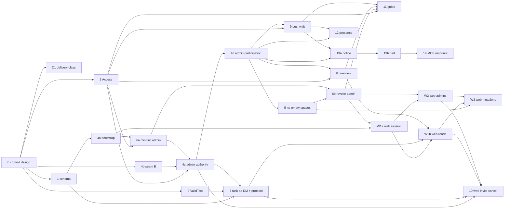

# Server implementation slices

> **Committed in slice 0.** Design paths use `docs/design/specs/…` and `docs/design/arch/…`. Spec paths without a prefix (e.g. `admin/analysis.md`) are relative to `docs/design/specs/`.

Refines `docs/design/specs/REVIEW.md` §11. Ids keep the REVIEW numbers; a split slice gets a letter (4a–4d, 6a/6b, 13a/13b, W1a/W1b); slice `0` commits the design and goes first. Each slice = one branch + one PR, green CI (`go`, `typescript`, `python`), mergeable on its own. Client slices (E*, P*, GUI-*, PL-*) are Arch-client's (`slices-client.md`); they are named here only as consumers. The combined order of all slices is `BACKLOG.md`.

Shared rules for every slice (not repeated below):
- TDD: RED test first (named per slice), then the Gherkin moved into `server/spec/`, then code. Go tests are table-driven, `t.Parallel()` where safe, real SQLite via `internal/platform/db/dbtest.Open`, no sleeps (channels / deadline polling).
- A slice that adds a tool sets the absolute count in `tools/registry_test.go:11`, `rpc/handler_test.go:159`, `spec/transports.feature:54-57,191`, `spec/README.md:21`, `server/README.md:69`, and regenerates `server/TOOLS.md` (`cd server && go run ./cmd/tooldoc > TOOLS.md`; golden test `tools/doc_test.go:9-17`).
- Moving a design feature (`docs/design/specs/<folder>/<file>.feature`) into `server/spec/` means: copy the rules named, drop the PROPOSAL/analysis comments, keep scenario text verbatim, and add the file to the `spec/README.md:65-78` table. New server feature files keep their design-folder names; web files go to `server/spec/web/` [AD-11]. The design copy is a frozen input (slice 0) and is not edited when rules move.
- Contracts are in `contracts.md`; signatures in `server.md` §3.

## Order and dependency graph

Deviations from REVIEW §11, with reasons:
- **4 is split into 4a/4b/4c/4d** (L → four ≤ M), following `admin/analysis.md:287`.
- **6 is split into 6a (mint/list, endpoint guard) and 6b (revoke)** and **6a moves before 4c**: every admin feature file's Background is "the bootstrap admin minted admin ops" (`admin-role.feature:39`, `admin-messaging.feature:34`, `no-empty-spaces.feature:27`), so the scenarios of 4c/4d/5 can be moved verbatim only once `bus_mint_admin` exists. A minted admin token already authenticates as kind `admin` through `lookupToken` (`auth/repository.go:13-26`) once 4a lands. Counts: 31 after 6a, 32 after 6b.
- **7 depends on 4c** (not just 4): the inviter scenarios include admins "ops" and "admin" (`first-prompt.feature:47-50,95-98`), and admins may invite only from 4c.
- **8 and 9 depend on 4d**: overview `you.role "admin"` and admins' mailboxes need admin participation.
- **W1 is split** into session/transport (W1a) and reads (W1b); W1a needs 6b for "revoking an admin ends its sessions" (`gui-access.feature:120-125`).
- **New slice D1 (delivery class, PO-5)**, depends only on 0, merged early and in the protocol-2 release so the omp extension (E1) can rely on `class`.
- **10 is no longer a tool (PO-3)**: it becomes the GUI's invite cancel by id (migration + service + web endpoint) after W2 (CSRF) and W1b (pending list); the registry ends at 34. It has no ordering relation to 13a: migration numbers are assigned at merge time (`schema.md` §2).
- **New slice 0 (commit the design)** goes before everything: `tmp/` is gitignored, so DoR R2/R4 and every slice would otherwise point at files no reviewer can see. Every other slice depends on it (directly for the roots D1, 1, 2, 3, 4b).
- The graph above lists hard dependencies exactly as the slices' "Depends on" lines.

---

## Slice 0 — Commit the design (goes first)

- **Goal:** the design inputs become tracked files on `main`, so DoR R2/R4, the slice descriptions and every PR can link to committed paths: `tmp/specs/**` → `docs/design/specs/**`, `tmp/arch/**` → `docs/design/arch/**` (`definition-of-ready.md` §1).
- **Spec moved:** none (no behaviour change).
- **Files:** `docs/design/specs/**` (copy of `tmp/specs/`: `REVIEW.md` and the folders `admin/`, `findings/`, `guidance/`, `mail/`, `omp-parity/`, `web/`); `docs/design/arch/**` (copy of `tmp/arch/`: `server.md`, `schema.md`, `contracts.md`, `slices.md`, `definition-of-ready.md`, `client.md`, `gui.md`, `pipeline.md`, `slices-client.md`, `QUESTIONS.md`, `BACKLOG.md`); `docs/design/README.md` (new, one paragraph: what the folder holds; `specs/` is the frozen input, behaviour lives in `server/spec/` once a slice moves it; `arch/contracts.md` and `arch/BACKLOG.md` stay living and change only by PR). Inside the copied spec files, `tmp/specs/…` and `tmp/arch/…` references are rewritten to the durable paths **in place, without reflowing lines**, so every `file:line` anchor in the design stays valid. The arch files already use the durable paths; their "Durable path" banner line is replaced by one line "Committed in slice 0." (no line shift). `tmp/TODO.md` is not part of the design and is not copied.
- **Migrations:** —
- **Tests:** none (docs only). Check before merge: `git grep -nE 'tmp/(specs|arch)' docs/design/specs` prints nothing; in `docs/design/arch` only slice 0's own description (this entry, `BACKLOG.md` row 0) names the old location; every `docs/design/…` path named in `docs/design/arch/*.md` exists.
- **Docs:** `.omp/AGENTS.md` layout table gains the row `docs/design/` (X10); root `README.md` unchanged.
- **Depends on:** —. Client: — (every client slice depends on it through `slices-client.md`).
- **Size:** S in review effort (copy + path rewrite); the line count exceeds R11 because it is a verbatim copy of already-reviewed files, recorded as the one R11 exception.
- **Risks:** drift between the frozen specs and `server/spec/` once rules move — the README states which one is authoritative; tmp copies left behind — delete `tmp/specs` and `tmp/arch` locally after merge so nobody edits the stale copy.

## Slice D1 — Delivery class on every inbox entry (PO-5)

- **Goal:** every entry carries `class: "interrupt"|"queue"|"deferred"`, decided only by `inbox.ClassOf(type, critical)`; new entry types declare a class in one table (`contracts.md` §4.1).
- **Spec moved:** `mail/delivery-class.feature` rules `:39`, `:62` → `server/spec/delivery-class.feature` (the invite-task scenario `:57-60` after 7 merges; rule `:75` is client-side → E1); `server/spec/inbox.feature:29-33` entry shape gains `class`; `spec/README.md:63` glossary (Inbox entry → delivery class). The extension wording at `spec/README.md:40` and `ledger_tail.md.tmpl:37` stays with E1 (client), as REVIEW planned. The `bus_wait` row of `:64-73` moves with slice 9.
- **Files:** `inbox/class.go` (new), `inbox/class_test.go` (new), `inbox/entry.go` (`Class` field, json `class`), `inbox/service.go:44-57` (insert sets it), `inbox/repository.go:49-63` (scan sets it), `tools/inbox.go` (result sketch gains `class`), `server/TOOLS.md`.
- **Migrations:** — (derived, [AD-15]).
- **Tests:** `TestClassOf` (table = `delivery-class.feature:45-55`: every type × critical; critical → interrupt; lifecycle types → deferred; others → queue), `TestEveryTypeHasClass` (parses `entry.go` with `go/parser`, collects the `Type` constants, fails on any missing from `classByType` — no production list needed), `TestEntriesCarryClass` (table over `Read`, SSE frame of the stream); `TestStreamDelivery` gains the case "a new connection replays from the lowest unacked id; `Last-Event-ID` is ignored" (CR-8, `contracts.md` §4.2). RED: the field does not exist.
- **Docs:** `server/TOOLS.md`; `server/README.md` inbox section (delivery classes).
- **Depends on:** 0. Client: E1 maps classes (steer/aside/nextTurn); ships in the protocol-2 release with 7 (`contracts.md` §6).
- **Size:** S.
- **Risks:** low; the entry field is `class`, so it does not collide with the receipt field `delivery` of slice 12.

## Slice 1 — Schema reset (+ AGENTS X5)

- **Goal:** one `0001_schema.up.sql` that knows kind/role `admin`; old migration files deleted.
- **Spec moved:** `admin/schema-reset.feature` → `server/spec/schema.feature`, rules `:25` and `:49`, **without** the step "the bootstrap admin "admin" exists" (`:32`, added by 4a).
- **Files:** `server/migrations/0001_schema.up.sql` (new, DDL in `schema.md` §1); delete `0001_init.{up,down}.sql`, `0002_invites.{up,down}.sql`; `server/migrations/schema_test.go` (new, package `migrations_test`).
- **Migrations:** `0001_schema` (reset).
- **Tests (RED first):** `TestSchemaReset` table over (fresh DB → versions {1}; table set = 12 names; `agents.kind` admin ok / owner CHECK error; `participants.role` admin ok / owner error; second `db.Migrate` applies nothing) and `TestLaterMigrationAppliesOnTop` (`fstest.MapFS` = `migrations.FS` files + `0002_example.up.sql`). RED: the admin-kind insert fails on today's `0001_init`.
- **Docs:** `.omp/AGENTS.md:96-97` (X5: one-time reset exception, "irreversible" header convention); `server/README.md`, `server/DEPLOYMENT.md` Upgrade: "Pre-release databases are not upgraded: stop the server and delete `agent-message-bus.db`, `-wal` and `-shm` before starting this version."; `spec/README.md` features row. Release-note line → P2b.
- **Depends on:** 0. Client: — (P2b carries the release note).
- **Size:** S.
- **Risks:** every dev DB must be deleted (accepted K5); someone could mint leader `admin` on a slice-1 server, which makes 4a's bootstrap refuse to start — tell contributors to reset DBs after 4a too.

## Slice 2 — `domain.ValidText` + invite task error

- **Goal:** `invalid "task must be 1..65536 bytes"` for the invite task; body/title messages unchanged.
- **Spec moved:** `findings/invite-task-field.feature` rule `:38` replaces the outline `server/spec/invites.feature:34-42`; rule `:58` is already covered by `direct-messages.feature`/`blackboards.feature` (no duplicate; add a comment pointer).
- **Files:** `domain/text.go`, `domain/text_test.go`, `invites/service.go:56`, `invites/service_test.go:45-46`.
- **Migrations:** —
- **Tests:** `TestValidText` (empty, at limit, limit+1, per field name `body`/`task`); existing `TestValidBody`/`TestValidTitle` unchanged; `invites` `TestCreate` cases "empty task"/"long task" expect the task message and "no invite stored".
- **Docs:** —
- **Depends on:** 0. **Shared code:** `internal/domain` — approved.
- **Size:** S.
- **Risks:** none.

## Slice 3 — `Tool.Access` + purpose-first descriptions (non-admin)

- **Goal:** `Tool.Access` field feeds the TOOLS.md Access column; every description purpose-first with pitfalls; `bus_spawn_worker` documented in TOOLS.md.
- **Spec moved:** `guidance/tool-descriptions.feature` → `server/spec/tool-descriptions.feature`: rule `:13`; rule `:25` rows except `bus_wait` (`:34`, slice 9), `bus_revoke_member` (`:49`, slice 4c) and `bus_delete_space` (`:50`, slice 4d); `:52` critical scenario with the interim text "Leaders only. …" (4c switches to "Leaders and admins only. …"); rule `:71` with interim access "Leaders of the space.". Rules `:55`, `:81` → 4c/4d/8/9; rule `:99` → client E7.
- **Files:** `tools/registry.go` (`Access`), `tools/decode.go` (`define` gains `access`), `tools/doc.go` (index from `Access`; delete `splitDescription`), `tools/{admin,spaces,invites,topics,blackboards,inbox}.go`, `tools/schema.go:51-53`, `tools/ledger_tail.md.tmpl` (spawn-worker entry), `server/TOOLS.md`.
- **Migrations:** —
- **Tests:** `TestEveryToolStatesAccess` (table over `New(Deps{}).List()`: Access non-empty, contained in Description, Description does not start with it or with "Participants only"/"Leaders only"/"Any token"); `TestPitfalls` (table tool → required phrase); `TestLedgerIndexUsesAccess` replaces `TestSplitDescription`; golden `TestToolsLedgerIsCurrent`.
- **Docs:** `server/TOOLS.md` (generated); `spec/README.md` row.
- **Depends on:** 0. Client: the extension's `spawn-tool.ts` description and property texts must converge to the documented text (`tool-descriptions.feature:71-79`; Arch-client, E7); until then TOOLS.md documents the target.
- **Size:** M (string-heavy, little logic).
- **Risks:** touches every tool file → merge it early, before 6a/8/9/10 open their branches; golden-file churn.

## Slice 4a — Bootstrap admin identity (+ AGENTS X7 part 1)

- **Goal:** the instance token authenticates as agent `admin` (kind admin, real id, `Bootstrap: true`); `Build` returns an error; kind-conflict message article-aware.
- **Spec moved:** `admin/admin-tokens.feature` rule `:43` → `server/spec/admin-tokens.feature`; the step `schema-reset.feature:32` into `server/spec/schema.feature`. Rewrite `server/spec/auth.feature` admin rows (admin = bootstrap admin "admin"), `server/spec/spaces.feature` whoami admin row (name "admin", `spaces: []`), `server/spec/local-instance.feature:79-107` wording ("prints the bootstrap admin's token").
- **Files:** `auth/principal.go`, `auth/bootstrap.go` (new), `auth/service.go:31-44,103-113`, `auth/repository.go`, `spaces/whoami.go:26-28`, `server/build.go`, `server/build_test.go:23,174`, `main.go` (handle error; usage line `admin-token`), `mcpserver/server_test.go` (user id `admin:<id>`), `tools/ledger_head.md.tmpl:14-18` (token kinds).
- **Migrations:** —
- **Tests:** `TestBootstrap` (creates once; second call same id; existing leader named `admin` → error), `TestAuthenticateInstanceToken` (Principal fields; after `SetAdminToken` same id), `TestKindConflictArticle` (`agent ops is an admin agent` / `agent lead is a leader agent`), `TestMintLeaderNamedAdmin` (`conflict "agent admin is an admin agent"`), `TestWhoamiAdmin`, `TestBuildBootstrapError`.
- **Docs:** `.omp/AGENTS.md:111-112` (X7 part 1: the instance token is the bootstrap admin `admin`); `server/README.md` tokens section; `spec/README.md:49` glossary (Admin, Admin token).
- **Depends on:** 1. Client: — (E8a later uses the admin name).
- **Size:** M.
- **Risks:** `Build` signature change (K6) — two call sites only; a DB holding a non-admin agent named `admin` refuses to start (clear error message, alpha).

## Slice 4b — Membership seam B (refactor, no behaviour change)

- **Goal:** `Membership.Admin`, `Leads()`, `Joined()`, `RoleAdmin`; every authority site calls `Leads()`.
- **Spec moved:** none (behaviour unchanged; all existing scenarios stay green).
- **Files:** `spaces/membership.go`, `spaces/service.go:95-100`, `messaging/service.go:57`, `messaging/topics.go:79,124`, `blackboards/boards.go:55`, `blackboards/threads.go:108`.
- **Migrations:** —
- **Tests:** `TestMembershipLeadsJoined` (table: leader/member/admin-joined/admin-unjoined); existing package suites unchanged.
- **Docs:** —
- **Depends on:** 0. Client: —.
- **Size:** S.
- **Risks:** none; it is the refactor step that makes 4c a one-line change per site.

## Slice 6a — Mint and list admins; bootstrap-only token swap

- **Goal:** `bus_mint_admin`, `bus_list_admins`, `amb_admin_` minted tokens, audit line "admin minted", `POST /v1/admin/admin-token` bootstrap-only, shutdown any admin. Count **31**.
- **Spec moved:** `admin-tokens.feature` rules `:65`, `:143`, `:238` (mint scenarios), `:268`, `:290` → `server/spec/admin-tokens.feature`; `server/spec/transports.feature:232-246` admin endpoint rows.
- **Files:** `auth/admins.go` (new: `MintAdmin`, `ListAdmins`, `RequireAdmin`), `auth/token.go` (`NewToken(prefix)`), `auth/repository.go` (admin queries), `tools/admin.go`, `admin/handler.go` + `admin/guard.go` (`p.Bootstrap` for token swap), `tools/deps.go`, `server/TOOLS.md`.
- **Migrations:** —
- **Tests:** `TestMintAdmin` (table: non-admin forbidden before name check; invalid name; `admin` reserved; leader/member name conflict; re-mint = 2 tokens same agent; prefix `amb_admin_`), `TestListAdmins` (sorted; bootstrap row tokens 0), `TestAuditLineMint` (slog test handler; no token in record), `TestAdminTokenSwapBootstrapOnly`, `TestShutdownAnyAdmin`, `TestRotateKeepsMintedAdmins`.
- **Docs:** `server/DEPLOYMENT.md` incident playbook (`admin/analysis.md:234`); `server/README.md`; `spec/README.md` glossary (minted admin).
- **Depends on:** 3, 4a. Client: — (E8a admin-token sessions).
- **Size:** M.
- **Risks:** a stolen admin token can now mint durable admins (accepted, mitigated by list/revoke/audit, `admin/analysis.md:234`).

## Slice 4c — Admin authority in every space (+ AGENTS X3)

- **Goal:** resolver admin branch; admins read, send (incl. `all`, critical), post, create topics/boards/threads, close/remove/delete others', invite and revoke members **and leaders** (last leader included) in every space without joining; not auto-subscribed; subscribe requires joining; unjoined admins unreachable.
- **Spec moved:** `admin-role.feature` rules `:46` (minus the two space-list scenarios `:48-59`, → 4d), `:94`, `:141`, `:159` (minus `:193-202`, → 4d), `:232`, `:247` → `server/spec/admin-role.feature`; `admin-messaging.feature` rule `:40` → `server/spec/admin-messaging.feature`; rewrite rows `membership.feature:51,93-95`, `direct-messages.feature:92-94`, `topics.feature:339-341`, `blackboards.feature:28`; `tool-descriptions.feature` rule `:55` rows for these tools, rule `:81` (server side: an admin's invite works; the worker's first entry is from "ops" once 7 lands), pitfall `:49`; critical text "Leaders and admins only. …"; `spec/README.md:59` (Critical glossary).
- **Files:** `spaces/resolver.go` (delete `requireAgent`; admin branch; `requireJoined`), `spaces/service.go:183-200` (`Leave` refuses `!m.Joined()` with `forbidden "not a participant of space X"`, so an unjoined admin never "leaves" silently), `spaces/revoke.go:30-79` (admin may revoke leaders), `messaging/topics.go:52,101-112` + `messaging/repository.go:78` (`all` subscribed only if joined), `blackboards/threads.go:76`, `blackboards/posts.go:39-56`, `tools/*.go` access sentences, `tools/schema.go`.
- **Migrations:** —
- **Tests:** `TestResolveAdmin` (table: unknown space, unjoined → `Admin` true `Role ""`, joined later in 4d); per-feature tables `TestAdminActs{Messaging,Blackboards}`; `TestAdminRevokesLeaders` (incl. last leader → space survives with member; revoked leader's token still authenticates, may re-join); `TestUnjoinedAdminUnreachable` (`not_found "participant ops not in space demo"`, `all` delivers nothing, subscribe → forbidden join first); `TestAuthorityDoesNotLeak`.
- **Docs:** `.omp/AGENTS.md:133` (X3: "Only leaders and admins may send to `all` or send critical messages"); `server/TOOLS.md`.
- **Depends on:** 3, 4b, 6a. Client: —.
- **Size:** M.
- **Risks:** resolver is the single gate for every feature — regression risk mitigated by unchanged leader/member suites; admins posting to threads without being subscribed must not notify themselves (author exclusion stays).

## Slice 4d — Admin participation, lifecycle and inbox

- **Goal:** admins create (join as `admin`, leaderless space), join, leave, delete any space; role `admin` in lists (order admin → leader → member; `SpaceInfo.Admins`; `members` counts members only); whoami lists joined spaces; admins read/ack their inbox and open their stream; admin targets cannot be revoked.
- **Spec moved:** `admin-role.feature` scenarios `:48-59` (space lists with `admins`), rule `:207` + scenarios `:193-202`; `admin-messaging.feature` rules `:69`, `:119`, `:151`, `:180`; rewrite `inbox.feature:108-110,148-150,259-262`, `spaces.feature` admin rows (`:17-20,82,125,156-158,181-190,228`), `membership.feature:150-152`; `tool-descriptions.feature` pitfall `:50`, access rows for inbox tools and lifecycle tools.
- **Files:** `spaces/service.go` (`Create`, `Join`, `Delete`, `Leave`, `List`, `summarize`), `spaces/repository.go:143-146` (order), `spaces/whoami.go`, `spaces/revoke.go` (admin target conflict), `inbox/service.go:99-104` + `inbox/handler.go:46-52` (delete `requireAgent`), `tools/spaces.go` (result sketch `{name, leaders, admins, members, joined}`), `tools/inbox.go`.
- **Migrations:** —
- **Tests:** `TestAdminCreatesLeaderlessSpace`, `TestAdminDeletesAnySpace`, `TestJoinedAdminNotOtherLeader` (sole leader still deletes), `TestAdminJoinLeave` (row, inbox, subscriptions gone, authority kept, blackboards kept), `TestParticipantOrder`, `TestListSpacesAdmins`, `TestAdminInbox` (read/ack across joined spaces; `acked: 2`), `TestAdminStreamSlot` (200, 409 second, two admins independent), `TestRevokeAdminTargetConflict`.
- **Docs:** `server/TOOLS.md`; `spec/README.md` glossary (Participant role admin, Inbox for admins).
- **Depends on:** 4c. Client: E8a (admin-token sessions open the stream), GUI-3 lists (via W1b).
- **Size:** M.
- **Risks:** `bus_list_spaces` result gains `admins` (additive); `bus_list_participants` gains role value `admin` — extension renders it as text (Arch-client to confirm).

## Slice 5 — No empty spaces (narrowed last-leader rule)

- **Goal:** the last participant's departure deletes the space in the same transaction; a lone leader may leave.
- **Spec moved:** `admin/no-empty-spaces.feature` rules `:31`, `:80` → `server/spec/no-empty-spaces.feature`; `membership.feature:137-140` retitled "…while other participants remain"; new rule after `membership.feature:154` (lone leader leaves → space deleted). Rule `:105` → 6b.
- **Files:** `spaces/service.go:183-219` (`Leave` counts participants first; `removeParticipant` → `countParticipants` → `deleteSpace`, drops hook entries), `spaces/repository.go` (`countParticipants`).
- **Migrations:** — (relies on `0001_schema` cascades, `schema.md` §1).
- **Tests:** `TestLastDepartureDeletesSpace` (table: leave / revoke member / admin revokes last leader+member…; cascade assertions on topics, boards, invites, tokens, inbox), `TestPendingInviteDoesNotKeepSpace` (code → `invalid or expired invite code`), `TestLoneLeaderLeaves`, `TestLastLeaderStillRefusedWhileOthersRemain`.
- **Docs:** `spec/README.md` design decision "No empty spaces"; `tools/spaces.go` leave/revoke descriptions; `server/TOOLS.md`.
- **Depends on:** 4d. Client: —.
- **Size:** S.
- **Risks:** a departure hook that returns entries for a deleted space would hit the FK on insert — dropped by design (D15); test it.

## Slice 6b — Revoke admins

- **Goal:** `bus_revoke_admin`; audit line "admin revoked". Count **32**.
- **Spec moved:** `admin-tokens.feature` rule `:165`, `:238` (revoke scenarios); `no-empty-spaces.feature` rule `:105`.
- **Files:** `spaces/admins.go` (new `RevokeAdmin`), `spaces/service.go` (`accounts` iface + `AdminAgent`, `RevokeAgentTokens`), `auth/admins.go`, `auth/repository.go`, `tools/admin.go`, `server/TOOLS.md`.
- **Migrations:** —
- **Tests:** `TestRevokeAdmin` (table: unknown → false; bootstrap forbidden for every caller; leader name conflict; tokens gone → `invalid token`; participations gone, solo spaces deleted, shared spaces kept, boards kept; re-mint same id; self-revoke), `TestAuditLineRevoke` (incl. no-op; refused → no line).
- **Docs:** `server/DEPLOYMENT.md` playbook step `bus_revoke_admin`.
- **Depends on:** 5, 6a. Client: GUI-5 (via W2).
- **Size:** M.
- **Risks:** an open inbox stream of the revoked admin lives on until disconnect (pre-existing gap, `admin/analysis.md:240`).

## Slice 7 — Invite task as direct message + `Agent-Bus-Protocol`

- **Goal:** invites record `invited_by`; accept delivers the task as a `direct_message` from the inviter in the accept transaction and no longer returns `task`; `/healthz` reports `Agent-Bus-Protocol: 2`.
- **Spec moved:** `guidance/first-prompt.feature` rules `:35`, `:52` → `server/spec/invites.feature` (replace `:8`, `:57`, `:61-64`); `findings/plugin-version-skew.feature` scenario `:121-124` → `server/spec/transports.feature` health rule; `spec/README.md:51` glossary (invite code, task).
- **Files:** `migrations/NNNN_invites_invited_by.{up,down}.sql`, `invites/service.go` (`Create` stores inviter; `Accept` in `ib.Deliver`; `Admission` without `Task`), `invites/repository.go` (`row.invitedBy`), `spaces/admission.go` (`AdmitMember` returns agent id), `server/build.go` (`invites.NewService(…, inboxSvc, …)`), `server/protocol.go` (new), `server/routes.go:34-37`, `tools/invites.go` (description).
- **Migrations:** `NNNN_invites_invited_by` (number at merge, `schema.md` §2.1).
- **Tests:** `TestInviteRecordsInviter` (table: lead, lead2, admin "ops", bootstrap "admin"), `TestAcceptDeliversTask` (one entry, fields, published once after commit via fake publisher), `TestAcceptWithoutTaskDeliversNothing`, `TestFailedAdmissionKeepsCodeNoEntry`, `TestTaskFromDepartedInviter`, `TestReinviteSendsAnotherTask`, `TestAcceptBodyHasNoTask` (handler), `TestHealthzProtocolHeader`.
- **Docs:** `server/README.md` (accept body), `ledger_head.md.tmpl:20` (accept `{name, space, token}`), `server/TOOLS.md`; `spec/README.md:51,71`.
- **Depends on:** 1, 2, 4c. Client: **E9a and E9b must ship in the same release** (extension checks the protocol and reads the task from the inbox); P2b closes that release.
- **Size:** M.
- **Risks:** breaking accept body for non-omp HTTP clients (accepted, guidance T4); an old extension on the new server still receives the task, but as a queued inbox message instead of the first prompt.

## Slice 8 — `bus_space_overview` (+ AGENTS X6 overview)

- **Goal:** read composition `internal/overview`; tool `bus_space_overview`. Count **33**.
- **Spec moved:** `guidance/space-overview.feature` (rules `:33`, `:97`, `:135`) → `server/spec/overview.feature`; `tool-descriptions.feature:65` access row.
- **Files:** `overview/service.go`, `overview/service_test.go` (new), `blackboards/threads.go` + `blackboards/repository.go` (`RecentThreads`, space-wide query), `tools/overview.go` (new), `tools/deps.go`, `server/build.go`, `server/TOOLS.md`.
- **Migrations:** —
- **Tests:** `TestOverview` (table: member view; leader; joined admin role `admin` first; unjoined admin role null, `all` subscribed false, not in participants; empty lists `[]`; closed topics excluded; ≤ 10 recent threads ordered by last post; per-caller `subscribed`), `TestOverviewGate` (not_found / token not valid / not a participant / `space is required`), `TestOverviewHasNoSideEffects` (row counts before/after).
- **Docs:** `.omp/AGENTS.md:32,37` (X6: `internal/overview`); `spec/README.md` features row and component diagram.
- **Depends on:** 3, 4d. Client: E8b (context block), GUI-3 (via W1b).
- **Size:** M.
- **Risks:** 5 reads without a transaction can interleave with a write — acceptable for a read-only view (same as today's list tools).

## Slice 9 — Server `bus_wait`

- **Goal:** long-poll tool with filters, scope-aware, shutdown-aware, never acks, never takes the slot. Count **34**.
- **Spec moved:** `mail/bus-wait.feature` (all rules) → `server/spec/bus-wait.feature`; `tool-descriptions.feature:34` pitfall and `:68` access.
- **Files:** `inbox/wait.go` (new), `inbox/repository.go` (filtered select: `from_name`, `thread_id`, limit 100), `inbox/service.go` (`NewService(root, …)`), `inbox/handler.go` (`StreamHandler()`), `inbox/presence.go` (waiter count; slot logic moved from `slots.go`), `tools/inbox.go`, `server/build.go`, `server/routes.go:29`, `server/httpserver.go` (new: `NewHTTPServer(h http.Handler) *http.Server` with only `ReadHeaderTimeout: 10s`; CR-7), `main.go:145` (calls it; wiring only), `server/TOOLS.md`.
- **Migrations:** —
- **Tests:** `TestWaitReturnsPendingAtOnce`, `TestWaitBlocksAfterSeen`, `TestWaitEndsOnMatchingEntry` (channel-driven, no sleep), `TestWaitIgnoresOtherSpace` (member), `TestWaitSubscribeBeforeRead` (publish between subscribe and read via fake broker hook), `TestWaitFilters` (`from`, `threadId`), `TestWaitTimeout` (injected 1 ms timeout), `TestWaitNeverAcks`, `TestWaitBounds` (0, 301 → invalid), `TestWaitAdminScope`, `TestWaitEndsOnDisconnect`, `TestWaitEndsOnRoot`, `TestWaitDroppedSubscriptionRereads`, `TestWaitDoesNotTakeSlot`, `TestHTTPServerKeepsLongCalls` (CR-7: `WriteTimeout`, `ReadTimeout`, `IdleTimeout` are 0; RED: the constructor does not exist), `TestListToolsIncludesWaitAndAck` (CR-9: `GET /v1/tools` for leader, member and admin tokens lists `bus_wait` and `bus_inbox_ack` with their `inputSchema`; RED: no `bus_wait`).
- **Docs:** `server/TOOLS.md`; `spec/README.md` (design decision: long-poll seam); `server/DEPLOYMENT.md` reverse-proxy note: allow ≥ 310 s on `/v1/tools/*` and `/mcp` (CR-7).
- **Depends on:** 3, 4d. Client: E6 (local shadow; transport timeout `timeoutSeconds + 10 s`), E7.
- **Size:** M.
- **Risks:** one broker subscription per waiting call (slow-consumer drop → re-read path); MCP clients with 60 s tool timeouts (default 30 s covers them).

## Slice 10 — Web invite cancel by id (PO-3)

- **Goal:** opaque invite id; `GET /web/api/spaces/{space}/invites` lists pending invites with `id`; `DELETE /web/api/spaces/{space}/invites/{id}` → `{cancelled}` (`contracts.md` §10.6). **No tool** (registry stays 34); `bus_revoke_member` keeps cancelling all codes of a name.
- **Spec moved:** `web/gui-invite-cancel.feature` (rules `:33`, `:49`, `:92`) → `server/spec/web/gui-invite-cancel.feature`. `findings/invite-cancel.feature` is superseded by PO-3 and not moved (the new file says "moved here from" it). `spec/README.md:51` glossary (invite id, cancel in the GUI); `transports.feature` asserts no `bus_cancel_invite` (`gui-invite-cancel.feature:118-120`).
- **Files:** `migrations/NNNN_invites_id.{up,down}.sql`, `invites/code.go` (`newID`), `invites/repository.go` (insert with id, `deleteByID(spaceID, id)`, pending list with id), `invites/service.go` (`Create` sets id, `Cancel`, `Pending.ID`), `web/invites.go` (new: both routes), `server/build.go`.
- **Migrations:** `NNNN_invites_id` (number at merge, `schema.md` §2.3).
- **Tests:** `TestCancelByID` (table = `gui-invite-cancel.feature:49-90`: pending → true, then accept fails `invalid or expired invite code`; twice → false; unknown `"nope"` / malformed → false; redeemed → false; expired → false; id of another space → false and that code still accepted; other code of the same name still redeemable; joined member kept; unjoined admin ok; leader session in its own space ok), `TestWebInvitesAccess` (member session 403 `only leaders may list or cancel invites`; leader of another space 403; unknown space 404; no session 401; missing/foreign CSRF 403 and code still accepted), `TestCancelLogLine` (`action=cancel-invite`, actor, space, target; no line when nothing was cancelled), `TestListPendingHasID`, `TestInvitesIDMigrationBackfills` (rows pending before the migration get unique non-empty ids), `TestNoCancelTool`.
- **Docs:** `server/README.md` web section; `spec/README.md`.
- **Depends on:** 4c (admins cancel), 7 (invites service shape), W1b (pending list), W2 (CSRF). Client: GUI cancel action (Arch-client GUI-6); `/bus spawn` exposes no cancel handle.
- **Size:** M.
- **Risks:** ids are space-scoped in the check (`space_id` and `id` both match), so an id leaked from one space cancels nothing elsewhere.

## Slice 11 — Guide (+ AGENTS X4, X6 guide)

- **Goal:** `internal/guide` (`guide.md` from `guidance/guide-draft.md`), MCP `instructions`, `GET /v1/guide`, TOOLS.md "Working on the bus".
- **Spec moved:** `guidance/agent-guide.feature` rules `:22`, `:36`, `:53`, `:60`, `:94` (first half: the guide never says "skill"; the "no repo link to SKILL.md" half → E8c) → `server/spec/guide.feature`; `transports.feature` header route list (`:11-14`) and MCP instructions scenario.
- **Files:** `guide/guide.md`, `guide/guide.go`, `guide/guide_test.go` (new), `mcpserver/server.go:20-22`, `server/routes.go`, `server/build.go`, `tools/doc.go` + `ledger_*.md.tmpl`, `server/TOOLS.md`.
- **Migrations:** —
- **Tests:** `TestGuideBudget` (≤ 4000 chars), `TestGuideCoversRoles` (table of required statements, `agent-guide.feature:65-92`), `TestGuideNeverSaysSkill`, `TestMCPInstructions` (same for leader/member/admin), `TestGetGuide` (200 + content type; no bearer → 401; admin ok), golden ledger.
- **Docs:** `.omp/AGENTS.md:134` (X4: report to the task's sender, fall back to a leader, results in a thread), `.omp/AGENTS.md:32,37` (X6: `internal/guide`); `server/README.md`, `spec/README.md`.
- **Depends on:** 3, 6b, 8, 9. Client: E8b (context block reads `/v1/guide`), E8c (skill retirement).
- **Size:** M.
- **Risks:** the guide mentions the "You have mail" hint (`guide-draft.md:11`) before 13b exists — wording is conditional ("may end with"), accept; bearer `GET /v1/guide` as specified (Q-A5, confirm-default).

## Slice 12 — Presence and receipts (PO-9)

- **Goal:** receipts on sends/posts; `connected` on participants and overview.
- **Spec moved:** `omp-parity/presence.feature` (rules `:23`, `:59`, `:73`) → `server/spec/presence.feature`; additive result lines in `direct-messages.feature`, `topics.feature`, `blackboards.feature`, `spaces.feature:164-184` (participants table).
- **Files:** `inbox/presence.go` (`Connected`, `DeliverReceipts`, `Receipt`), `inbox/repository.go` (names of recipient ids), `messaging/direct.go`, `messaging/topics.go`, `blackboards/posts.go`, `spaces/service.go` (`Participant.Connected` via a `presence` iface), `overview/service.go`, `tools/topics.go`, `tools/blackboards.go`, `server/build.go`, `server/TOOLS.md`.
- **Migrations:** —
- **Tests:** `TestReceipts` (table: live via slot, live via waiter, queued; topic excludes sender, sorted; empty `[]`; post excludes author), `TestReceiptAtCommit`, `TestParticipantsConnected` (per agent across spaces).
- **Docs:** `server/TOOLS.md` result sketches.
- **Depends on:** 4d, 9. Client: E10d (receipt texts).
- **Size:** M.
- **Risks:** `spaces` gains a read dependency on inbox presence (already imports `inbox`, no cycle); result shapes change for three hot tools (additive keys).

## Slice 13a — Mail notice (edge) (PO-7)

- **Goal:** persisted edge/noticed state per entry; notice query per scope.
- **Spec moved:** `mail/mail-notice.feature` (all rules, including the critical re-notify rule `:147`, decided by PO-7) → `server/spec/mail-notice.feature`.
- **Files:** `migrations/NNNN_inbox_notice.{up,down}.sql`, `inbox/notice.go` (new), `inbox/service.go:44-57` (edge on insert), `inbox/repository.go`.
- **Migrations:** `NNNN_inbox_notice` (number at merge, `schema.md` §2.2).
- **Tests:** `TestEdge` (table: first into empty; second not; one tx = one edge; failed tx none; full ack re-arms; partial ack and read do not; leaving empties scope; member scopes independent; leader spans spaces; per recipient; critical re-notifies), `TestNoticeSurvivesRestart` (reopen DB), `TestNoticeHasNoBodies`.
- **Docs:** `spec/README.md` glossary (edge, notice).
- **Depends on:** 4d, 9. Client: —.
- **Size:** M.
- **Risks:** two `EXISTS` per recipient per delivery on the single writer; existing rows default to no edge.

## Slice 13b — "You have mail" hint (+ AGENTS X7 part 2) (PO-7)

- **Goal:** `mail` sibling on RPC results, trailing MCP text block; reads/waits/stream mark noticed; web reads never do.
- **Spec moved:** `mail/mail-hint.feature` (all rules; `:117` omp rule → client) → `server/spec/mail-hint.feature`; `transports.feature:70-76` success body gains optional `mail`.
- **Files:** `inbox/notice.go` (`TakeNotice`, `ReadMarking`), `inbox/stream.go` (mark sent edges), `rpc/handler.go:57-62`, `mcpserver/server.go:31-70`, `tools/inbox.go` (`bus_inbox_read`/`bus_wait` use marking path), `tools/deps.go`.
- **Migrations:** —
- **Tests:** `TestHintOnce` (table per transport), `TestLookingClearsHint`, `TestAckNeverHintsItsOwnEntries`, `TestRPCMailFieldAbsent`, `TestHintScopes` (leader lists spaces; admin), `TestWebReadDoesNotMark`; `TestStreamDelivery` (incl. D1's reconnect case) stays green after the `stream.go` change (CR-8).
- **Docs:** `.omp/AGENTS.md:112` (X7 part 2: results may carry `mail`); `ledger_head.md.tmpl` (RPC envelope); `server/TOOLS.md`.
- **Depends on:** 13a. Client: E7 (the extension drops `mail`; regression test).
- **Size:** M.
- **Risks:** one extra query per tool call; strict RPC clients and the additive key (`mail/analysis.md:334`).

## Slice 14 — MCP inbox resource (future version; out of the current version by PO ruling)

- **Goal:** `bus://_inbox/…` resources, subscribe/updated, `subscriptions/listen`.
- **Spec:** `mail/mcp-inbox-resource.feature`.
- **Size:** L → must be split before it is picked up (stateful router; resources + subscribe; session bounds/revocation; 2026-07-28 listen). **Depends on:** 13b. **Deferred** to a future version (PO ruling on Q-M3); not groomed now.

## Slice W1a — Web transport, own listener and sessions (+ AGENTS X6 web) (PO-10 b, PO ruling on Q-A1)

- **Goal:** `internal/web` on its **own listener** (PO ruling on Q-A1): `AMB_WEB_ADDR` (any `host:port`; empty or `off` disables the GUI; default `127.0.0.1:8081` [AD-16]); a second `http.Server` built in `internal/server`, and graceful shutdown covers both listeners; embedded placeholder SPA, `POST/DELETE /web/session`, per-request re-validation, 405 on mutating methods, sign-in rate limit. The API listener (`AMB_ADDR`) serves no `/web` route.
- **Spec moved:** `web/gui-access.feature` (all rules, as rewritten by Spec-review for `AMB_WEB_ADDR`) → `server/spec/web/gui-access.feature`; `spec/README.md:90` ("no UI" line); `transports.feature` (GUI on its own listener; no `/web` on the API listener).
- **Files:** `web/{embed,assets,sessions,session_handler,authn,limit}.go`, `web/dist/.gitkeep` + `web/.gitignore` (`all:dist` embed, fallback page, [AD-14]), root `.gitignore:2` `dist/` → `/dist/` (otherwise it matches `server/internal/web/dist/` and the `.gitkeep` cannot be added; same PR, moved here from Arch-client's GUI-1), `auth/service.go` (`AuthenticateHash`), `platform/config/config.go` (`WebAddr` from `AMB_WEB_ADDR`, `DefaultWebAddr`; approved by the PO ruling), `server/routes.go` (`WebRoutes` separate from the API mux), `server/build.go` (returns both handlers), `server/httpserver.go` (`NewHTTPServer` reused for the GUI server), `server/run.go` (new: `Run(ctx, api, web *http.Server, apiLn, webLn net.Listener, cancelStreams)`: serves both via `httpserver.Serve` in two goroutines, cancels both on the first error, joins errors; `web` nil when disabled), `main.go` (opens the second listener; wiring only).
- **Migrations:** —
- **Tests:** `TestWebAddrConfig` (table: unset → `127.0.0.1:8081`; `off` and empty → disabled; `0.0.0.0:9000`; same address as `AMB_ADDR` → config error), `TestRunServesBothAndShutsDownBoth` (ctx cancel ends both; a failing GUI listener ends the API server with the error; disabled GUI → API only), `TestAPIListenerHasNoWeb` (`/web/` on the API handler → 404), `TestSignIn` (bootstrap → "admin"; minted → "ops"; leader; member; unknown/empty/Basic → 401, no cookie, no token echo; cookie attributes `Path=/web`, HttpOnly, SameSite=Strict, Secure on TLS), `TestSessionRestore` (`GET /web/session` same csrf; 401 without), `TestSessionRevalidation` (rotate ends bootstrap only; revoke admin; revoke member; sign-out), `TestWebReadOnly` (405), `TestSessionCookieNotBearer` (`/v1/inbox/stream` with only the cookie → 401), `TestSignInRateLimit`, `TestAssets` (fallback page when not built and it has no inline script or style; `GET /web/.gitkeep` and unknown `/web/<path>` → 404; CSP and cache headers per path, CR-10/CR-G3).
- **Docs:** `.omp/AGENTS.md:32,37` (X6: `internal/web`), `.omp/AGENTS.md:111` (X8: smoke tests set `AMB_WEB_ADDR=127.0.0.1:<port2>` or `off`); `server/README.md` (GUI address); `server/DEPLOYMENT.md` (`AMB_WEB_ADDR`: default loopback `127.0.0.1:8081`; the operator controls exposure by the address; Docker sets `AMB_WEB_ADDR=:8081` and `EXPOSE 8081` only to publish the GUI, otherwise `off`; reverse proxy notes).
- **Depends on:** 4a, 6b. Client: none to merge; the GUI build (Arch-client GUI-1) writes the gitignored `dist/` bundle; GUI-1 and GUI-2 depend on this slice.
- **Size:** M.
- **Risks:** shared `platform/config` change (approved by the PO ruling); a second listener means a second port to document and firewall; in-memory sessions lost on restart (accepted [AD-8]).

## Slice W1b — Web reads

- **Goal:** `/web/api/state` (list + per space), thread reads, own inbox read-only, `invites.ListPending`, `inbox.Count`.
- **Spec moved:** `web/spaces-and-participants.feature`, `topics.feature`, `blackboards.feature`, `invites.feature`, `live-updates.feature`, `gui-inbox.feature` → `server/spec/web/`.
- **Files:** `web/{state,reads,inbox}.go`, `invites/service.go` + `invites/repository.go` (`ListPending`, pending counts), `spaces/admission.go` (`AuthorizeInvites`: leader rights), `inbox/service.go` (`Count`), `server/build.go`.
- **Migrations:** —
- **Tests:** `TestStateList` (admin all spaces with counts; leader all; member own; invite counts only with leader rights), `TestStateSpace` (composition; no bodies; no codes; `invites` absent for member sessions; 404; 403 non-participant leader; 401), `TestListPending` (redeemed/expired/revoked disappear; never the code; member → `only leaders may list or cancel invites`), `TestWebInboxReadOnly` (own scope only; 405; no ack; no slot).
- **Docs:** `server/README.md` web section.
- **Depends on:** W1a, 7 (`invitedBy`), 8. Client: GUI-3, GUI-4.
- **Size:** M.
- **Risks:** polling cost (5 s per open tab) on the single writer is read-only; acceptable.

## Slice W2 — Web admin area

- **Goal:** list/mint/revoke admins in the GUI; CSRF infrastructure.
- **Spec moved:** `web/gui-admins.feature` → `server/spec/web/gui-admins.feature`.
- **Files:** `web/admins.go`, `web/csrf.go`, `server/routes.go`.
- **Tests:** `TestWebAdmins` (table: list; mint shows token once; invalid name 400; `admin` 409; other kind 409; revoke; bootstrap 403; unknown → deleted false; no session 401; leader/member session 403), `TestCSRF` (missing, foreign session).
- **Depends on:** W1a, 6b. Client: GUI-5.
- **Size:** S.
- **Risks:** the admin token shown once in a browser — page must not cache (`Cache-Control: no-store`).

## Slice W3 — Web mutations (PO-1 log line, PO-4 delete after confirmation)

- **Goal:** invite, revoke (confirm), post, send, delete space (confirm) from the GUI; one log line per mutation.
- **Spec moved:** `web/gui-mutations.feature` → `server/spec/web/gui-mutations.feature`; the `@po-decision` scenarios (`:178-181`, `:241-244`, "operator actions list shows …") are rewritten to assert the PO-1 log line (`msg="web mutation" actor action space target`); the `@po-decision` tag on the delete rule (`:214`) is dropped (PO-4).
- **Files:** `web/mutations.go`, `server/routes.go`.
- **Tests:** `TestWebMutations` (table per route: success, CSRF missing/foreign 403, no session 401, validation messages, confirm missing 400 with message, last-leader / last-participant outcomes), `TestMutationLogLine`.
- **Depends on:** 5, W1b, W2. Client: GUI-6.
- **Size:** M.
- **Risks:** confirmation strings are the only guard against a mistaken revoke/delete; the GUI must send exactly `<space>/<name>` / `<space>`.

---

## `.omp/AGENTS.md` corrections

| Id | Line(s) | Correction | Slice |
|---|---|---|---|
| X1 | 130 | Subagents get what their own extension instance registers; withhold at registration | E3 (client) |
| X2 | 7, 17, 84 | Drop `skills/`; the review checklist names the guide `server/internal/guide/guide.md` | E8c (client) |
| X3 | 133 | "Only leaders and admins may send to `all` or send critical messages." | 4c |
| X4 | 134 | Report to the task's sender, fall back to a leader of the space, put results in a thread | 11 |
| X5 | 96-97 | One-time reset exception for `0001_schema`; "irreversible" header convention for migrations without `.down.sql` | 1 |
| X6 | 32, 37 | Feature list + `internal/overview`, `internal/guide`; transports + `internal/web` | 8, 11, W1a |
| X7 | 111-112 | The instance token is the bootstrap admin `admin` (4a); RPC results may carry `mail` (13b) | 4a, 13b |
| X8 (new) | 111 | Smoke tests: the GUI listens on `AMB_WEB_ADDR` (default `127.0.0.1:8081`; set a free port or `off` for throwaway instances) | W1a |
| X9 (new) | 143-156 | Definition of done amended per `definition-of-ready.md` §2; add a "Definition of ready" section | 1 |
| X10 (new) | 13-20 (Layout) | Layout row `docs/design/`: specs (frozen input) and architecture (contracts and backlog stay living) | 0 |
