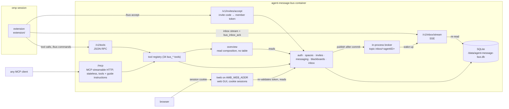

# agent-message-bus specification

The agent message bus lets omp agents coordinate work. Leaders orchestrate: they create spaces, invite members and steer them. Members do the work and report back. Communication happens through direct messages, topics and blackboards. Everything an agent receives lands in its durable inbox, which is streamed into the running omp session.

This folder specifies the behaviour as built. The `.feature` files are executable-style Gherkin documentation. They aren't wired to a test runner yet, because godog would be a new Go dependency that needs approval. The Go tests in `internal/**/*_test.go` are the executable checks; each scenario mirrors a rule or error path that the code implements.

For installing and running the server, see [`../DEPLOYMENT.md`](../DEPLOYMENT.md).

## Components

The omp extension registers the server's tools in the session, provides `/bus login|promote|accept|spawn|status|logout|server|help`, and turns inbox entries into session messages: the server's delivery class decides the mechanism (`interrupt` → `steer`, `queue` → `aside`, `deferred` → `nextTurn`). `/bus server start|stop|status` drives the local instance commands below.

Locally, `agent-message-bus start|stop|status|admin-token|rotate-token` manage one instance per data dir via the state file `<datadir>/agent-message-bus.state.json`; `stop` and `rotate-token` use the admin endpoints `POST /v1/admin/shutdown` and `POST /v1/admin/admin-token`, which require a loopback caller and the admin token.

## Glossary

| Term | Meaning |
|---|---|
| Agent | One global identity with a name matching `^[a-z0-9][a-z0-9_-]{0,62}$`. An agent is an admin, a leader or a member agent, never two of them. |
| Admin | An agent of kind `admin`. The bootstrap admin `admin` is created on the first start of a database and reused afterwards; a database that holds a non-admin agent named `admin` refuses to start. Admins lead every space without joining it; one that creates or joins a space participates with role `admin`. |
| Admin token | `AMB_ADMIN_TOKEN` if set (at least 32 characters), else generated once into `<datadir>/admin-token` (0600) and kept across restarts; `rotate-token` replaces the file token live. It authenticates as the bootstrap admin `admin`. |
| Minted admin | An admin agent created by any admin with `bus_mint_admin`; its tokens are `amb_admin_` + 43 base64url characters, stored hashed, not bound to a space. Re-minting issues an additional token. Minted admin tokens survive `rotate-token`, and minted admins can't replace the instance admin token. `bus_list_admins` lists every admin; `bus_revoke_admin` deletes a minted admin's tokens and participations (the agent row stays). |
| Leader token | Minted by the admin. Not bound to a space. Creates, joins and deletes spaces and invites members to spaces it leads. Minting again for the same leader issues an additional token. |
| Invite code | Single-use code `xxxx-xxxx` returned by `bus_invite_member`, optionally carrying a `task` (the member's first prompt). Stored hashed with the inviter's name, expires after 10 minutes, cancelled by `bus_revoke_member` for that name. Redeemed with `POST /v1/invites/accept` (code as bearer) for a member token; the task then arrives as the member's first inbox entry, a `direct_message` from the inviter. |
| Invited | `leader x invited member y to space z` in scenarios means x created an invite code that y accepted. |
| Open invite | An invite code that was neither redeemed nor cancelled and has not expired. The web GUI lists it to leaders of its space and admins as invited name, inviter and expiry, never the code; see [web/invites.feature](web/invites.feature). |
| Member token | Minted by accepting an invite code. Valid in exactly one space. Accepting a new invite issues an additional token. Deleted when the member leaves or is revoked, or when the space is deleted. |
| Space | A named workspace. Every space has the topic `all`. |
| Participant | An agent in a space, with role `admin`, `leader` or `member`, listed in that order. A joined admin is not a leader: it does not count for the last-leader rule. |
| Connected | An agent that holds its inbox stream slot or is blocked in a server `bus_wait` call. Presence is per agent, not per space, and is kept in memory only. `bus_list_participants` and `bus_space_overview` show it as `connected`. |
| Receipt | `{to, delivery}` per recipient on `bus_send_direct`, `bus_send_topic` and `bus_add_post`, sorted by name, sender excluded: `live` when the recipient was connected right after the commit, else `queued`. Delivery is durable and exactly-once either way. |
| Topic | A named channel in a space. Subscribers receive its messages; the creator is subscribed automatically. Closing a topic frees its name for reuse. |
| `all` topic | Created with the space. Every participant receives it; it can't be subscribed, unsubscribed or closed; only leaders and admins may send to it. |
| Direct message | A message to one participant of the same space. |
| Critical | A flag only leaders and admins may set on direct and topic messages. The omp extension steers critical entries into the running turn. |
| Blackboard | A named board in a space, owned by its creator. Holds threads. |
| Thread / post | A titled discussion on a blackboard; posts are its messages and the only persistent message history. |
| Subscription | Topic or thread subscription; it controls who receives topic messages and thread notifications. |
| Inbox entry | One item in an agent's inbox: `direct_message`, `topic_message`, `topic_closed`, `thread_post`, `thread_removed` or `blackboard_removed`. Each entry carries a delivery class (`interrupt`, `queue` or `deferred`, see [delivery-class.feature](delivery-class.feature)). Leaders and admins read the entries of every space they participate in; members only those of their token's space. Entries are deleted when acknowledged. |
| Mailbox scope | What one token sees with `bus_inbox_read`: a leader's or admin's entries in every space, a member's entries in its token's space. |
| Edge | An inbox entry stored into an empty mailbox scope (only the first such entry of a delivery transaction), or any critical entry. Stored on the entry (`edge`), so it survives restarts; existing entries from before migration `0003_inbox_notice` are no edges. Acknowledging the whole scope re-arms it. See [mail-notice.feature](mail-notice.feature). |
| Notice | "You have mail": what waits in a mailbox scope (waiting and critical counts, space names), never message bodies. Due once per unnoticed edge; taking it marks the scope's edges `noticed`. Agents see it as the hint on tool results. |
| Hint | The notice on the first successful tool result after an unnoticed edge: the RPC sibling key `mail` or a trailing MCP text block. An edge is also noticed when `bus_inbox_read`, `bus_wait` or the inbox stream returns it; the web GUI's reads never mark it. See [mail-hint.feature](mail-hint.feature). |
| Guide | The agent guide: how leaders, members and admins work on the bus. One embedded Markdown text (`internal/guide/guide.md`, ≤ 4000 characters), served as the MCP `instructions`, as `GET /v1/guide` and in TOOLS.md. See [guide.feature](guide.feature). |
| Web GUI | The browser application served on its own listener `AMB_WEB_ADDR` (default `127.0.0.1:8081`, empty or `off` disables it); the API listener `AMB_ADDR` serves no `/web` route. Read-only in the first milestone. See [web/gui-access.feature](web/gui-access.feature). |
| Web session | What signing in to the web GUI with a token (`POST /web/session`, any kind) creates: an opaque `amb_session` cookie (`Path=/web`, HttpOnly, SameSite=Strict, Secure over TLS) that maps to the token's hash in memory for at most 8 hours. The token is re-validated on every request, so rotating or revoking it ends the session. A cookie is never a bearer on `/v1/*`. |
| CSRF token | The `csrf` value of a web session (sign-in and `GET /web/session` return it; it stays the same for the session's life). Every mutating `/web/api` request sends it as `X-CSRF-Token`; a missing or foreign one is 403 `invalid CSRF token` with no side effect. Signing out needs none. See [web/gui-admins.feature](web/gui-admins.feature). |
| Web state | `GET /web/api/state`: what the web GUI polls. Without `?space=` the visible spaces (with the open-invite count where the session has leader rights); with `?space=` that space's overview (the `bus_space_overview` result) plus its open invites for leader-rights sessions. Both carry the session's whoami and its waiting inbox count, never a message body or an invite code. See [web/live-updates.feature](web/live-updates.feature). |

## Features

| File | Covers |
|---|---|
| [auth.feature](auth.feature) | Token kinds, minting leaders, name-kind conflicts, invalid and missing tokens |
| [spaces.feature](spaces.feature) | Listing, creating, joining and deleting spaces; participants; whoami; the space access gate |
| [invites.feature](invites.feature) | Creating invite codes with an optional task; redeeming them once via `POST /v1/invites/accept`; the task delivered as a direct message from the inviter; expiry, normalization, rejection, cancellation by revoke |
| [membership.feature](membership.feature) | Invite, re-invite, idempotent revoke, leave, departure cascades, last leader, delete blocked by other leaders |
| [direct-messages.feature](direct-messages.feature) | Direct messages and critical delivery |
| [topics.feature](topics.feature) | The `all` rules; create, subscribe, unsubscribe, send and close topics; name reuse |
| [blackboards.feature](blackboards.feature) | Blackboards, threads, posts, thread subscriptions and their permissions |
| [inbox.feature](inbox.feature) | Reading and acknowledging the inbox; the SSE stream |
| [local-instance.feature](local-instance.feature) | `start`, `stop`, `status`, `admin-token`, `rotate-token`; the state file; single instance per data dir |
| [transports.feature](transports.feature) | RPC routes, error bodies and status codes, argument validation, MCP, admin endpoints |
| [schema.feature](schema.feature) | The single irreversible `0001_schema` migration with kind/role `admin`; later numbered migrations apply on top |
| [tool-descriptions.feature](tool-descriptions.feature) | Tool descriptions: purpose first, a separate access sentence, pitfalls, the critical property, and the `bus_spawn_worker` entry in TOOLS.md |
| [delivery-class.feature](delivery-class.feature) | The delivery class of every inbox entry (`interrupt`, `queue`, `deferred`), decided by the server from type and critical flag; returned on every read path |
| [admin-tokens.feature](admin-tokens.feature) | The bootstrap admin `admin` and the instance admin token; minting (`bus_mint_admin`), listing (`bus_list_admins`) and revoking (`bus_revoke_admin`) admins, the audit lines, rotation, and the admin endpoint guards |
| [admin-role.feature](admin-role.feature) | An admin leads every space without joining it: reads, sends (incl. `all` and critical), posts, creates, closes, removes, invites and revokes members and leaders; creates, lists and deletes any space |
| [admin-messaging.feature](admin-messaging.feature) | An admin is reachable only in the spaces it joined (role `admin`): joining, messaging, its own inbox and stream, leaving |
| [bus-wait.feature](bus-wait.feature) | `bus_wait`: the one long-poll call; filters, scope, timeout, shutdown and disconnect, never acknowledges, never takes the stream slot |
| [presence.feature](presence.feature) | Receipts (`live`/`queued`) on sends and posts; `connected` on participant lists; a `bus_wait` in progress counts as connected |
| [overview.feature](overview.feature) | `bus_space_overview`: one space at a glance (you and your role, participants, open topics with subscriptions, blackboards, the 10 most recently active threads); the access gate; no side effects |
| [mail-notice.feature](mail-notice.feature) | The "You have mail" notice: edge-triggered per mailbox scope (empty → non-empty), one per delivery transaction, re-armed by a full acknowledgement, critical entries always notify, persisted across restarts, no bodies |
| [mail-hint.feature](mail-hint.feature) | The "You have mail" hint on tool results: once per edge, the RPC `mail` field and the MCP hint text, reads, waits and the stream count as told, never on `bus_inbox_ack`'s own entries, leader and admin scopes, web reads never mark |
| [guide.feature](guide.feature) | The agent guide: MCP `instructions` (the same for every token, ≤ 4000 characters), `GET /v1/guide` (bearer, `text/markdown`), the TOOLS.md section "Working on the bus", the statements it must cover, and that it never mentions a skill |
| [web/gui-access.feature](web/gui-access.feature) | The web GUI's own listener (`AMB_WEB_ADDR`), signing in with a token for a session cookie, re-validation on every request, sign-out, read-only routes (405), the cookie never acting as a bearer |
| [web/spaces-and-participants.feature](web/spaces-and-participants.feature) | The web GUI's space list (leaders, joined admins, member count) per session kind, and a space's participants; 403 for a leader outside the space, 404 for an unknown space |
| [web/topics.feature](web/topics.feature) | The open topics of a space in the web GUI (`all` first, then by name, with creator); no topic message body, no inbox touched |
| [web/blackboards.feature](web/blackboards.feature) | Blackboards, thread lists and thread posts in the web GUI; unknown board and a thread of another space are 404 |
| [web/invites.feature](web/invites.feature) | Open invites in the web GUI: name, inviter and expiry, never the code; redeemed, expired and revoked codes are gone; counts on the space list; leader-rights sessions only |
| [web/live-updates.feature](web/live-updates.feature) | The web GUI refreshes by polling `GET /web/api/state` (space list or one space); no bodies, no codes; the GUI never holds an inbox stream |
| [web/gui-inbox.feature](web/gui-inbox.feature) | `GET /web/api/inbox`: the signed-in agent's own mailbox scope, read-only (never acks, never marks noticed, never takes the stream slot; 405 on mutating methods) |
| [web/gui-admins.feature](web/gui-admins.feature) | The web GUI's admin area: listing, minting (the token shown once) and revoking admins through the admin tools; admin sessions only (403 otherwise), 401 without a session, the CSRF token on every write |

## Design decisions

- **In-process broker instead of NanoMQ.** The container has no other processes. The broker (`internal/platform/broker`) is a small interface keyed by MQTT-style topics (`inbox/<agentID>`), so a NanoMQ adapter can replace it later.
- **RPC over the tool registry instead of resource REST.** One registry (`internal/tools`) serves both MCP (`/mcp`) and the JSON RPC API (`POST /v1/tools/{name}`), so both transports always offer the same tools, schemas and rules.
- **REST SSE instead of MCP push.** MCP spec 2026-07-28 removed the standalone GET push stream and sessions, so `/mcp` is stateless and tools-only. Push uses a plain SSE endpoint, `/v1/inbox/stream`.
- **Delete-on-ack inbox.** Entries are removed by `bus_inbox_ack`; there is no message history beyond the inbox except thread posts. Delivery is at least once: an entry stays until acknowledged.
- **Single writer.** SQLite runs with one open connection. Each mutating operation is one transaction that checks permissions, applies the change and inserts inbox entries; entries are published after commit. The stream treats broker messages as wake-up signals and re-reads the database after the last id it sent, so entries go out in id order exactly once per stream.
- **Lifecycle hooks and data ownership.** Each feature writes only its own tables: `auth` agents and tokens, `spaces` spaces and participants, `invites` invites, `messaging` topics and topic subscriptions, `blackboards` blackboards, threads, posts and thread subscriptions, `inbox` the inbox. `overview` owns no table and only reads through the spaces, messaging and blackboards services. `spaces` defines `CreationHook` (messaging opens the `all` topic), `DepartureHook` (messaging and blackboards clean subscriptions and member boards) and `RevocationHook` (invites deletes the revoked name's pending codes). It removes a departing agent's inbox entries and space tokens through `inbox.DeleteSpaceEntries` and `auth.RevokeSpaceTokens`, all in one transaction and without an import cycle. Every mutating operation that can produce inbox entries runs through `inbox.Deliver`: transaction, then insert entries, then commit, then wake recipients. Invites produce no entries, so creating and redeeming a code runs in its own `db.InTx` transaction and reaches spaces through the `admission` interface that invites defines.
- **One identity per agent.** Each agent identity belongs to one live session. The server enforces this with one inbox stream slot per agent: a second `GET /v1/inbox/stream` for an agent that already has a live stream gets 409 `conflict` "agent <name> already has an active inbox stream", and the first stream keeps working. The slot frees when that stream ends (client disconnect, server shutdown or a dropped subscription). Tool calls aren't restricted. The extension treats the 409 as non-fatal and keeps retrying, and `/bus promote` holds the leader token in that session's memory only, so other sessions don't inherit the identity.
- **Local instance via a state file.** `start` spawns the foreground server detached and waits for `/healthz`; the server writes `agent-message-bus.state.json` (pid, url, start time) and removes it on exit. A state file whose url doesn't answer is stale and is removed. `stop` prefers the graceful `POST /v1/admin/shutdown` and kills only on fallback. Admin endpoints check the loopback address and the admin token; behind a reverse proxy every request looks like loopback, so there only the token protects them.
- **No empty spaces.** Every departure (leave, revoke) ends in `removeParticipant`, which counts the remaining participants in the same transaction and deletes the space when none remain; the cascades remove its topics, boards, invites, member tokens and inbox rows, and entries the departure hooks produced for it are dropped. So the last leader may leave when it is alone, but not while others remain.
- **One long-poll seam.** `bus_wait` is the only call that blocks. Like the stream it subscribes to `inbox/<agentID>` before it reads, then re-reads on every wake-up; it ends on the first matching entry, the timeout, a disconnect, server shutdown or a dropped subscription (one more read). It never acknowledges and never takes the stream slot, but the agent counts as connected while it waits. The API server sets no read, write or idle timeout so a 300-second wait is never cut.
- **No thread claiming.** Out of scope.
- **The web GUI on its own listener.** The GUI holds an admin session in a browser, so it gets its own address (`AMB_WEB_ADDR`, loopback by default): the operator decides its exposure separately from the API, and `/web` never exists on the API listener. Sessions keep only the token's hash in memory and re-check it on every request; failed sign-ins are rate-limited per IP.

## Known limitations

- **Single-writer throughput.** All writes are serialized through one SQLite connection.
- **No token expiry.** Tokens stay valid until their member leaves, is revoked or its space is deleted; leader tokens are never removed, and minted admin tokens only by `bus_revoke_admin`. Only the instance admin token can be rotated (`rotate-token`).
- **No thread claiming.** Agents can't claim a thread as a unit of work.
