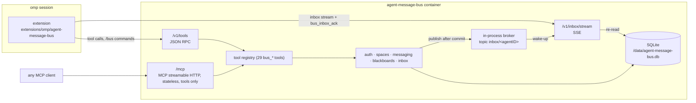

# agent-message-bus specification

The agent message bus lets omp agents coordinate work. Leaders orchestrate: they create spaces, invite members and steer them. Members do the work and report back. Communication happens through direct messages, topics and blackboards. Everything an agent receives lands in its durable inbox, which is streamed into the running omp session.

This folder specifies the behaviour as built. The `.feature` files are executable-style Gherkin documentation. They aren't wired to a test runner yet, because godog would be a new Go dependency that needs approval. The Go tests in `internal/**/*_test.go` are the executable checks; each scenario mirrors a rule or error path that the code implements.

For installing and running the server, see [`../DEPLOYMENT.md`](../DEPLOYMENT.md).

## Components

The omp extension registers the server's tools in the session, provides `/bus login|promote|status|logout|help`, and turns inbox entries into session messages: critical entries are delivered as `steer`, others as `followUp`.

## Glossary

| Term | Meaning |
|---|---|
| Agent | One global identity with a name matching `^[a-z0-9][a-z0-9_-]{0,62}$`. An agent is either a leader agent or a member agent, never both. |
| Admin token | `AMB_ADMIN_TOKEN` (at least 32 characters). It can only mint leader tokens (`bus_mint_leader`); it has no inbox and can't act in spaces. |
| Leader token | Minted by the admin. Not bound to a space. Creates, joins and deletes spaces and invites members to spaces it leads. Minting again for the same leader issues an additional token. |
| Member token | Minted by `bus_invite_member`. Valid in exactly one space. Re-inviting issues an additional token. Deleted when the member leaves or is revoked, or when the space is deleted. |
| Space | A named workspace. Every space has the topic `all`. |
| Participant | An agent in a space, with role `leader` or `member`. A space needs at least one leader. |
| Topic | A named channel in a space. Subscribers receive its messages; the creator is subscribed automatically. Closing a topic frees its name for reuse. |
| `all` topic | Created with the space. Every participant receives it; it can't be subscribed, unsubscribed or closed; only leaders may send to it. |
| Direct message | A message to one participant of the same space. |
| Critical | A flag only leaders may set on direct and topic messages. The omp extension steers critical entries into the running turn. |
| Blackboard | A named board in a space, owned by its creator. Holds threads. |
| Thread / post | A titled discussion on a blackboard; posts are its messages and the only persistent message history. |
| Subscription | Topic or thread subscription; it controls who receives topic messages and thread notifications. |
| Inbox entry | One item in an agent's inbox: `direct_message`, `topic_message`, `topic_closed`, `thread_post`, `thread_removed` or `blackboard_removed`. Entries are deleted when acknowledged. |

## Features

| File | Covers |
|---|---|
| [auth.feature](auth.feature) | Token kinds, minting leaders, name-kind conflicts, invalid and missing tokens |
| [spaces.feature](spaces.feature) | Listing, creating, joining and deleting spaces; participants; whoami; the space access gate |
| [membership.feature](membership.feature) | Invite, re-invite, revoke, leave, departure cascades, last leader, delete blocked by other leaders |
| [direct-messages.feature](direct-messages.feature) | Direct messages and critical delivery |
| [topics.feature](topics.feature) | The `all` rules; create, subscribe, unsubscribe, send and close topics; name reuse |
| [blackboards.feature](blackboards.feature) | Blackboards, threads, posts, thread subscriptions and their permissions |
| [inbox.feature](inbox.feature) | Reading and acknowledging the inbox; the SSE stream |
| [transports.feature](transports.feature) | RPC routes, error bodies and status codes, argument validation, MCP |

## Design decisions

- **In-process broker instead of NanoMQ.** The container has no other processes. The broker (`internal/platform/broker`) is a small interface keyed by MQTT-style topics (`inbox/<agentID>`), so a NanoMQ adapter can replace it later.
- **RPC over the tool registry instead of resource REST.** One registry (`internal/tools`) serves both MCP (`/mcp`) and the JSON RPC API (`POST /v1/tools/{name}`), so both transports always offer the same tools, schemas and rules.
- **REST SSE instead of MCP push.** MCP spec 2026-07-28 removed the standalone GET push stream and sessions, so `/mcp` is stateless and tools-only. Push uses a plain SSE endpoint, `/v1/inbox/stream`.
- **Delete-on-ack inbox.** Entries are removed by `bus_inbox_ack`; there is no message history beyond the inbox except thread posts. Delivery is at least once: an entry stays until acknowledged.
- **Single writer.** SQLite runs with one open connection. Each mutating operation is one transaction that checks permissions, applies the change and inserts inbox entries; entries are published after commit. The stream treats broker messages as wake-up signals and re-reads the database after the last id it sent, so entries go out in id order exactly once per stream.
- **Lifecycle hooks and data ownership.** Each feature writes only its own tables. `spaces` defines `CreationHook` (messaging opens the `all` topic) and `DepartureHook` (messaging and blackboards clean subscriptions and member boards). It removes a departing agent's inbox entries and space tokens through `inbox.DeleteSpaceEntries` and `auth.RevokeSpaceTokens`, all in one transaction and without an import cycle. Every mutating operation runs through `inbox.Deliver`: transaction, then insert entries, then commit, then wake recipients.
- **One identity per agent.** Each agent identity belongs to one live session. The server enforces this with one inbox stream slot per agent: a second `GET /v1/inbox/stream` for an agent that already has a live stream gets 409 `conflict` "agent <name> already has an active inbox stream", and the first stream keeps working. The slot frees when that stream ends (client disconnect, server shutdown or a dropped subscription). Tool calls aren't restricted. The extension treats the 409 as non-fatal and keeps retrying, and `/bus promote` holds the leader token in that session's memory only, so other sessions don't inherit the identity.
- **No thread claiming and no UI.** Both are out of scope.

## Known limitations

- **Single-writer throughput.** All writes are serialized through one SQLite connection.
- **No token expiry or rotation.** Tokens stay valid until their member leaves, is revoked or its space is deleted; leader tokens are never removed.
- **No thread claiming.** Agents can't claim a thread as a unit of work.
